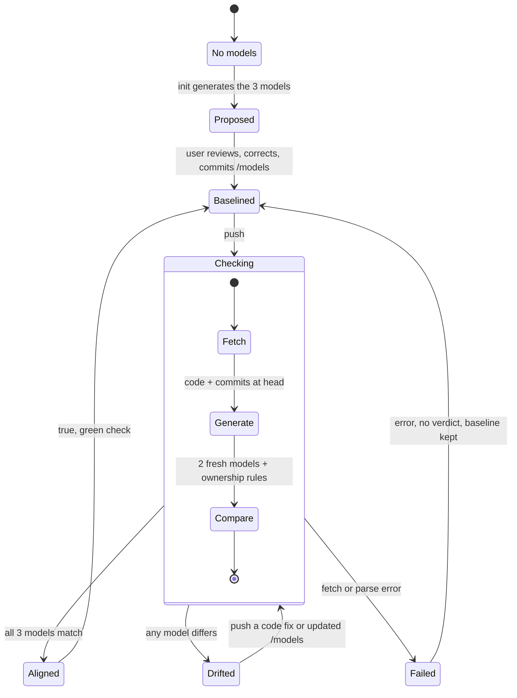

# Documentation Tracker (DocumentationModelDrifter): specification

Team 15's top-level specification: requirements and acceptance criteria. The pod contract is
docs/contract/.

Last revised 2026-10-31.

## How to read this file

Section [Q11](#q11-open-decisions) lists the decisions still open; text that depends on one says "(open, see [Q11](#q11-open-decisions))".

Names. Documentation Tracker is the pod's shared product. DocumentationModelDrifter is Team 15's
implementation of it. Its command line tool is called drifter.

Which document wins. This file is Team 15's top-level specification: requirements and acceptance
criteria. Specs under openspec/specs/ (none yet) refine one piece each and cite the REQ and AC ids they serve.
When the two disagree, this file is corrected first and the piece spec follows. For anything another
team's tester or system sees (routes, JSON, tests), the pod contract in docs/contract/ wins over
this file (Section 5). The course's docs/base/student-facing-spec.docx.pdf wins over both.

Diagrams are in docs/models/; docs/README.md maps them. The lifecycle diagram's Mermaid source is
in 3.2.

## Q1 Common problem selection

### 1.1 Selected problem

Users are engineering and compliance teams at general-purpose AI model providers, who must keep
technical documentation accurate as the design changes. Architecture changes between commits are
normal, but they happen silently: reviews and separate documents miss them, so the documented
architecture drifts from the code and people must re-read the code to learn what is true.

Documentation Tracker keeps the architecture documentation as three models next to the code:
structural (parts and relations), behavioral (states and transitions) and ownership (who may change
what). On every push and pull request, a read-only check rebuilds the models from the code and
compares them with the committed ones. A difference means code and documentation disagree, not
that the code is wrong; a person fixes the code or commits updated models, and that commit records
who accepted the change. While the check passes, /models describes the code.

This supports Article 53(1)(a) of the EU AI Act: keep technical documentation current and supply it
on request [1]. The models cover the code side of Annex XI: architecture (1(d)), integration means
(2(a)), and design specifications and choices (2(b)) [5]; 2(c) to 2(e) are out of scope. The tool
keeps documentation current; it does not write it or certify compliance. (Items open, see [Q11](#q11-open-decisions).)

### 1.2 Selection rationale

The check gives four things: no silent architecture changes, since each is accepted on record or
rolled back; models people and agents can trust instead of re-reading code; a short list of
architectural differences for each pull request review; and accepted models that constrain every
later change, including an agent's. It is deterministic, leaves decisions to people, needs no
external LLM, and resembles Matt Pocock's code-review skill, which checks changes against
documented standards [2].

The engineering decisions are real: what facts to extract, how to handle history, how to keep
false alerts low. Both teams' systems are compared on the shared tests of the pod contract, and
this check is measured on its labelled commits by accuracy, false-alert rate, coverage and time.

It follows MAGE [3]: each model is the smallest representation that answers one question, and a
gate keeps model and code in correspondence. The code owns the facts, so models are derived and
re-derived (2.5). Agreement is not correctness, so a model becomes the standard only after a person
reviews and commits it, and a difference is investigated before either side changes (3.2, 4.3).
Drift belongs to finished work, so the pull-request result counts, and the check starts advisory
(3.2, 4.3). This is MAGE's brownfield path: recover, reconcile, govern (4.3).

### 1.3 Pod agreement

The pod is Teams 15 and 16. Each team has 4 members. 

The course requires one infrastructure with separate implementations: "Within a pod, project
paths, methods, inputs, responses, and behavior must match the shared specification. Teams choose
their internal implementations." [6] Staff may pair either team's tester with either team's system,
so both teams build to one contract.

That contract is docs/contract/ (version 2.4.0, pending Team 16's agreement; 2.3.0 was agreed by Teams 15 and 16 on 2026-10-31). It builds
on Team 16's v1.1 package [7], in which Team 16 checks prose documentation. Team 15 checks models
instead, which the contract allows through two deviations (5.1). Team 16 builds no models.

## Q2 Common scope

### 2.1 System boundary

```text
Outside: developer (runs drifter init and update locally, commits /models, reviews pull requests)
Outside: GitHub Action (runs drifter check on its own checkout on every push and pull request)
Outside: cross-team tester and other API callers (call the hosted service)
      |
      |  in: repository + commit (code, /models and git history are read at that commit)
      v
Inside:  drifter, one codebase run by the CLI, the Action and the hosted service:
         GitHub integration -> three generators -> comparison -> verdict
      |
      |  out: the four-field answer (aligned + one list of differences per model): an exit
      |       code in the CLI and the Action, the drift key of /analyze in the hosted service
      v
Outside: the analysed repository, read-only. The tool never writes to it, /models included.
```

### 2.2 Scope

#### Included scope

- Generate the three models of a repository as canonical JSON (drifter init), and regenerate
  them after an intended change (drifter update). The developer commits them to /models.
- On each push and pull request, check the code at that commit against the committed /models
  (drifter check) and return true or false with the differences per model.
- Return the answer as JSON of four fields, "aligned", "structural", "behavioral" and
  "ownership", so it can be validated automatically. In the hosted service it is the drift key
  of the pod's /analyze result (5.2).
- Tie each answer to the commit it checked (REQ-04).
- In the hosted service, also do what the pod contract asks of every system: list every changed
  path between base and head, classified by the pod's mapping-v1.1.yaml, and save each result
  under an id (Section 5).

#### Excluded scope

- Version control systems other than Git.
- Models or documentation stored outside the repository.
- Prose documentation (README, `docs/*.md`) is not analysed. In the pod's /analyze result, issues
  is therefore always [] (5.1).
- Judging whether the code is correct, or whether a design change is a good idea. The tool only
  says that code and models disagree.
- Writing to the analysed repository, including /models.
- Decision, measurement and provenance models.
- LLMs or any generative model at runtime.
- Durable storage for verdicts beyond what REQ-04 names.
- A full custom GitHub-style graphical interface.

#### Operating limits and assumptions

- Intended users are engineering and compliance teams at general-purpose AI model providers.
  Authorized reviewers remain responsible for compliance judgments.
- The hosted service supports public GitHub repositories. The CLI and the Action work on any
  checkout. Code and /models live in the same repository.
- The first version supports Python source only. Files are read as text and parsed, never
  imported or executed. This specification names no parser: each team chooses its own, and each
  release pins its parser and Python version.
- Both teams use the pod contract (Section 5).
- Testing uses small public fixture repositories (4.2).
- Limits: 80 s per check, under the pod's 90 s limit per project call, so a check past its
  deadline answers 500 before the caller gives up; 60 s per git call; at most 2 checks at once
  in the hosted service (7.3). An in-scope file over 1 MB fails the check (FILE_TOO_LARGE),
  and a binary or non-UTF-8 in-scope file fails it (PARSE_FAILED); no file is skipped (3.3).
  Ownership covers every changed path, hidden paths, symlinks and submodules included.

## Q3 Common specification

### 3.1 Requirements

#### REQ-01 - Read the repository at a commit

Given a Git repository, a commit and an optional base commit, the system shall read the code and
/models at that commit, read-only. A short SHA is expanded to the full one; a SHA that cannot be
fetched or is ambiguous gives COMMIT_NOT_FOUND, asking for the full SHA. The base defaults to the
commit's first parent and decides which commits the ownership check judges; for a root commit it
is null and only that commit is judged. A base given in the request is used as given.

#### REQ-02 - Flag drift between the code and its models

The system shall regenerate the structural and behavioral models from the code at the commit and
compare them with the committed /models by element id. It shall check every non-merge commit
between the base and the commit against the ownership rules. Each difference shall name the model,
the change (ADDED, REMOVED, MODIFIED or VIOLATION), the element id or path, and the file. The
answer is true only when all three lists of differences are empty. Supports the documentation
maintenance obligation in Article 53(1)(a) and the design content in Annex XI.

#### REQ-03 - Keep people in charge of accepting drift

A false answer asks a person for a decision and is never resolved by the tool. A person accepts
drift by committing updated /models; until then the code must be fixed instead. That commit, with
its author, timestamp and review in the pull request, is the review record, and the git history of
/models shows who accepted each baseline. The system shall not approve or modify code or models on
its own. Intermediate commits may legitimately disagree with the models, so the result that counts
is the one on the pull request. A repository adopts the check as advisory (warn only) first and
makes it a required pull-request check once its false-alert rate is acceptable.

#### REQ-04 - Preserve traceable evidence

Each check shall produce its answer as JSON tied to the commit it checked. The GitHub Action
uploads it as a workflow artifact (kept 90 days by default) and writes it to the job summary of
that commit's run. The git history of /models is the durable record of every accepted design
change. Together these support responses to Commission requests under Articles 91 and 53(1)(a).
The hosted service also saves every /analyze result write-once under an analysis_id and returns
it unchanged, also after a restart or redeploy (Section 5).

#### REQ-05 - Handle invalid inputs and incomplete checks explicitly

When inputs are missing or invalid, the repository or commit cannot be accessed, /models is missing
or malformed, an in-scope file cannot be parsed, or the check fails, the system shall return an
error and a short message. It shall never return true or false for a check it could not complete.
Users must be able to tell a successful check from one that could not be done.

#### REQ-06 - Protect repository content

The system shall treat the repository as read-only input, shall not execute or import its code,
and shall not write to it, /models included. Engineering teams need checks that cannot alter their
code.

#### REQ-07 - Provide deterministic, testable results

Each implementation shall accept requests and return JSON through the common interface in Section
5. Given the same repository version, /models and tool version, repeated runs shall return
byte-identical models and a byte-identical answer.

#### Categories that do not apply

Physical safety, hardware control and hard real-time response do not apply: the system analyses
repository content and controls nothing physical. Full software-correctness verification and
legal-compliance certification are excluded.

### 3.2 The three models and the system model

#### The product's models

/models holds four files: structural.json, behavioral.json, ownership.json and scope.json.

The model format is Team 15's: only Team 15's system reads and writes /models, so the pod contract
leaves it to this specification. Both generators take the in-scope files as a dict of path to
text. The orchestrator parses every in-scope file once before any generator runs and stops with
PARSE_FAILED, so generators may assume every file parses.

- **Structural**
  - Question: What exists, and how do the parts relate?
  - Contents: modules, classes, functions and methods as nodes; imports and inheritance between
    them as edges (calls are not modelled in schema_version 1). The format, kinds and id scheme are in docs/base/structure.md; where it
    disagrees with this file, this file wins.
  - Comparison: regenerate at the commit, then set difference by element id.
- **Behavioral**
  - Question: What may happen, and in what order?
  - Contents: at least states and the transitions between them. Kind names, id scheme, mining
    rules and the JSON Schema are open (see [Q11](#q11-open-decisions)).
  - Comparison: regenerate at the commit, then set difference by element id.
- **Ownership**
  - Question: Who may change what?
  - Contents: rules. Each rule is a path pattern and its owners, given as git author emails.
    Rules are tried in order and the first match wins. A path no rule matches is open to anyone.
  - Source: drifter init proposes a first file from git history (how, open, see [Q11](#q11-open-decisions)). People
    then correct it by hand, like a GitHub CODEOWNERS file.
  - Comparison: not regenerated per push. Every non-merge commit between the base and the
    checked commit is judged: each file it changes must have, as its git author, one of the
    owners of that file's path. Co-authors do not count, and bots get no special case (list a
    bot's email to allow it). A violation names the commit, the path, the author and the owners.

Why ownership is checked differently: it is mined from history, and history grows with every push,
including the push being checked. Regenerating and comparing it would fail whenever someone new
touched a folder, whether or not anything was wrong. Checking authors against rules answers the
ownership question directly: was this change made by someone allowed to make it?

Scope. scope.json holds include and exclude path patterns. It decides which files feed the
structural and behavioral generators; drifter init writes the defaults, include `**/*.py` and exclude
`tests/**`. Ownership rules apply to every path, whatever the scope says. Editing the scope without
regenerating the models shows up as drift by itself. The pattern rules for scope.json and
ownership.json are still to be fixed (open, see [Q11](#q11-open-decisions)).

Layout of every model file, so that every run produces the same bytes:

- Keys sorted; 2-space indent; UTF-8 with non-ASCII characters written as they are, not escaped.
- LF line endings and exactly one trailing newline.
- Lists sorted by element id.
- No timestamps, absolute paths or line numbers, so moving code without changing it is not drift.
- A schema_version field; a schema change bumps the version.

Differences are reported from the code's side:

| Change | Meaning |
| --- | --- |
| ADDED | in the code but not in the model |
| REMOVED | in the model but not in the code |
| MODIFIED | the same id in both, with different attributes |
| VIOLATION | ownership only: a commit changed a file its author does not own |

Empty models. An empty list of differences means that model matches, including when the
committed and fresh models both have no elements, or ownership.json has no rules. Whether a model
describes anything at all is visible in /models itself, not in the answer.

#### The system model

The lifecycle of a repository under the tool, drawn in docs/models/behavioral-model.png. Its source:



### 3.3 Model explanation

The tool proposes models once. A person reviews and corrects them, then commits them as the
baseline. After that, every push is checked and ends in one of three states. Only Drifted needs a
person, who either fixes the code or commits updated models in the next push. A Failed check gives
no verdict and leaves the baseline as it was. An in-scope file that cannot be parsed fails the
check (PARSE_FAILED) instead of being skipped: a skipped file's elements would vanish from the
fresh model and show up as REMOVED drift that is not real. The check compares the facts in the code
with the facts in the models.

## Q4 Acceptance criteria

### 4.1 Requirement coverage

AC-01 to AC-10 have the pod's numbers and meanings (v1.1 SPEC section 10, copied word for word in
contract section 5). Each criterion first gives the pod's check, then "This system:" says how this
system meets it; for this system "doc" means /models and a finding means a drift difference. AC-11
is this system's own and counts as AC-02.

- AC-01, REQ-01: Pod: changes and skipped equal golden, all cases (T-01 to T-07). This system: a
  short commit SHA also gives the same answer as the full SHA, and an unknown or ambiguous one
  returns 404 COMMIT_NOT_FOUND. Checked automatically.
- AC-02, REQ-02: Pod: missing and outdated docs flagged (c8, c1; T-18, T-19). This system: the
  documentation is /models. A commit changes what a structural or behavioral model describes without
  updating /models. The verdict is false and names the right model, exact element id and file.
  Checked automatically.
- AC-03, REQ-02 and REQ-07: Pod: code and doc updated together gives no finding (c7; T-20). This
  system: a commit changes only comments and whitespace, or changes the code together with matching
  updated /models. The verdict is true. Checked automatically.
- AC-04, REQ-03: Pod: every finding is PENDING_REVIEW (T-21). This system: what it flags also waits
  for a person; after a false verdict, the code and /models are unchanged and the tool has made no
  commit. Checked automatically and by inspection.
- AC-05, REQ-03: Pod: authorized review decisions, Phase 5 (T-22). This system: only a person
  allowed to do so accepts flagged drift. Accepting means committing updated /models, so write
  access to the repository is that permission. Committing updated /models after a false verdict
  makes the next check true, and the git history of /models gives the person who accepted it and
  when. Checked automatically by Team 15's own tests.
- AC-06, REQ-04: Pod: two runs give distinct ids; GET returns each unchanged, including after a
  restart (c2; T-14 to T-16). This system: each Action run also uploads its answer as an artifact of
  that commit's run. The hosted service saves every /analyze result, and GET /analysis/{analysis_id}
  returns it unchanged, also after a restart. Checked automatically.
- AC-07, REQ-05: Pod: missing commit_id, malformed JSON, bad repository format, wrong type → 400
  INVALID_REQUEST (T-08 to T-11). This system: a request without a commit id returns 400 with a
  message saying what is missing, and no verdict. Checked automatically.
- AC-08, REQ-05: Pod: nonexistent repo/commit → 404; unknown analysis_id → 404; mapping problem →
  saved ERROR (T-12, T-13, T-15). This system: an unknown repository or commit returns 404 with a
  message. A commit with no /models, or an in-scope file that cannot be parsed, gives no verdict,
  never true or false: drift is null with a drift_error code in the hosted service, and exit code 2
  in the CLI. Checked automatically.
- AC-09, REQ-06: Pod: repository unchanged, no code executed, no credentials in logs (inspection,
  Phase 5; T-23). This system: the repository is byte-identical before and after a check, none of
  its code runs, and no credentials appear in responses or logs. Checked by automated tests and
  inspection.
- AC-10, REQ-07: Pod: five runs of c4 and of c1 give identical significant fields, including
  identical finding_ids (T-17). This system: five runs with the same repository, commit, /models and
  tool version also return byte-identical models and answers (Team 15's own tests), and generate at
  the baseline returns the committed structural.json, behavioral.json and scope.json byte for byte
  (pod test T-33). Checked automatically.
- AC-11, REQ-02: A commit by someone who is not an owner of a changed path gives false, naming the
  commit, path, author and owners; the same change by an owner gives true. Checked automatically.
  The pod's coverage reports count it as AC-02 (T-30 lists AC-02).

### 4.2 Test data and expected outputs

Team 15 builds one small, controlled Git repository, MuhammadSban/doc-tracker-model-fixtures, with
labelled commits and a manually defined expected verdict per model. Its expected answers are
published in docs/contract/model-golden-outputs.json in two groups (contract section 3): L-pre's
once the repository exists, L0 to L7's once the formats of all four model files are settled,
because L0 commits all four. The repository stays fixed so results reproduce. Invalid requests
and unknown commits are tested by the pod's shared tests on Team 16's fixture
(ParthGupta06/doc-tracker-fixtures).

The fixture starts with a commit before /models exists, then the cases below.

Starting set of labelled cases (to be revised, see [Q11](#q11-open-decisions)):

| Case | What the commit does | Expected |
| --- | --- | --- |
| L-pre | Python code, no /models yet | no verdict: MODELS_NOT_FOUND |
| L0 | init on the fixture repo; /models committed | true |
| L1 | comments and whitespace only | true |
| L2 | adds one function | false: structural, 1 ADDED function |
| L3 | removes one import | false: structural, 1 REMOVED imports |
| L4 | adds a state and a transition into it | false: behavioral, 1 ADDED state and 1 ADDED transition (kind names per the behavioral format) |
| L5 | L2's change plus updated /models in the same commit | true |
| L6 | a non-owner edits an owned path | false: ownership, 1 violation |
| L7 | a hand edit removes an inherits edge from structural.json that the code still makes | false: structural, 1 ADDED inherits |

Each count must be exactly 1, and every other list empty, so the fixture follows five rules. Its
code sits under src/, so module ids carry no folder prefix (docs/base/structure.md). L3 removes
an import of a module of the repository; an import of an external library is not in the model.
L7's base class is a class of the repository; an external one gives no edge. L4 adds its state and
transition without adding a module, class, function, method, import, inheritance or call, so the
structural model does not change. Every commit L0 to L7 except L6 is made by an owner of every
path it changes, under the ownership.json committed at L0, so only L6 gives a violation.

### 4.3 Independent evaluation

Another team can evaluate most criteria by sending requests to the deployed service and checking
the JSON returned. The drift tests depend only on the model format in 3.2 and the expected
answers, not on how the generators are implemented. Internal design documentation may be
inspected for criteria that cannot be decided from responses alone (AC-04, AC-09).

## Q5 Cross team testing interface

### 5.1 The pod contract

The cross-team interface is the pod contract in docs/contract/, version 2.4.0, pending Team 16's
agreement (2.3.0 was agreed on 2026-10-31). It builds on Team 16's v1.1 package [7] and wins over this file for anything
another team's tester or system sees.

| File | Holds |
| --- | --- |
| pod-contract.openapi.yml | the system API: POST /system/analyze, GET /system/analysis/{id}, POST /system/generate (optional), GET /system/health, and the course's /system/test routes |
| pod-tester.openapi.yml | the tester API and suite report, as the course fixes them |
| pod-contract.md | sessions, fixtures, expected answers, the test list T-01 to T-33, coverage, limits, retries, errors and how the contract changes |
| mapping-v1.1.yaml | Team 16's classification rules and skip allowlist, loaded at runtime |
| golden-outputs.json | Team 16's expected answers for their fixture |

Two deviations from v1.1 let this design meet the contract (contract section 9):

1. No prose detector. v1.1 fills issues with findings about .md files; this system does not read
   prose documentation, so its issues is always [].
2. Optional model-drift additions. This system adds drift and drift_error to every /analyze
   result and serves POST /generate. Testers never require them.

GET /system/health lists "features": ["model_drift"], so testers skip the prose tests and run
the drift tests (contract section 1).

Everything else in the contract this system follows as written, including change detection,
classification, unmapped, saved results and error codes.

### 5.2 How this system's answer appears

The four-field answer of 3.2 is the drift key of every /analyze result. Keys are sorted, and each
list is sorted (by element id; ownership by commit SHA, then path, compared as strings) and empty
when that model matches. An ownership violation's owners are sorted as strings.
The element id and kind below follow docs/base/structure.md.

```json
"drift": {
  "aligned": false,
  "behavioral": [],
  "ownership": [],
  "structural": [
    {"change": "ADDED", "file": "src/shop/orders.py", "id": "shop.orders:Order.cancel",
     "kind": "method"}
  ]
},
"drift_error": null
```

An ownership difference:

```json
{"author": "barshan@example.com", "change": "VIOLATION", "commit": "<40 hex>",
 "owners": ["kaan@example.com"], "path": "src/payments/charge.py"}
```

No verdict (REQ-05). The /analyze result keeps status SUCCESS, because change detection still ran;
drift is null and drift_error says why:

| Code | Meaning |
| --- | --- |
| MODELS_NOT_FOUND | the commit has no /models, or a file in it is missing |
| INVALID_MODELS | a file in /models fails its schema |
| PARSE_FAILED | an in-scope file cannot be parsed, or is binary or not UTF-8; the message names the file and, for a syntax error, the line |
| FILE_TOO_LARGE | an in-scope file is over 1 MB; the message names it |

The model check does not depend on status: it also runs when change detection gives status ERROR
(CHANGE_LIMIT_EXCEEDED), so drift is the same as the CLI's answer for that commit.

HTTP errors are the contract's: 400 INVALID_REQUEST; 404 REPOSITORY_NOT_FOUND, COMMIT_NOT_FOUND,
ANALYSIS_NOT_FOUND; 500 ANALYSIS_FAILED (including a check past its deadline) and STORAGE_FAILED.

POST /system/generate takes the same request and returns the exact text of the four /models files,
as drifter init would write them.

Exit codes of drifter check, which the GitHub Action passes or fails on:

| Exit code | Meaning |
| --- | --- |
| 0 | true: all three models aligned |
| 1 | false: drift found |
| 2 | error: no verdict (any drift_error code, or a request that fails) |

### 5.3 Tests that exercise this design

The pod's drift tests T-24 to T-33 (contract section 4) run in both teams' testers. They run the
labelled cases of 4.2 against the hosted service and compare the whole drift object with the expected answer; T-33 checks
/generate at L0 byte for byte, except ownership.json, which people correct by hand (3.2). Team 15's own tests check that drift is byte-identical across
repeated runs. T-32 is published first, since it needs only L-pre (4.2).
T-01 to T-23 check change detection, classification, saved results and errors.
Against this system, T-18 to T-21 (prose findings) are skipped: its GET /system/health
lists features ["model_drift"] and not prose_detector (deviation 1, contract section 1).

## Q6 Milestones for phases 4 and 5

### 6.1 Phase 4

Capability: generate the three models, check a commit against them, and test both teams' hosted
systems against each other.

Artifacts: structural, behavioral and ownership generators; comparison; orchestrator; the drifter
command line tool (init, update, check); the hosted /system routes of the pod contract at a public
URL, with change detection, classification by mapping-v1.1.yaml and a durable result store; the
tester (/test/setup, /test/run, /test/report) running T-01 to T-33; the model JSON Schemas; the
labelled test repository and docs/contract/model-golden-outputs.json.

Uncertainty reduced: whether the models capture design changes people care about without flagging
noise (Risk 1, 9.1), and whether the contract holds when each team's tester grades the other
team's system (Risk 4).

Demonstration: point our tester at Team 16's hosted system and theirs at ours, run the suite, and
read the reports: T-26 (L2) got false with the new function in "structural", and T-29 (L5) got
true with three empty lists.

Automated validation, run by the tester: AC-01, AC-02, AC-03, AC-06, AC-07, AC-08, AC-10, AC-11
(counted as AC-02). By Team 15's own tests: AC-05, which the pod tests only in Phase 5 (T-22).
Requirement coverage: REQ-01, REQ-02, REQ-03, REQ-04, REQ-05, REQ-07.

### 6.2 Phase 5

Capability: the check runs on every push and pull request, and its answer can be found later.

Artifacts: a tagged release that installs with pip and the reusable workflow at that tag; answers
saved as workflow artifacts; the advisory-first rollout (REQ-03).

Uncertainty reduced: the whole loop works end to end without the tool ever writing to a repository.

Demonstration: on a public repository, push a change that drifts and see a red check; commit
updated /models and see a green check; open the run's answer artifact and find, through the git
history of /models, who accepted the change.

Automated validation: AC-04 and AC-09 (also by inspection), and AC-06 for the Action's
artifacts. Requirement coverage: REQ-03, REQ-04, REQ-06.

### 6.3 Sequencing rationale

Each phase needs the one before: the check cannot run without generators, and the gate cannot run
without the check. If time runs short, cut in this order: richer behavioral patterns, a viewer.
Durable storage for /analyze results is not cut, because the pod contract requires it. The
generators, comparison, gate and review loop stay.

## Q7 Team system design

### 7.1 Architecture and data flow

| Piece | Input -> output |
| --- | --- |
| GitHub integration | repository (public GitHub repo or local checkout), commit, base -> files at the commit, and each non-merge commit's author email and changed paths |
| Structural generator | files -> structural.json |
| Behavioral generator | files -> behavioral.json |
| Ownership generator and check | history -> ownership.json; commits and authors -> violations |
| Comparison | baseline model and fresh model -> differences |
| Change detection | base and head -> changes, skipped and unmapped, classified by the pod's mapping-v1.1.yaml (hosted service only) |
| Result store | one /analyze result -> a saved run, durable across restarts (hosted service only) |
| Orchestrator | one request -> one four-field answer, and in the hosted service one /analyze result with it as drift; parses every in-scope file once (PARSE_FAILED), then calls the others in order |
| Tester | a system's URL -> the course's report, with what each test got |

One codebase, three ways to run it, all through the orchestrator:

- The drifter CLI on a developer's machine: init and update write models locally for the
  developer to review and commit; check prints the answer and sets the exit code.
- The GitHub Action: runs drifter check on its own checkout on every push and pull request,
  uploads the answer as an artifact and writes it to the job summary.
- The hosted /system API: serves the pod contract's routes (analyze, analysis by id, generate,
  health) for course testing and other callers.

Generators are pure functions (files in, JSON out): no git, network, clock or randomness. Only the
GitHub integration runs git.

Adoption. A repository installs drifter with pip from the DocumentationModelDrifter GitHub
repository at a release tag, and adopts the check with one uses: line pointing at the reusable
workflow at that same tag. The tag is the tool version, so every run of one tag gives the same
result.

### 7.2 Design decisions

The models are a living map between documentation and code, and the check is fully
deterministic. The tool is not a wrapper around an LLM.

One infrastructure, separate implementations: both teams share the API in docs/contract/, and
each writes its own code (1.3). Only Team 15 builds models, so the model format and mining rules
belong to this specification.

Human review is mandatory: only a person can accept drift (REQ-03). Enforcement starts advisory
and becomes a required pull-request check once false alerts are low (REQ-03).

The developer writes /models; the tool only reads. Models use stable ids, never line numbers.
Ownership is a rule check, for the reason given in 3.2.

### 7.3 Operation and observability

The service has no accounts, no login and no job queue, and the repository holds the models. Its
one piece of state is the result store, which keeps every /analyze result durably. It runs at
most 2 checks at once, stops each check at its deadline, and reports that it is up at
GET /system/health. A third check waits for a free slot within its own deadline, and gets 500
ANALYSIS_FAILED if the deadline passes while it waits; waiting in the request is not a job queue.
System setup allows one active test session at a time (contract section 2).

Two measures show whether the check is useful: how often drift is accepted (updated /models)
rather than fixed in the code, and the false-alert rate on labelled no-drift commits.
Postmortems use precision and recall on planted changes.

### 7.4 Validation strategy

- Golden tests per generator: small code snippets, each with its exact expected JSON.
- The labelled cases in 4.2, run locally, in CI and by the tester against the deployed service.
- A determinism test: the same commit gives byte-identical /models on Linux and on Windows.
- The pod's drift tests T-24 to T-33, including generate at the fixture baseline matching the
  committed structural.json, behavioral.json and scope.json byte for byte (T-33).
- A test that runs all 10 cases of the pod's golden-outputs.json against the system.
- Tiny fixture repositories built with git init in tests, with scripted authors for ownership.

## Q8 Build, buy and reuse

### 8.1 Capability decisions

- Repository access: reuse Git. The GitHub integration resolves commits, reads files and
  history, and handles failures without running repository code.
- Model mining: build. Team 15 writes its generators to the format in 3.2, with a parser of its
  choice, and maintains its generators and golden tests.
- Workflow automation: reuse GitHub Actions. The Action is the main trigger, on every push and
  pull request, and runs the check on its own checkout. Standard runners are free for public
  repositories.
- Distribution: reuse pip and GitHub release tags. No PyPI or Marketplace publishing.
- Team process: reuse OpenSpec [4] for the team's own specs and tickets. Each ticket is an
  OpenSpec change whose scenarios are agreed before coding, and each scenario becomes one test.
  OpenSpec manages documents only and does not read code, so it is not part of the product.

### 8.2 GenAI use

Claude and Codex assist development: code, tests, reviews and documents, with every result checked
by people and by the tests in Section 4. GenAI is not part of the running system, which keeps the
check repeatable and avoids runtime cost.

## Q9 Major risks and investigation plan

### 9.1 Priority risks

#### Priority 1: noise

The models may flag changes nobody considers design drift, such as renaming an internal helper. If
most red checks are noise, developers accept every change with update and the check loses its
value; AC-03 would also fail on real code. Investigation: plant known
changes in the test repository, some that change the design and some that should not, and measure.
Targets: at least 90 of 100 planted design changes flagged, and fewer than 10 of
100 no-drift commits flagged. Run it first in Phase 4. If the false-alert target fails, Team 15
narrows the models through the scope or by dropping kinds of element.

#### Priority 2: behavioral coverage

The behavioral model only captures the patterns this specification defines. A repository without
them gets an empty model whose list of differences is always empty. Investigation: run the
generators on the fixture repository and on two or three real Python repositories in Phase 4. If
most come back empty, Team 15 decides whether to add a broader pattern.

#### Priority 3: determinism across environments

Parser output can change between parser or Python versions, and path separators and ordering
differ between operating systems, any of which breaks REQ-07. Mitigation: each release pins its
parser and Python version, every file follows the layout in 3.2, and the determinism test runs on
Linux and Windows.

#### Priority 4: the contract moving under us

Team 16 keeps developing its v1.1 package. A stricter tester could reject our extra drift keys, or
a new required field could appear. Mitigation: the contract's change rule (every change bumps the
version and needs both teams), and running both testers against both systems before each phase
demonstration.

### 9.2 Risks requiring pod agreement

None open: the pod contract in docs/contract/ settles the interface, the testing contract and the
fixtures. Later changes follow its section 10.

## Q10 References

[1] European Parliament and Council of the European Union. "Regulation (EU) 2024/1689 laying down
harmonised rules on artificial intelligence (Artificial Intelligence Act)." Official Journal of the
European Union, L series, 12 July 2024. https://eur-lex.europa.eu/eli/reg/2024/1689/oj. Accessed:
2026-09-27.

[2] Matt Pocock. "Skills for Real Engineers." GitHub repository, README, "Reference-Engineering,"
code-review entry. https://github.com/mattpocock/skills/tree/main. Accessed: 2026-09-25.

[3] James C. Davis, Kelechi G. Kalu, Huiyun Peng and Parth Vinod Patil. "Model-Based Agentic
Software Engineering." arXiv:2608.25174, 2026. https://arxiv.org/pdf/2608.25174. Accessed:
2026-10-30.

[4] Fission AI. "OpenSpec: spec-driven schema." https://openspec.dev/docs/schemas/spec-driven.
Accessed: 2026-10-30.

[5] European Commission, AI Act Service Desk. "Annex XI: Technical documentation referred to in
Article 53(1), point (a)." https://ai-act-service-desk.ec.europa.eu/en/ai-act/annex-11. Accessed:
2026-10-30.

[6] ECE 30861. "Cross-team Testing Interface." docs/base/student-facing-spec.docx.pdf in this
repository.

[7] Team 16. "Documentation Tracker: Pod 15/16 Shared Specification v1.1" (SPEC.md,
openapi-system-v1.1.yaml, mapping-v1.1.yaml, golden-outputs.json). Proposed 2026-10-30.

[8] Teams 15 and 16. "Pod 15/16 contract", version 2.4.0. docs/contract/ in this repository.
Proposed 2026-10-31, pending Team 16's agreement.

## Q11 Open decisions

#### Settled by the pod contract (2026-10-30)

- Team 16's agreement to the interface and the testing contract: agreed to docs/contract/ 2.3.0; 2.4.0 pending.
- The shared fixture: Team 16's fixture serves the shared tests; Team 15 builds the model fixture.
- Saving answers by id: every /analyze result is saved durably and returned by GET
  /system/analysis/{analysis_id}.
- Prose documentation: out of scope; issues is always [] in this system's results.

#### To settle in Team 15

- Behavioral contents: kind names, id scheme, mining rules and the JSON Schema; it must hold at
  least states and transitions (3.2). It comes first, with the path pattern rules below: the
  fixture commits L0 to L7, and so T-24 to T-31 and T-33, depend on them; only T-32 does not. Structural is settled in docs/base/structure.md, except
  its JSON Schema.
- Path pattern rules for scope.json and ownership.json, including whether scope.json names source
  roots besides src/ (structure.md drops only src/ from module ids).
- The Annex XI claim (1.1): whether to keep the specific Annex XI items or only the general
  Art. 53(1)(a) claim.
- What drifter init proposes as the first ownership.json.
- The labelled cases L-pre and L0 to L7 (4.2), to be revised in a separate pass. That pass should
  also add a parse-failure case for PARSE_FAILED.
