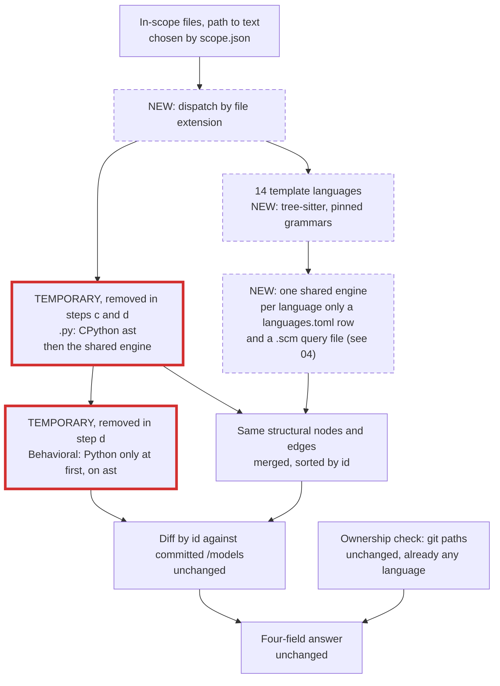

# What changes, what stays

Question: for drifter to read more than Python, which parts of one check change, and which stay exactly as they are?

## The picture

Solid boxes stay as they are. Dashed boxes are new or changed.

Red border, labelled **TEMPORARY**: on CPython `ast` only during steps a to c, removed by step d (04, "Python on the template").

## The table

| Part | Status | What exactly |
| --- | --- | --- |
| **Purpose**: rebuild models from code, compare with committed ones | Stays | Same question, same answer |
| **Rules**: static, never runs code, pure, sorted by id, byte-identical on every OS | Stays | Tested for tree-sitter, see research §2 |
| **Model files**: `structural.json`, `behavioral.json`, `ownership.json`, `scope.json` | Stays | Same files, same `schema_version: 1` |
| **Structural schema**: kinds `module`, `class`, `function`, `method`. Edges `imports`, `inherits` | Stays | New languages use the same kinds (see 03) |
| **Diff by id**, ADDED, REMOVED, MODIFIED | Stays | Does not care where an element came from |
| **Ownership model and checker** | Stays | Already works on any file path |
| **Python ids** (`shop.orders:Order.cancel`) | Stays | Existing committed models do not change |
| **Python parsing** | **Changes later. TEMPORARY until step d** | Agreed steps: **a** build the 14 languages first, with Python still on `ast`. **b** Compare edges and check against the goldens. **c** Move Python structural. **d** Move Python behavioral and drop `ast` (04, Python on the template) |
| **CLI, API, error codes** | Stays | `PARSE_FAILED` now also means "tree-sitter found an error" in a language whose row says `on_error = "fail"` |
| **Four-field answer** | **Changes, if the team agrees** | Lists the files read with `on_error = "skip"` (partly read). A pod contract change (04, "Parse errors") |
| `parse_files` in `common.py` | **Changes** | Dispatches by extension: **TEMPORARY:** `.py` goes to `ast` (until step c), the rest to the shared engine. In the end state `parse_files` is replaced by one `extract(files) -> Facts` that returns no trees ([final_templates.md](final_templates.md), design note 1). Each file is parsed once, not twice as today |
| `generate_structural` | **Changes** | Python files go through today's code until step c, then through the shared engine too. Other files go to the shared engine. Results are merged |
| `DEFAULT_SCOPE` in `check.py` | **Changes** | `include` adds the extensions of the 14 template languages. CSS and HTML are left out on purpose: they are not architecture (see 04). `exclude` adds `**/node_modules/**`, `**/dist/**`, `**/*.min.js` and the test, fixture and vendored folders (fix M1 in 04) |
| `requirements.txt` | **Changes** | Adds pinned wheels: `tree-sitter`, plus one grammar per language. No Node.js, no compiler |
| **New** `Source/models/engine.py`, `languages.toml`, `queries/*.scm` | **New** | One engine, one row and one query file per language (see 04) |
| **Behavioral for the new languages** | Later | Same idea (`if (s === "pending") s = "paid"`), not tried yet |

## What the simplest version leaves out

These are needed for a complete solution. Each one is a decision for the team, not part of this proposal.

1. **Behavioral model for the new languages.** Only Python has state machines at first.
2. **Smart import resolution**: tsconfig `paths`, webpack aliases, package `exports`. The first version resolves relative paths only (`./api` → `api.ts`, `api/index.ts`).
3. **React-specific facts**: a `component` tag, and `uses` edges for `<Button/>`. Each one is a schema change.
4. **Vue, Svelte, Angular templates, Sass and Less.** Each needs another grammar.
5. **Languages not decided yet** (Elixir, Haskell, Julia, Zig). One grammar wheel plus one query file each, through the shared template (see 04).
6. **The duplicate-id fix** for overloaded names, needed before Java, C#, C++, Kotlin, Scala, Swift and TypeScript handle ordinary code (see 04).
