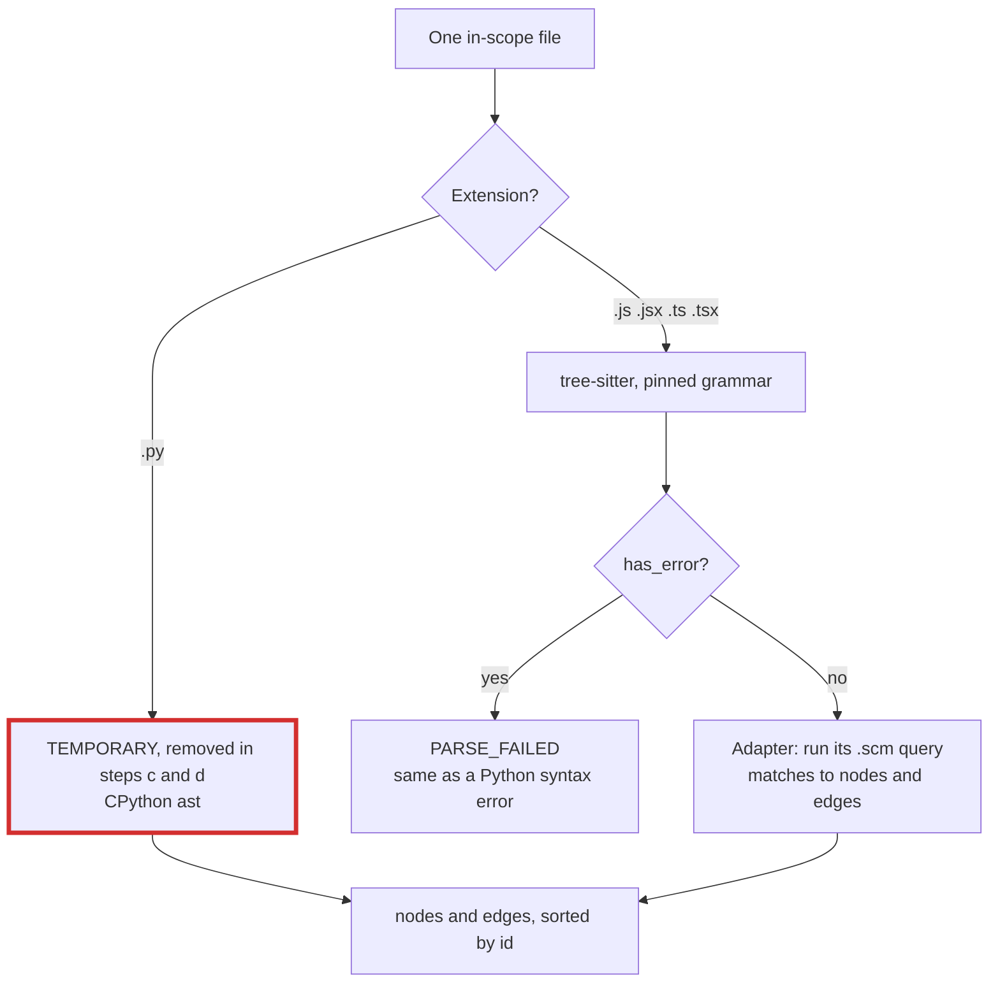

# Language adapters

Question: how does a new language plug in, and what must every adapter keep true so the models stay deterministic?

> **Superseded in part by [04-one-template.md](04-one-template.md).** The per-language Python files below (`languages/<lang>.py`) are replaced there by one shared engine. A language becomes only a `.scm` file and a table row. Rule 4 (a tree with errors fails the file) is replaced there by a per-language error policy, and Python moves onto the same engine instead of keeping `ast`, in agreed steps a to d (04, "Python on the template"). The other rules and the "why tree-sitter" table here still hold.

## Idea in one line

**One parser library (tree-sitter) for every non-Python language. One adapter per language. Every adapter speaks the same output: structural nodes and edges.**

Python keeps CPython `ast` for now, so nothing that already works is touched. *Replaced in 04:* Python moves onto the same engine in steps a to d, once its output is byte-identical.

## Why tree-sitter

The full comparison is in [research-multi-language.md](research-multi-language.md).

| Option | Verdict | One-line reason |
| --- | --- | --- |
| **tree-sitter** (py-tree-sitter + pinned grammar wheels) | **Use** | Small MIT pure wheels, no Node.js, one query language for all languages, fast (92k lines in about 0.55 s), byte-identical on Windows and Linux |
| ast-grep | Runner-up | Same engine underneath, but a 44 MB wheel and less control |
| Babel / TypeScript compiler | No | Needs Node.js in the Docker image, one tool per language |
| Semgrep | No | Heavy install, and its rules are licensed for internal business use only |
| SCIP / stack-graphs / ctags | No | SCIP needs `npm install` of the analysed repo. stack-graphs is archived. ctags is GPL and finds definitions only |

**The old concern, "output order varies", does not hold** with pinned versions used in-process. The research ran the same input with two hash seeds and on both OSes and got the same bytes each time. We still sort by id at the end, as today, so the order never depends on the engine.

## The shape



Red border, labelled **TEMPORARY**: on CPython `ast` only during steps a to c, removed by step d (04, "Python on the template").

## Files

```
Source/models/
  common.py               # parse_files: dispatch by extension (changed)
  structural_model.py     # Python walker (unchanged); merges adapter output (changed)
  languages/              # new
    __init__.py           # EXTENSIONS = {".js": javascript, ".ts": typescript, ...}
    javascript.py  javascript.scm   # also .jsx
    typescript.py  typescript.scm   # .ts, and .tsx with the tsx grammar
```

Each adapter is one function:

```python
def structural(path: str, tree) -> tuple[list[dict], list[dict]]:
    # turns one parsed file into structural nodes and edges, same shape as Python's
```

## Rules every adapter keeps

These are the same rules as `docs/diagrams/model-seam.md`, applied to a new language.

1. **Never run or install the code.** No `npm install`, no Node.js.
2. **Pin exact versions** of `tree-sitter` and every grammar wheel. A grammar upgrade is a deliberate change that is checked with goldens.
3. **Use `QueryCursor.matches()`, then sort by id.** Never rely on match order.
4. **A tree with errors fails the file** (`PARSE_FAILED`). Never emit a partial model. The research saw an `ERROR` node swallow a whole class. *Replaced in 04:* measured on real code, this rule gives no verdict on most C and C++ repositories, so each language row chooses `fail` or `skip`, and `skip` lists the partly read files.
5. **No line numbers in output**, so moving code is not drift.
6. **Only edges to files in this repository.** `import React from "react"` gives no edge, the same as `import json` in Python.
7. **Goldens per language**: a small source file and its exact expected JSON, as the Python generators already have.

## Adding the next language later

Replaced by 04: add one `languages.toml` row and one `.scm` file, then pass the four guards (vocabulary check, conformance test, coverage check, reference corpus). No Python per language.
