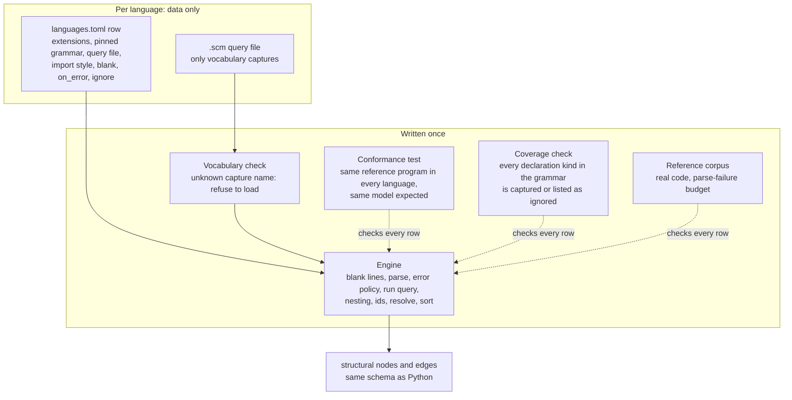

# One template for every language

Question: how does drifter cover C, C++, Java, Rust, C#, Swift, Go, JS and more **without** a separate piece of code for each language?

## The idea

**Code once, data per language.** There is one engine, written once. A language is not code: it is **one row in a table and one small query file**. Every query file must speak the same small vocabulary, and a shared test checks that every language gives the same answer to the same program.

| | Per-language adapters (doc 02) | **One template (this doc)** |
| --- | --- | --- |
| Per language | A Python adapter plus a `.scm` file | **A `.scm` file plus one table row. No Python** |
| Adding a language | Write and review new code | Write about 5 query lines, pass the shared test |
| Bugs in walking, nesting, ids, sorting | Fixed N times | Fixed **once** in the engine |
| Enforced by | Code review | **The vocabulary check and the conformance test (below)** |

## Proven, not assumed

A throwaway prototype in the session scratchpad ran **one** 110-line engine over the same `Order` program written in each language. **All 14 languages in scope work on the reference program**, each with 4 to 9 query lines and no other code. Most of them still need the duplicate-id fix below before they handle ordinary code. CSS, HTML, MATLAB, Bash, Objective-C, Dart, SQL, Perl, R, zsh, PowerShell and fish were tried or checked, then left out (see below). Python is not in this count: it moves onto the template in steps a to d (see "Python on the template").

| Language | Grammar on PyPI (pinned, MIT) | Query lines | Classes | Methods nested right | Params | Imports | Inherits |
| --- | --- | --- | --- | --- | --- | --- | --- |
| Java | `tree-sitter-java` 0.23.5 | 5 | ✓ (plus nested `Order.Line`) | ✓ | ✓ | ✓ | ✓ |
| Kotlin | `tree-sitter-kotlin` 1.1.0 | 5 | ✓ class, object | ✓ (`suspend` = async ✓) | ✓ | ✓ | ✓ |
| Scala | `tree-sitter-scala` 0.26.4 | 6 | ✓ class, object, trait | ✓ | ✓ | ✓ | ✓ |
| C# | `tree-sitter-c-sharp` 0.23.5 | 6 | ✓ | ✓ (`async` ✓) | ✓ | ✓ | ✓ (two bases) |
| C++ | `tree-sitter-cpp` 0.23.4 | 5 | ✓ | ✓ | ✓ | ✓ `#include "…"` | ✓ |
| C | `tree-sitter-c` 0.24.2 | 4 | ✓ (`struct`) | n/a | ✓ | ✓ | n/a |
| Rust | `tree-sitter-rust` 0.24.2 | 9 | ✓ struct, trait | ✓ via `@owner` (`impl`) | ✓ | ✓ | n/a (traits) |
| Go | `tree-sitter-go` 0.25.0 | 5 | ✓ struct | ✓ via `@owner` (receiver) | ✓ | ✓ | n/a (embedding) |
| Swift | `tree-sitter-swift` 0.7.4 | 5 | ✓ | ✓ | ✓ | ✓ | ✓ |
| JavaScript | `tree-sitter-javascript` 0.25.0 | 6 | ✓ | ✓ (`async` ✓) | ✓ | ✓ | ✓ |
| TypeScript | `tree-sitter-typescript` 0.23.2 | 8 | ✓ class, interface | ✓ (`async` ✓) | ✓ | ✓ | ✓ |
| PHP | `tree-sitter-php` 0.25.1 | 8 | ✓ class, interface | ✓ | ✓ (`$a`) | ✓ `require_once` | ✓ |
| Ruby | `tree-sitter-ruby` 0.23.1 | 6 | ✓ class, module (`Shop.Order`) | ✓ (plus `def self.x`) | ✓ | ✓ `require_relative` | ✓ |
| Lua | `tree-sitter-lua` 0.5.0 | 5 | none: Lua has no class construct, only tables | ✓ via `@owner` (`Order.cancel`, `Order:refund`) | ✓ | ✓ `require("…")` | n/a |

Same bytes across runs with different hash seeds. What happens to a file the grammar cannot fully read is set per language (see "Parse errors" below).

### Out of scope

Each of these was prototyped or checked, then left out, because it bent or broke the template:

| Language | Why it was dropped |
| --- | --- |
| CSS | Not architecture: no modules, classes, functions or states, only `@import` between stylesheets. Its moves would count as drift, raising false alerts. And `tree-sitter-css` 0.25.0 rejects Tailwind's `@config`, `@plugin`, `@source` and `@custom-variant`, so one Tailwind file would block the verdict for the whole repo. CSS files stay covered by ownership, which judges every changed path regardless of scope |
| HTML | Almost no architecture: its only edge is page → script, and a modern app has one `index.html` with one `<script>`. Server templates (`src="{{ url_for(...) }}"`) give no edge at all. And `tree-sitter-html` 0.23.2 rejects valid HTML5: `<p>one <p>two` without `</p>` is an error, so one such file would block the verdict for the whole repo. The scripts a page loads are still modelled through their own JS/TS imports. Ownership still covers HTML files |
| Dart | The only PyPI grammar is 0.1.0, published by a third party (`efrenbl`). A function's body sits *beside* its signature, which needed an extra engine rule |
| SQL | Tables and views, not code. Needed a new `references` edge kind, which is a schema change |
| Perl | `tree-sitter-perl` 2.0.3 does not load with core 0.26: its `language()` returns a raw pointer, and the core rejects it with `OverflowError` |
| R | No wheel on PyPI. The official `r-lib/tree-sitter-r` would have to be built from git |
| PowerShell | `tree-sitter-powershell` 0.26.4 (third party, `airbus-cert`) loads, and multi-line scripts work. But it **rejects valid code**: `function F { param($a) Write-Output $a }` runs in PowerShell and is `PARSE_FAILED` here. A false "no verdict" on correct code breaks the purpose |
| zsh | `tree-sitter-zsh` 0.63.4 works on the sample, but it is a one-person third-party grammar. Shell scripts are out of scope anyway (see Bash / sh) |
| fish | No grammar on PyPI |
| MATLAB | Thin model: functions are found on a search path, so there are almost no edges. Mostly scientific scripts, and a proprietary language. It also shares `.m` with Objective-C, so the extension cannot tell the two apart |
| Bash / sh | Glue scripts, not architecture. Its only edges are `source` lines, often dynamic (`source "$DIR/x.sh"`), and its functions have no named parameters |
| Objective-C | Prototyped and working, then removed. A legacy language: Apple moved to Swift, which is in scope. It needed the most special handling for the least value: the `.m` clash with MATLAB (a content check), selector names cut to their first part (`cancel:code:` → `cancel`), classes split between `@interface` and `@implementation`, and 25 % of real files failing before the macro fixes. Removing it also removes the `.m` problem |

Kotlin, TypeScript, Scala, PHP, Ruby and Lua were all added with **no engine change at all**: only query files.

### Not decided yet

Prototyped on one sample each, all loading with the pinned core and needing no engine change, but not in scope:

| Language | Grammar | Why it waits |
| --- | --- | --- |
| Elixir | `tree-sitter-elixir` 0.3.5, from the Elixir team, Apache-2.0 | `def` and `defmodule` are ordinary calls. Multi-clause functions give duplicate ids. The argument count is part of a function's identity |
| Haskell | `tree-sitter-haskell` 0.24.1 | No classes or methods in the usual sense. Functions written as several equations give duplicate ids |
| Julia | `tree-sitter-julia` 0.23.1 | Multiple dispatch: one name, many methods, so duplicate ids |
| Zig | `tree-sitter-zig` 1.1.2 | Clean fit, but a smaller user base |

On PyPI but not tried: OCaml, F#, Fortran, Solidity, and Groovy (third party, 0.1.2). Not on PyPI: Erlang, Elm, Clojure, Visual Basic.

## One problem to fix before building: duplicate ids

An id is `file:Class.method`. Many languages allow one name to be defined twice in the same scope, which gives two elements the same id. That breaks the element rule (unique ids, `docs/diagrams/model-seam.md`), so the check would say `INVALID_MODELS`. Tested in the prototype:

| Cause | Languages |
| --- | --- |
| Overloading: `go(int)` and `go(int, int)` | Java, C#, C++, Kotlin, Scala, Swift, TypeScript |
| A trait method with the same name as an inherent method | Rust |
| Redefinition: the last one wins at runtime | Ruby (and Python, which already keeps the last) |
| Multi-clause functions, multiple dispatch | Elixir, Haskell, Julia (not in scope) |

Not affected: C, Go, JavaScript, PHP and Lua, which have no overloading.

The fix belongs in the engine, once, for every language:

1. **Overloads:** a name defined more than once in one scope gets its parameter types in the id, `A.go(int,int)`. That needs one new capture, `@param.type`. A name defined once keeps its plain id, so most ids do not change.
2. **Redefinition** (Ruby): keep the last, the same rule as Python today.
3. **Rust trait methods:** add the trait to the id, `A.Show::go`.

This is a design decision for the team, and it has not been prototyped.

## The parts



### 1. The vocabulary (the template every language must fill in)

A query file may use **only** these capture names. The engine refuses to load a file with any other name.

| Capture | Means | Engine turns it into |
| --- | --- | --- |
| `@def.class` + `@name` | A type: class, struct, interface, trait, protocol | `class` node |
| `@def.function` + `@name` | A function or method | `function` node, or `method` if it sits inside a class |
| `@owner` | The type a method belongs to when it is written **outside** that type (Go receiver, Rust `impl`) | Makes it `Owner.name`, a `method` |
| `@param` | One parameter name | Goes into `params`, in source order |
| `@async` | An async marker | `"async": true` |
| `@inherits` | A base type of that `@def.class` | `inherits` edge |
| `@import` | The import or include target text | `imports` edge, after resolution |

The engine does the rest the same way for every language: method versus function by position, nested names (`Order.Line.qty`), one element per syntax node, ids, sorting, and the row's error policy for a file the grammar cannot fully read (see "Parse errors").

### 2. The language row

```toml
# Source/models/languages.toml
[java]
extensions = [".java"]
grammar    = "tree-sitter-java==0.23.5"
query      = "java.scm"
imports    = "dotted"                  # path | dotted | none
on_error   = "fail"                    # fail | skip  (see Parse errors)
blank      = []                        # no preprocessor
ignore     = ["field_declaration", "local_variable_declaration", "constant_declaration"]

[cpp]
extensions = [".cpp", ".cc", ".hpp", ".h"]
grammar    = "tree-sitter-cpp==0.23.4"
query      = "cpp.scm"
imports    = "path"
on_error   = "skip"
blank      = ["pragma", "conditional", "macro_line"]
ignore     = ["field_declaration", "declaration"]
```

| Field | Meaning |
| --- | --- |
| `extensions`, `grammar`, `query`, `imports` | Which files, which pinned parser, which query file, which import style |
| `on_error` | What a file the grammar cannot fully read does: `fail` stops the check (`PARSE_FAILED`), `skip` reads the rest and reports the file |
| `blank` | Preprocessor lines replaced with spaces before parsing (M2 to M4 below). Only for languages with a preprocessor |
| `ignore` | Declaration kinds of the grammar we leave out **on purpose**, such as fields and local variables. Read by the coverage check |

And a whole language, Java, from the prototype:

```scheme
(import_declaration (scoped_identifier) @import)
(class_declaration name: (identifier) @name superclass: (superclass (type_identifier) @inherits)?) @def.class
(interface_declaration name: (identifier) @name) @def.class
(method_declaration name: (identifier) @name) @def.function
(formal_parameter name: (identifier) @param)
```

### 3. The conformance test (how the template is enforced)

One reference program, `Order`, with a base class, a nested class, a method with two params, an async function and one import. It is written once in each language under `tests/languages/<lang>/`. The test runs the engine on each version and requires **the same model** in every language, apart from the file paths. This is one of the five guards; a new language is done when all five pass (see "When a language changes"). A language that cannot express a feature (C has no classes, Go has no inheritance) states that in its row, and the test skips only that line.

### 4. The coverage check (nothing is missed silently)

The conformance test only checks what is in the reference program. New syntax the grammar knows but our query does not capture would be **missed without any error**. Tested: the Java grammar parses `record Point(int x, int y) { int sum() {…} }` and `enum Color {…}` with no error, but the prototype query dropped both, and recorded `sum` as a top-level function instead of `Point.sum`.

Every grammar lists the syntax kinds it knows, readable from the `Language` object (`node_kind_count`, `node_kind_for_id`). The check:

1. Takes every kind whose name ends in `declaration`, `definition` or `_item`.
2. Requires each one to be **captured** by the row's query or listed in its **`ignore`** field.
3. Fails on any kind that is in neither, naming it.

It is generic and needs no code per language. Run against the prototype queries, it already finds real gaps:

| Language | Declaration kinds in the grammar | Not captured yet (examples) |
| --- | --- | --- |
| Java | 15 | `enum_declaration`, `record_declaration`, `constructor_declaration`, `annotation_type_declaration` |
| TypeScript | 12 | `abstract_class_declaration`, `enum_declaration`, `type_alias_declaration` |
| Kotlin | 6 | `property_declaration` |
| Rust | 19 | `const_item`, `macro_definition` |

Each one becomes a conscious choice: capture it, or add it to `ignore`.

### 5. The reference corpus (real code, not one sample)

Each language keeps one or more pinned real repositories as test data, read from git and never built or run. The test requires, on non-test files, a parse-failure rate within the row's budget: **0 for an `on_error = "fail"` row**. This catches grammars that reject valid code (PowerShell, HTML) before a language is admitted.

## Parse errors: why they happen and what we do

tree-sitter reads code **as written**. A file it cannot fully read gets `ERROR` nodes. Measured on one real repository per language (15 repositories, 32,393 files, `research-template-engine.md` §3), there are three causes:

| Cause | Example | Languages |
| --- | --- | --- |
| **Macros (preprocessor).** The compiler replaces a word with other text first. The parser sees the word | `FMT_BEGIN_NAMESPACE` is really `namespace fmt {` | C, C++, partly C# (`#if`, `#pragma`) |
| **Grammar behind the language.** Syntax the grammar has not learned yet | Java `@Nullable Object @Nullable ... args`, Kotlin `@Synchronized set(value)`, Swift `#error("…")` | Java, Kotlin, Swift |
| **Broken on purpose.** Test files that check how a tool handles bad code | webpack test cases, `bad-syntax.php` | JS, PHP, Lua, TS |

### Four fixes, applied before parsing (measured 2026-11-02)

Each one replaces whole lines with spaces of the same length, so every other byte keeps its position and the output stays deterministic.

| Fix | Where it lives | What it does | Measured effect |
| --- | --- | --- | --- |
| **M1** | Default `scope.json` exclude, every language | Leaves out `test/`, `tests/`, `spec/`, `fixtures/`, `examples/`, `testdata/`, `vendor/`, `deps/`, `third_party/`, `*.spec.*`, `*.test.*` | Removes cause 3. JS 230 → 0, TS 2 → 0, C 347 → 53 |
| **M2** | Row `blank = ["pragma"]` | Blanks `#pragma`, `#error`, `#warning`, `#line`, `#region` | C# 65 → 42 |
| **M3** | Row `blank = ["macro_line"]` | Blanks a line that is only an ALL_CAPS macro (`NS_ASSUME_NONNULL_BEGIN`, `FMT_BEGIN_NAMESPACE(...)`) | Helps C and C++. **Breaks Java** (13 → 85, because `INSTANCE;` is an enum value), so only for languages with a preprocessor |
| **M4** | Row `blank = ["conditional"]` | Blanks `#if`, `#ifdef`, `#else`, `#endif`, so both branches read as one | C# 42 → 7. C++ unreadable share per failing file 20 % → 2.6 % |

A fix that is safe in one language can break another (M3 in Java), so every fix is switched on **per row** and proven on that row's reference corpus.

### Option (b): `on_error = "skip"`

What is left after M1 to M4 is handled per row:

- **`fail`**: the check stops with `PARSE_FAILED`, as today. For rows at 0 failures on their corpus.
- **`skip`**: the engine drops every capture inside an `ERROR` subtree, keeps the rest of the file and all other files, and **lists the file** in the answer as partly read. The parser marks the same region every time, so the output stays deterministic.

The cost: a change inside an unreadable region is not seen, and the answer gains a "partly read" list. That second point is a contract change, so it needs the team's agreement.

Left over after M1 to M4, on non-test files:

| Language | Files still failing | Average unreadable share of a failing file | Row setting |
| --- | --- | --- | --- |
| Go, Rust, Ruby, Scala, PHP, Lua, JS, TS | 0 | — | `fail` |
| C# | 7 of 931 (0.8 %) | 0.1 % | `skip` |
| Swift | 2 of 53 | ~0 % | `skip` |
| Java | 13 of 1,869 (0.7 %) | 0.7 % | `skip` |
| C | 45 of 231 (19.5 %) | 2.8 % | `skip` |
| C++ | 18 of 19 | 2.6 % | `skip` |
| **Kotlin** | 8 of 551 (1.5 %) | **40.7 %** | `skip`. The largest blind spot, a grammar gap that no blanking fixes: report it upstream and recheck on each grammar upgrade |

One repository per language, so these rates are a first measurement, not a guarantee.

## How the engine runs efficiently

Measured on 15 real repositories, 32,393 files, 4.15 M lines (`research-template-engine.md`). The engine does about 228k lines a second on one core, and the largest repository (Guava, 793k lines) takes 3.3 s against the 80 s deadline. Parsing, which runs in C, is 65 % of the time.

| Rule | Why (measured) |
| --- | --- |
| **Load each grammar and compile each query once per language**, and only for languages present in the repository | The prototype compiled the query again for every file, at 0.5 to 112 ms each, about 26 s on webpack |
| **Parse each file once** | Every file is parsed three times today (`_read_files` in `check.py`, then the structural and the behavioral generator) |
| **Turn each tree into facts, then drop it** | Keeping every tree, as `parse_files` does today, peaked at 713 MB. Dropping each one peaks at 28 to 103 MB |
| **Find nesting with one sort and a stack**, not by comparing every pair | 7.3x faster, same nodes on all 32,393 files |
| **Cache each file's facts by its git blob id** plus the engine, grammar and query version. Facts are path-free, the path is added after | Only 400 of 32,393 files changed between nearby versions. A two-commit check needs 58 % fewer parses with an in-memory cache alone |
| **No threads** | The tree-sitter binding holds Python's lock while parsing, so threads give nothing. A process pool gives 4.2x with 8 workers and is kept as a later option for very large repositories |

## When a language changes: the upgrade procedure

A new language version is handled by data, never by engine code:

1. **Bump the pinned grammar version** in the row. Never automatically: it is a deliberate release with a release note.
2. **Run the five guards**: the vocabulary check, the conformance test, the coverage check, the reference corpus and the goldens.
3. **Fix what they name**, usually 1 or 2 query lines or one `ignore` entry.

What each kind of change does:

| Change | Example | Caught by |
| --- | --- | --- |
| The pinned grammar does not know the new syntax yet | A new keyword | `on_error`: `skip` reports the file, `fail` stops. Fixed by upgrading the grammar |
| The upgraded grammar renames a node our query uses | `function` → `function_expression` | The query **refuses to load** (`QueryError`) at upgrade step 2, before any user sees it |
| The grammar knows the syntax, our query does not capture it | Java `record` | The **coverage check** at upgrade step 2 |

Two costs remain:

- **An upgrade can change the extracted facts**, so every repository in that language shows drift once, with no code change. The same is true of upgrading CPython for Python today, which is why parsers are pinned.
- **We depend on grammar maintainers.** Official grammars (Java, Go, Rust, JS/TS, C#, C, C++) are actively maintained. Community ones (Swift, Kotlin, Lua) may lag behind new syntax. While they lag, `skip` keeps the check working and reports the files.

## Python on the template

Decision (agreed 2026-11-02): Python moves onto the template too, so there is **one** way to extract every language, one set of tests, and every engine rule (ids, the duplicate-id fix, caching) is built once. It moves in four steps, **a to d** (below).

### Evidence (measured 2026-11-02)

A `python.scm` of 6 query lines (`tree-sitter-python` 0.25.0) ran over this repository's 55 Python files and was compared with today's `generate_structural`, element by element:

| Compared | Result |
| --- | --- |
| Elements from `ast` | 614 |
| Same ids from the template | **614 of 614** |
| Same kind, params (with `/`, `*`, `*args`, `**kwargs`), decorators, async | **614 of 614** |
| Extra elements from the template | 21, all functions defined inside functions, which today's generator leaves out on purpose |
| Edges (`imports`, `inherits`) | **Not compared yet** |

The 21 extra elements become one engine rule for every language: **a definition inside a function body is not an element**. Closures and local helpers are not architecture in any language.

### The pod contract allows it

The pod contract (`pod-contract.md`, its OpenAPI file) names no parser: `PARSE_FAILED` is "an in-scope file cannot be parsed". The one line that says "parse Python with ast only" is in Team 16's `spec-v1.1.md` §6.3, for their Layer-2 prose fact check, not for model drift. Its REQ-06 says "parsing only (for example `ast.parse`), never import or exec", which tree-sitter keeps. What *is* binding is the output: `model-golden-outputs.json` must come out **byte-identical**. "Pinned CPython ast" in our own docs (`diagrams/one-check.md`, `diagrams/init.md`, `base/overview_phase4.html`) describes our internals, and is updated when the change is built.

### Steps a to d (agreed)

| Step | What | Gate |
| --- | --- | --- |
| **a** | Build the template with the 14 languages. Python stays on `ast` meanwhile | — |
| **b** | Compare **edges** and check against the goldens. Add the nested-definition rule. Python resolves relative imports (`from . import x`) and base classes through each module's bindings, which the simple `dotted` style and "one class of that name" rule may not match | Nodes and edges byte-identical on this repository, the Python reference corpus and `model-golden-outputs.json` |
| **c** | Move **Python structural** onto the template | Step b passes |
| **d** | Move **Python behavioral** once the behavioral vocabulary exists, then drop `ast` | Behavioral goldens byte-identical |

If step b shows Python's import or inheritance rules need more than the fixed menu, they are added as **import styles available to every language** (for example `dotted-relative`), never as Python-only code.

## The one part that does not fit a template: imports

Turning an import's text into a **file in this repository** works differently between language families. It is a small **fixed menu** in the engine, chosen per row. A language never gets its own code:

| Style | Languages | Rule | Example |
| --- | --- | --- | --- |
| `path` | C, C++, JS, TS, PHP (`require`), Ruby (`require_relative`) | Relative to the importing file. Try the listed extensions, then `index.*` | `#include "base.h"` → `src/base.h` |
| `dotted` | Java, Kotlin, Scala, Python, Rust (`crate::`), Lua (`require("shop.base")`) | Dots or `::` become folders. Exactly one matching file, or no edge (the same as Python's `_imported` today) | `shop.base.Entity` → `…/shop/base/Entity.java` |
| `none` | C#, Swift, Go, PHP `use` (first version) | No `imports` edges. These import a **namespace or module**, not a file | `using Shop.Base;` gives no file |

`inherits` targets resolve the same way for every language: a base name becomes an edge only if exactly one class of that name exists in the repository. Otherwise there is no edge, never a guess.

## What changes from doc 02

| Doc 02 said | Now |
| --- | --- |
| `languages/<lang>.py` per language | **Gone.** One `engine.py` |
| `EXTENSIONS` dict in code | `languages.toml`, data |
| Goldens per language | One conformance test over all languages, plus the coverage check, the reference corpus and a few edge-case goldens |
| `PARSE_FAILED` on any error node | Per row: `fail` keeps it, `skip` reads the rest and reports the file |
| `parse_files` returns trees to each generator | One `extract(files) -> Facts`. Trees never leave the engine, both models are views of the facts ([final_templates.md](final_templates.md)) |

Unchanged from 01 to 03: schema, ids with file extension, diff, ownership, pinned versions, sort by id. Changed: Python moves onto the template in steps a to d (see "Python on the template").

## Limits, to decide consciously

1. **Imports for C#, Swift and Go** need a namespace or module node to be meaningful. That is a schema change (a new node kind), so the first version emits no edge.
2. **C and C++ headers**: `<stdio.h>` is a system header and gives no edge. Only `"…"` includes resolve. Macros are not expanded, so code generated by macros is invisible. M2 to M4 only stop macros from breaking the parse.
3. **Python** keeps its dotted ids (`shop.orders:Order.cancel`) when it moves onto the template, so committed models do not change. Its row needs a module-id rule (strip `.py`, `src/` and `__init__`), and a `.py` syntax error is decided by tree-sitter instead of CPython. Those can differ on rare edge cases, which the Python reference corpus checks.
4. **Behavioral** (state machines) is a second, small vocabulary (`@guard.variable`, `@guard.value`, `@assign.variable`, `@assign.value`) on the same engine. It has not been prototyped.
5. **Grammar quality varies.** `tree-sitter-swift` is at 0.7.x. Pinning plus the conformance test catches a regression when a version is bumped.
6. **One core version must fit every grammar.** All grammars are pinned together against one `tree-sitter` core, like a lock file. A grammar that does not load with that core, as Perl's does not, stays out until it does.
7. **Lua has no classes**, only tables. Methods get `Order.cancel` ids through `@owner`, but there is no `Order` class node. Ruby's `require "json"` (a gem) gives no edge, as `import json` gives none in Python.
8. **A grammar can reject valid code**, as PowerShell's and HTML's do. The reference corpus (part 5) catches it. It was measured on one repository per language, so more than one per language is needed before rollout.
9. **The "partly read" list is a contract change.** The answer must name the files read with `skip`. The pod contract decides how, so it needs the other team's agreement.
