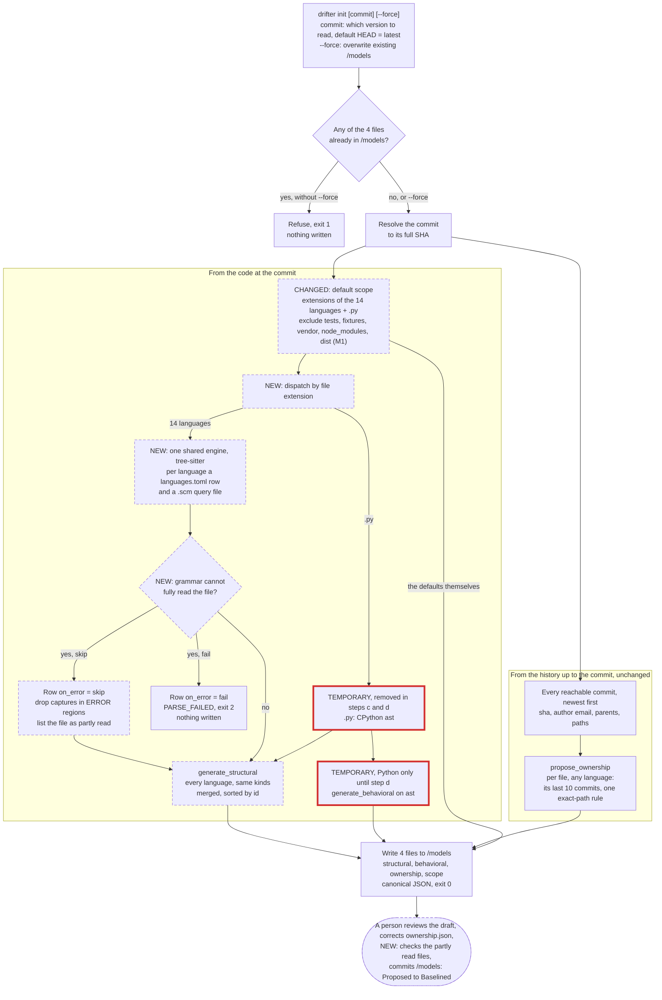

# drifter init, beyond Python

Question: once drifter reads more than Python, how does `drifter init` change, and what stays exactly as `docs/diagrams/init.md` describes it?

A proposal on branch `phase5-kk`, not built. It applies 01 to 05 to the one command that writes the first `/models`. Where this doc and 04 or `05-decisions-log.md` disagree, 04 and 05 win.

## Short answer

init is still the arrow **No models → Proposed**. It still runs once, writes a draft, checks nothing, and builds all four files in memory before writing any. Three things change, all on the **code side**: the default scope it writes, how each file is read, and what can stop it. The **history side** (ownership) does not change: it already works on every path in any language.

## The picture

Solid boxes stay as they are in `docs/diagrams/init.md`. Dashed boxes are new or changed.

Red border, labelled **TEMPORARY**: on CPython `ast` only during steps a to c, removed by step d (04, "Python on the template").

## How init changes, step by step

The rollout steps of 04 change init in this order. Each step must leave a Python-only repository's init output **byte-identical**.

| Step | What `drifter init` does on a repository | Gate |
| --- | --- | --- |
| **Today** | Default scope `**/*.py`, excluding `tests/**`. Every file parsed by CPython `ast`, three times (`_read_files`, then each generator). Behavioral and structural from Python only | — |
| **a** | New default scope. Python still on `ast`. Files of the 14 languages go to the shared engine and add structural nodes and edges with path ids (`web/src/Cart.tsx:Cart`). Behavioral stays Python only | The conformance test and reference corpus pass for each language row that is switched on |
| **b** | No change to what init writes. Python's edges are compared, template against `ast` | Nodes and edges byte-identical on this repository, the Python reference corpus and `model-golden-outputs.json` |
| **c** | Python structural is read by the shared engine too. Ids stay dotted (`shop.orders:Order.cancel`) | Step b passes |
| **d** | Python behavioral moves onto the engine and `ast` is dropped. init calls `extract(files) -> Facts` once and both models are views of it ([final_templates.md](final_templates.md)) | Behavioral goldens byte-identical |

Languages are switched on in the waves of 05: init only reads a language once its row is in `languages.toml`.

## The table

| Part | Status | What exactly |
| --- | --- | --- |
| **Purpose**: write the first `/models` as a draft for a person to review | Stays | Still **No models → Proposed**. Still checks nothing |
| **Guard**: refuse if any of the four files exists, unless `--force` | Stays | Exit 1, nothing written |
| **Resolve the commit** | Stays | Full SHA, defaults to `HEAD` |
| **All files built in memory before any is written** | Stays | A stop still leaves `/models` as it was |
| **Ownership proposal** (`propose_ownership`) | Stays | Already one rule per changed path, in any language, and not limited by scope. A `.tsx` file already gets its owners today |
| **Output**: four files, canonical JSON, `schema_version: 1` | Stays | Same schemas, same kinds. The new languages use `module`, `class`, `function`, `method`, `imports`, `inherits` (03) |
| **Python ids** | Stays | `shop.orders:Order.cancel`, also after steps c and d. A Python-only repository gets the same bytes as today |
| **Hosted `POST /system/generate`** | Stays the same as init | Runs the same `generate_models`, so every change below applies to it too |
| `DEFAULT_SCOPE`, written as `scope.json` | **Changes** | `include` adds the extensions of the 14 languages. `exclude` adds the M1 folders (`test/`, `tests/`, `spec/`, `fixtures/`, `examples/`, `testdata/`, `vendor/`, `deps/`, `third_party/`, `*.spec.*`, `*.test.*`), plus `**/node_modules/**`, `**/dist/**`, `**/*.min.js`. CSS and HTML stay out (04, "Out of scope") |
| **Reading each file** (`_read_files`) | **Changes** | Dispatch by extension. **TEMPORARY:** `.py` on `ast` until step c. In the end state one `extract` call reads and parses each file once, instead of three times |
| **What stops init**: `FILE_TOO_LARGE`, `PARSE_FAILED`, exit 2 | **Changes** | `PARSE_FAILED` now also means "tree-sitter found an error in a file whose row says `on_error = "fail"`". A file in a `skip` row (C#, Swift, Java, C, C++, Kotlin) no longer stops init: it is read in part |
| **Partly read files** | **New, if the team agrees (O2)** | init cannot leave them in the four files, because the schemas have no place for them. Proposed: init prints them after writing, so the reviewer knows which parts of the draft are blind. The same list appears in every later check answer |
| `generate_structural` | **Changes** | Nodes and edges from every enabled language, merged and sorted by id |
| `generate_behavioral` | **Later. TEMPORARY until step d** | Python only, on `ast`. A repository with no Python gets a behavioral.json with no states, which is valid (O4) |
| **Duplicate ids** (overloads in Java, C#, C++, Kotlin, Scala, Swift, TS) | **Must be fixed first (O1)** | init does not run the element rule, so without the fix it would write a draft with duplicate ids, and the first `drifter check` on it would say `INVALID_MODELS`. That is why those languages ship in waves 2 and 3 |
| `requirements.txt` | **Changes** | Pinned `tree-sitter` and one grammar wheel per language. init still never runs, installs or builds the analysed code (REQ-06) |

## Existing repositories

The new default scope only reaches a repository through init. Committed `scope.json` files keep `**/*.py` (05, suggestion 6).

| Command on a repository that already has `/models` | Effect |
| --- | --- |
| `drifter check` | Unchanged. Reads the committed `scope.json`, so still Python only |
| `drifter update` | Unchanged. Rewrites structural and behavioral with the **committed** scope, so still Python only |
| `drifter init --force` | **Takes the new defaults.** It replaces all four files, so `scope.json` widens to every enabled language, and structural.json gains their nodes. It also replaces a hand-corrected ownership.json, as today |
| Edit `scope.json` by hand, then `drifter update` | The way to add other languages **without** losing a hand-corrected ownership.json |

## Still to decide

These are open items from `05-decisions-log.md` that init depends on:

- **O1** duplicate ids: needed before init can write a valid draft for overloaded languages.
- **O2** the partly read list: whether init prints it, and how the check answer carries it.
- **O3** no `imports` edges for C#, Swift and Go: init writes their nodes but no dependency graph.
- **O4** behavioral for the new languages: until then init writes their behavioral side empty.
