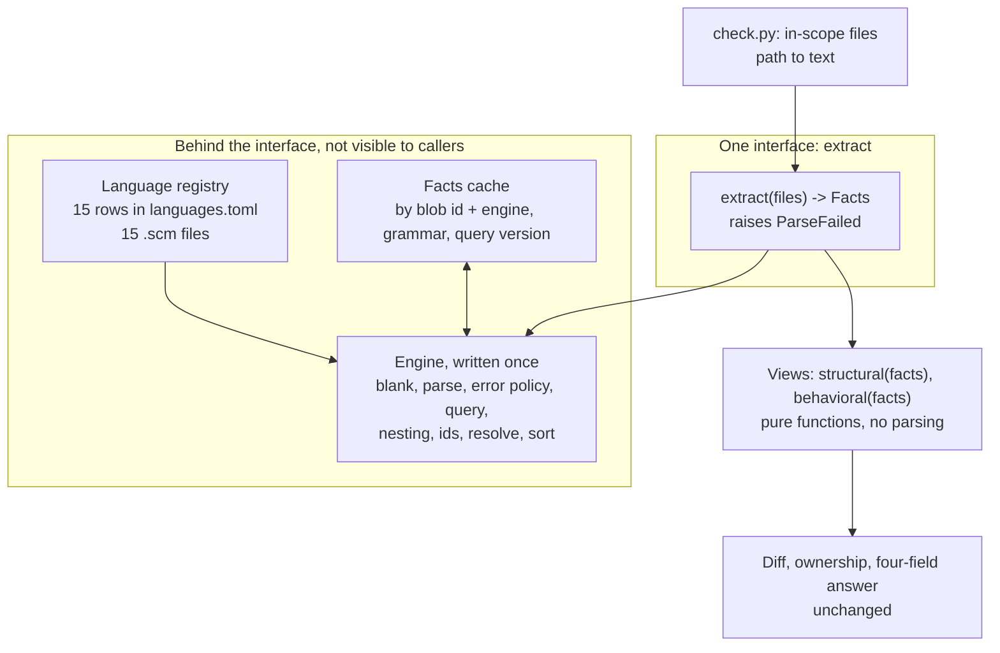

# Final templates: the end state

Question: once steps a to d are done, what does drifter's extraction look like, and where are its seams?

This is the **target**, not today. Today Python runs on CPython `ast` (`Source/models/common.py`, `structural_model.py`, `behavioral_model.py`) and no engine exists. It assumes the open items O1 (duplicate ids) and O2 (the "partly read" list) are accepted as proposed in 04. Where this doc and 04 disagree on what is decided, 04 and `05-decisions-log.md` win. The design below is a proposal.

## In one line

**One deep module, `extract`, turns in-scope file text into path-tagged facts. Every language, Python included, is a data row plus a query file behind it. The two models are small views of those facts.**

## What is gone

| Today | End state |
| --- | --- |
| `import ast` in `common.py`, `structural_model.py`, `behavioral_model.py` | Gone. No module outside the engine knows a parser exists |
| `parse_files() -> dict[path, ast.Module]` returns parser trees | Gone. Trees never leave the engine and are dropped after each file |
| Each file parsed three times: `_read_files`, then each generator | Parsed **once**, inside `extract` |
| Python-only walkers (`_collect`, `_params`, `_imports`, `_resolve`) | Gone. `python.scm` plus the shared engine rules |
| `module_id` strips `.py` and `__init__` in Python code | A row setting, `module_id = "dotted"`, from a fixed menu |
| `DEFAULT_SCOPE.include = ["**/*.py"]` | Every enabled language's extensions, plus the M1 excludes |

## The shape



## The interface

Everything a caller must know, and nothing else:

```python
# Source/models/engine.py
def extract(files: dict[str, str]) -> Facts: ...

@dataclass(frozen=True)
class Facts:
    elements: tuple[Element, ...]     # sorted by id
    edges: tuple[Edge, ...]           # sorted by id
    guards: tuple[Guard, ...]         # behavioral facts, sorted by id
    partly_read: tuple[str, ...]      # paths read under on_error = "skip", sorted
```

| Part of the interface | Rule |
| --- | --- |
| Input | Repo-relative path to decoded text. Size and encoding are already judged by `check.py` |
| Output | Same `files` in, same bytes out: no clock, no hash seed, no thread order |
| Error mode | `ParseFailed(path, line, reason)` for the first failing file in path order, only from a `fail` row. Code `PARSE_FAILED` as today |
| Out-of-scope extension | Not an error. A file whose extension no row claims gives no facts |
| Never | Imports, runs or builds the analysed code (REQ-06). Never reaches the network: grammars are pinned wheels |

The views stay what `check.py` already calls through `GENERATORS`, but take facts instead of text:

```python
GENERATORS: dict[str, Callable[[Facts], dict]] = {
    "behavioral": behavioral_view,
    "structural": structural_view,
}
```

`check.py` calls `extract` once in `_read_files` and passes the facts on. That replaces today's per-file `parse_files({path: ...})` probe, so syntax is judged in the same place it is extracted.

## Behind the interface

### Language registry (the adapters)

Each language is an **adapter** at the engine's internal seam: one `languages.toml` row plus one `.scm` file. There are 15 of them (14 plus Python), so the seam is real, not hypothetical.

```toml
[python]
extensions = [".py"]
grammar    = "tree-sitter-python==0.25.0"
query      = "python.scm"
module_id  = "dotted"          # dotted | path
imports    = "dotted-relative" # path | dotted | dotted-relative | none
on_error   = "fail"
blank      = []
ignore     = []
```

| Row field | Menu | Notes |
| --- | --- | --- |
| `module_id` | `dotted`, `path` | `dotted` strips the extension, `src/` and `__init__`, so committed Python models keep `shop.orders:Order.cancel`. Every other row uses `path` (`web/src/Cart.tsx:Cart`) |
| `imports` | `path`, `dotted`, `dotted-relative`, `none` | `dotted-relative` is added only if step b shows Python needs it, and is then open to every row |
| `on_error` | `fail`, `skip` | Per 04 "Parse errors" |
| `blank` | `pragma`, `conditional`, `macro_line` | Only for rows with a preprocessor |
| `ignore` | grammar kinds | Read by the coverage check |

A row may only choose from the menus. A new menu entry is engine code, reviewed once, and available to every row. **No language ever gets its own Python code.**

### The two vocabularies

| Vocabulary | Captures | Fills |
| --- | --- | --- |
| Structural | `@def.class`, `@def.function`, `@name`, `@owner`, `@param`, `@param.type`, `@async`, `@decorator`, `@inherits`, `@import` | `elements`, `edges`. `@param.type` (O1) and `@decorator` (Python and TS decorators) are additions to the vocabulary in 04 |
| Behavioral | `@guard.variable`, `@guard.value`, `@assign.variable`, `@assign.value` | `guards` |

A query file with any other capture name refuses to load.

### Engine rules, the same for every row

1. A definition inside a function body is not an element.
2. Method versus function by position, or by `@owner`.
3. A name defined twice in one scope: overloads get `(param types)` in the id, redefinition keeps the last, Rust trait methods get `Trait::` (O1).
4. An `inherits` edge only if exactly one class of that name exists. An import edge only if exactly one file matches. Never a guess.
5. Compile each query once per run, parse each file once, turn the tree into facts, drop the tree.
6. Facts are path-free and cached by git blob id plus the engine, grammar and query versions. The path is added after. The cache is internal: no caller passes it, and with it off the output is the same.

## How it is tested: through the interface only

Every test calls `extract` or a view. None reaches past them into the engine.

| Guard | Runs | Fails when |
| --- | --- | --- |
| Vocabulary check | At registry load | A query uses an unknown capture, or a node name the grammar lacks (`QueryError`) |
| Conformance test | `extract` on `tests/languages/<lang>/` | Any row gives a different model of the `Order` program, apart from paths |
| Coverage check | At registry load, in tests | A grammar declaration kind is neither captured nor in `ignore` |
| Reference corpus | `extract` on pinned real repositories | A `fail` row has any parse failure, or a `skip` row is over its budget |
| Goldens | `check.py` end to end | `model-golden-outputs.json` and the committed models are not byte-identical |

A new language is done when all five pass. A grammar upgrade reruns them (04, "When a language changes").

## Design notes (codebase-design review)

Checked with the deep-module rules. Each note is a change from how 01 to 04 describe the design.

| # | Note | Why |
| --- | --- | --- |
| 1 | **The seam is `extract`, not `parse_files`.** Today `parse_files` returns `ast.Module`, so every caller learns the parser. Doc 01 keeps `parse_files` and only changes what it dispatches to | Returning trees leaks the implementation. With `extract` the parser can change, as Python's does in steps c and d, without any caller noticing. It also forces "drop trees" (04, efficiency rules), since no tree is ever returned |
| 2 | **One extraction feeds both models.** The views take `Facts`, not file text | Today each generator re-parses. Deletion test: delete the views and the work does not reappear in callers, so they are thin by design, which is right for pure projections |
| 3 | **`check.py` stops probing syntax itself.** `_read_files` calls `extract` once instead of `parse_files` per file | One place judges syntax: locality. A row's `on_error` policy then applies the same way in `drifter check`, `init` and `update` |
| 4 | **`partly_read` is part of the interface.** The answer reads it from `Facts`, not from a side channel | O2's contract change needs the data to reach the answer. Making it a field shows callers that `skip` exists |
| 5 | **`module_id` and import styles are menus, not Python code.** Python becomes a row like the others | Without it, Python keeps a private code path, and the engine has two adapters that do not share a seam |
| 6 | **The facts cache stays internal.** No `cache=` parameter | One adapter, in memory, so a public seam would be hypothetical. Tests prove it changes nothing by running with it off |
| 7 | **Registry checks run at load, not at use.** Vocabulary and coverage failures stop the process before any file is read | A bad row is a build error, not a per-repository `PARSE_FAILED` someone sees in production |

## Still to decide

These are the open items from `05-decisions-log.md`, which this end state depends on:

- **O1** duplicate ids: the rule in engine rule 3 is proposed, not agreed, and adds `@param.type`.
- **O2** the `partly_read` list in the answer: a pod contract change.
- **O3** imports for C#, Swift and Go: `none` until a namespace node kind exists.
- **O4** the behavioral vocabulary: not prototyped for any language, including Python on tree-sitter.
- **O5** Python edges on the template: the gate of step b.
