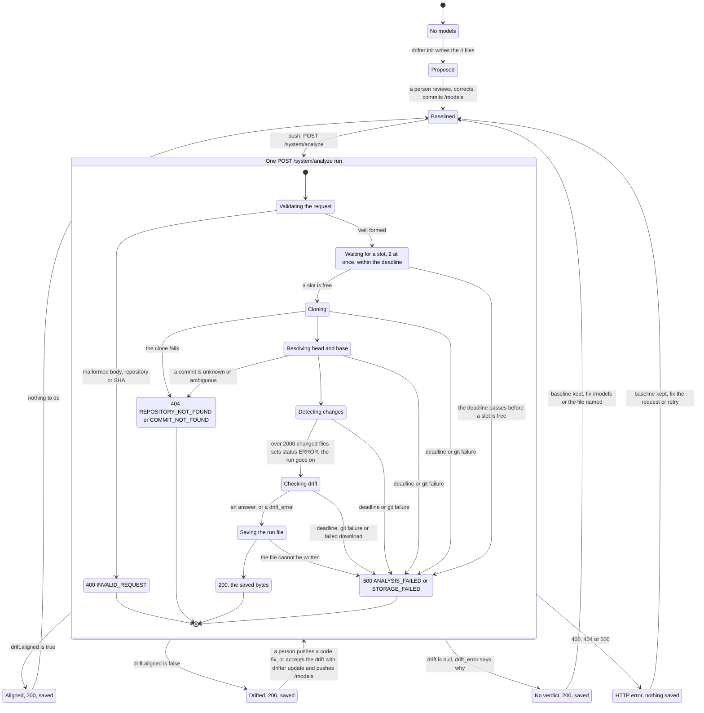

# Behavior: a repository under the tool, and one analyze run

Question: what can happen to a request, and what does the user see?

Two levels in one diagram. The outer states are the lifecycle of a repository: the tool proposes the models once, a person reviews and commits them as the baseline, and every push is then checked against them. The inner states are one check as the hosted service runs it, one `POST /system/analyze` request, in the order the code reaches them.

A run has three kinds of ending. With a **verdict** the answer is 200 and says aligned or drift. With **no verdict** the answer is still 200, with `drift` null and a `drift_error` that says why; it is never read as aligned. With an **HTTP error** the answer is 400, 404 or 500 and carries only a code and a message. Every 200 is saved as a run file and can be read again; an HTTP error saves nothing. Only drift needs a person. The spec (§3.2) calls the last two kinds together "Failed".

## Every ending

What one `POST /system/analyze` can answer. "Saved" means a run file exists and `GET /system/analysis/{analysis_id}` serves the same bytes again.

| Ending | HTTP | What tells it apart | When | Saved |
|---|---|---|---|---|
| Aligned | 200 | `drift.aligned` is `true`; the three lists are empty; `drift_error` is null | the regenerated models match the committed ones and no commit breaks an ownership rule | yes |
| Drift | 200 | `drift.aligned` is `false`; `structural`, `behavioral` and `ownership` list each difference | any of the three lists is not empty | yes |
| No verdict | 200 | `drift` is null; `drift_error.code` is `MODELS_NOT_FOUND`, `INVALID_MODELS`, `FILE_TOO_LARGE` or `PARSE_FAILED`, with a message that names the file | a file in `/models` is missing or invalid; an in-scope file is over 1 MB, not UTF-8 or does not parse | yes |
| Over the change limit | 200 | `status` is `ERROR`; `error.code` is `CHANGE_LIMIT_EXCEEDED`; `changes`, `skipped` and `unmapped` are empty | more than 2000 files changed between base and head. It is not a fourth verdict: `drift` or `drift_error` is filled as in one of the three rows above | yes |
| Bad request | 400 | `code` is `INVALID_REQUEST` | the body is not a JSON object, a field is missing or has the wrong type, the repository is not two names joined by a slash, or a SHA is not 7 to 40 hex digits | no |
| Not found | 404 | `code` is `REPOSITORY_NOT_FOUND` | the clone exits with an error, whatever the cause: no such repository, a repository that is not public, or a network failure. The message always says the repository was not found or is not public. A clone cut off by a time limit is a 500 instead | no |
| Not found | 404 | `code` is `COMMIT_NOT_FOUND` | the head or the base is not a commit of the repository, or a short SHA is ambiguous or on no branch or tag | no |
| Failed | 500 | `code` is `ANALYSIS_FAILED` | the 80 s deadline passes while the run waits for a slot; a git call starts after the deadline or is cut off by it; one git call takes over 60 s; a batched download does not bring every file; any other unexpected failure | no |
| Failed | 500 | `code` is `STORAGE_FAILED` | the run file cannot be written | no |

In every 200, `status` is `SUCCESS` unless the change limit is exceeded, and `issues` is `[]`. An HTTP error's body is only `code` and `message`.

Three limits shape a run. At most 2 runs are past the slot at once; a third waits for one, but only within its own deadline. The 80 s deadline starts when the request arrives, so the wait for a slot counts against it, and a wait that reaches it ends in 500 `ANALYSIS_FAILED`. After the wait the deadline is checked each time git is called, so the work after the last git call, regenerating and comparing, is not cut off by it. One in-scope file may be at most 1 MB. `/system/generate` and the console's `/models/view` wait for the same 2 slots under the same deadline, and `GET /system/health` runs apart from them, so it answers while runs wait.

Reading a run again: `GET /system/analysis/{analysis_id}` answers 200 with the saved bytes, or 404 `ANALYSIS_NOT_FOUND` for an id that is unknown or malformed.

## The same check from the CLI

`drifter check` runs the same check on a local checkout (`data-flow.md`). It prints JSON and saves nothing.

| Ending | Exit code | Printed |
|---|---|---|
| Aligned | 0 | the four-field answer, `aligned` `true` |
| Drift | 1 | the four-field answer, `aligned` `false` |
| No verdict | 2 | `drift` null and the `drift_error` |
| git fails: an unknown commit, or a folder that is no checkout | 1 | a Python traceback, no JSON. The same exit code as drift; row CLI-1 of `docs/decisions/OPEN-DECISIONS.md` asks whether that is a defect |

The CLI has no slot, no deadline, no change limit and no HTTP errors. `drifter init` and `drifter update` end the same way on a no-verdict code: they print the `drift_error`, write nothing and exit 2 (`Source/drifter/cli.py:43-52`).

## The lifecycle's own transitions

- **No models to Proposed.** `drifter init` writes the four files. If one of them exists it writes nothing and exits 1, unless `--force`.
- **Proposed to Baselined.** A person reviews the draft, corrects `ownership.json`, and commits `/models`. This is the only write into the repository, and a person makes it.
- **Drifted and back.** A person either fixes the code, or accepts the drift: `drifter update` rewrites `structural.json` and `behavioral.json`, and the person commits them. An ownership violation is not accepted with `update`: the commit stays in base..head until the base moves past it.

## Premises, verified

Every state, status code and limit above, checked against the code on 2026-11-21 at `21e7921`, and re-cited on 2026-11-22 after E05 moved the slot and the deadline. Paths are under `Source/`.

| Premise | Source | Holds? |
|---|---|---|
| Every error code has one HTTP status: 400 for `INVALID_REQUEST`, 404 for the three not-found codes, 500 for `ANALYSIS_FAILED` and `STORAGE_FAILED`. | `GitHub_Connector/api.py:32-39`, `:70-73` | yes |
| A body FastAPI rejects is answered 400 `INVALID_REQUEST`, never 422. | `GitHub_Connector/api.py:84-102` | yes |
| The repository and each SHA are checked by pattern before any git call: 7 to 40 hex digits for a SHA. | `GitHub_Connector/analysis.py:34-48`, `:88` | yes |
| At most 2 runs hold a slot; the others wait for one only until their own deadline, and a wait that reaches it is 500 `ANALYSIS_FAILED`. `/system/generate` and `/models/view` wait for the same slots the same way. | `GitHub_Connector/analysis.py:51-62`, `:70-82`, `:89`, `:152`; `GitHub_Connector/api.py:178-181`; `GitHub_Connector/settings.py:43` | yes |
| The deadline is 80 s and runs from arrival, the moment the route's function starts, so the wait for a slot counts against it. | `GitHub_Connector/analysis.py:65-67`, `:87`, `:150`; `GitHub_Connector/settings.py:40` | yes |
| `GET /system/health` runs on the event loop, not in the thread pool where waiting checks sit, so it answers while they wait. | `GitHub_Connector/api.py:144-154` | yes |
| The deadline is checked when a git call starts and caps that call; one git call is capped at 60 s. Both end in 500 `ANALYSIS_FAILED`. | `GitHub_Connector/fetch.py:171-182`, `:196-201`; `GitHub_Connector/settings.py:39` | yes |
| Besides the wait for a slot, nothing checks the deadline outside a git call. | `GitHub_Connector/analysis.py:74`, `:162-169`; `drifter/check.py:89-99` | yes |
| A clone that exits non-zero is 404 `REPOSITORY_NOT_FOUND`, whatever made it fail; the code does not tell a missing repository from a network failure. A clone that runs out of time is a 500. | `GitHub_Connector/fetch.py:280-291`, `:178-182` | yes |
| A head or base that does not resolve to a commit is 404 `COMMIT_NOT_FOUND`. | `GitHub_Connector/fetch.py:268-269`, `:294-310` | yes |
| Changes are detected after the commits resolve, before the drift check. | `GitHub_Connector/fetch.py:270-275`; `GitHub_Connector/analysis.py:96-106` | yes |
| Over 2000 changed files sets `status` `ERROR` and `CHANGE_LIMIT_EXCEEDED` and empties the three lists; the result is still built and saved, with the drift answer made before the limit is judged. | `GitHub_Connector/analysis.py:106`, `:115-121`, `:123-141`; `docs/contract/mapping-v1.1.yaml:78` | yes |
| `status` is `ERROR` only for the change limit. | `GitHub_Connector/schemas.py:31-34`; `GitHub_Connector/analysis.py:115-119` | yes |
| A drift error is caught and becomes `drift` null with `drift_error`; it leaves `status` alone. | `GitHub_Connector/analysis.py:162-169` | yes |
| The four no-verdict codes and where each is raised: `MODELS_NOT_FOUND`; `INVALID_MODELS`; `FILE_TOO_LARGE`; `PARSE_FAILED`. | `drifter/check.py:221-223`; `:352-412`; `:243-244`; `:246-249`, `:344-349` and `models/common.py:12-39` | yes |
| A failed or incomplete download inside the drift check is an `AnalysisError`, which the drift check does not catch: 500, not no verdict. | `GitHub_Connector/fetch.py:93-95`, `:106-107`, `:125-129`; `GitHub_Connector/analysis.py:168` | yes |
| Any other failure, a git call that exits non-zero included, is 500 `ANALYSIS_FAILED`. | `GitHub_Connector/fetch.py:183-184`; `GitHub_Connector/api.py:76-81` | yes |
| `aligned` is true only when all three lists are empty. | `drifter/check.py:94-99` | yes |
| `issues` is always `[]`. | `GitHub_Connector/analysis.py:132` | yes |
| The run file is written once, after the clone is gone; a failed write is 500 `STORAGE_FAILED` and leaves no file. | `GitHub_Connector/analysis.py:140-143`; `GitHub_Connector/runs.py:32-44` | yes |
| Every HTTP error is raised before the save, or by it, so none leaves a run file. | `GitHub_Connector/analysis.py:88`, `:89`, `:95`, `:106`, `:141` | yes |
| The 200 body is the saved bytes, and GET serves the file unchanged. | `GitHub_Connector/api.py:105-108`, `:117-125`; `GitHub_Connector/runs.py:17-24` | yes |
| GET answers 404 `ANALYSIS_NOT_FOUND` for an unknown or malformed id. | `GitHub_Connector/api.py:120-124`; `GitHub_Connector/runs.py:14`, `:47-52` | yes |
| An HTTP error's body is `code` and `message`. | `GitHub_Connector/schemas.py:125-128`, `:157-168` | yes |
| The CLI exits 0 when aligned, 1 on drift and 2 with no verdict. | `drifter/cli.py:49-54` | yes |
| The CLI catches only a drift error; a failed git call is uncaught: a traceback and exit 1. | `drifter/cli.py:43-52`; `drifter/check.py:453-455`; `python -m drifter.cli check 0000000` ended in `CalledProcessError`, exit 1 | yes |
| `drifter init` refuses with exit 1 when a file exists and `--force` is absent. | `drifter/cli.py:57-65` | yes |
| `drifter update` rewrites structural and behavioral only. | `drifter/cli.py:46-48`; `drifter/check.py:279-287` | yes |
| An ownership violation is judged per commit in base..head, so regenerating `/models` does not clear it. | `drifter/check.py:167-190`; `GitHub_Connector/fetch.py:135-139` | yes |
