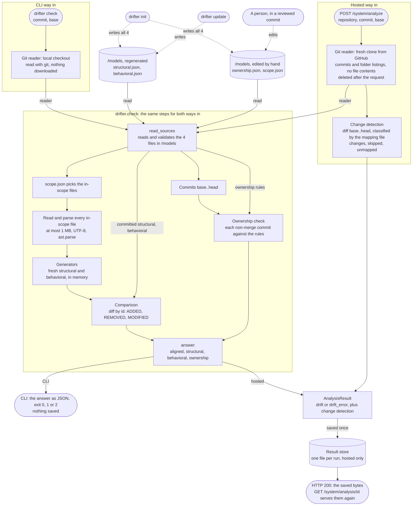

# Data flow of one check

Question: if I change this step, what sees it downstream?

One check has two ways in. The hosted `POST /system/analyze` reads the repository from GitHub through a fresh clone; `drifter check` reads a local checkout. Both hand a git reader to `drifter.check`, which is where they meet: from `read_sources` to `answer` the steps are the same code. A check regenerates `structural.json` and `behavioral.json` in memory and compares them with the committed ones; it only reads `ownership.json` and `scope.json`, which a person edits by hand. A check writes nothing into the repository. Only the hosted way adds change detection and saves the result.

The boxes are those of `dependency.md`: the CLI, the hosted `/system`, the git readers, the generators, the ownership check, the comparison, change detection and the result store. This page draws what flows between them, not who may import whom.

A solid arrow is data flowing during one check. A dotted arrow is a write into `/models`, which happens outside a check. A cylinder is something stored.

## Who writes /models

| Writer | structural.json, behavioral.json | ownership.json, scope.json |
|---|---|---|
| `drifter check`, `POST /system/analyze` | regenerated in memory, never written | read only |
| `drifter init` | written from the code at the commit, with the default scope | written: ownership proposed from all history, scope as the defaults, plus `verbosity` when `--verbosity` gives a level other than 4. With any of the four files present it writes nothing and exits 1, unless `--force`; `--force` replaces all four, hand edits included |
| `drifter update` | rewritten from the code, with the committed `scope.json`, or at the level its `--verbosity` gives | `scope.json` read, and rewritten with the new level only when `--verbosity` is given; `ownership.json` untouched |
| `POST /system/generate` | returned in the response as `drifter init` would write them; nothing is written or saved | the same |
| a person | not by hand: a hand edit that does not match the code is listed on every check, and is drift at the default volatility, 1 (Exact); at a higher volatility it is drift only once the model carries more changes than that level tolerates | edited by hand |

## What sees a change

Each row is one step. "Sees it" lists what is downstream of that step, so what to re-test when the step changes.

| Step | Where | Reads | Hands on | Sees a change to it |
|---|---|---|---|---|
| Hosted git reader | `GitHub_Connector.fetch` | GitHub, over git | a reader of one clone | every hosted route that clones: `/system/analyze`, `/system/generate`, `/models/view`. Not the CLI |
| Local git reader | `drifter.check.LocalReader` | the local checkout | a reader | `drifter check`, `init` and `update`. Not the hosted service |
| Change detection | `GitHub_Connector.fetch`, `.rules`, `.analysis` | the clone's diff, the mapping file | `changes`, `skipped`, `unmapped`, `status` | the hosted result and every run saved after the change. Not the drift answer, not the CLI |
| `read_sources` and its validation | `drifter.check` | the reader, the 4 files in `/models` | files, models, commits | both ways in: the no-verdict codes `MODELS_NOT_FOUND` and `INVALID_MODELS`. Not `init`, `update` or `/system/generate`, which do not call it |
| Scope | `drifter.check.in_scope` | `scope.json`, or the defaults | the in-scope paths | which files reach the generators in a check, `update` and `/models/view`; `init` and `/system/generate` use the defaults |
| Read and parse | `drifter.check._read_files`, `models.common.parse_files` | the in-scope files | text by path | a check, `init`, `update`, `/system/generate`: the no-verdict codes `FILE_TOO_LARGE` and `PARSE_FAILED`. Each generator parses the text again with the same `parse_files` |
| Generators | `models.structural_model`, `models.behavioral_model` | text by path | a fresh model | everything: a check, `init`, `update`, `/system/generate`, `/models/view`. A change in their output shows as drift in every repository until its `/models` is regenerated, and changes the published answers in `docs/contract/model-golden-outputs.json` |
| Comparison | `drifter.check.differences` | fresh and committed model | the `structural` and `behavioral` lists | the answer, both ways in. Its rules are drawn in `model-seam.md` |
| Ownership check | `drifter.check.check_ownership` | `ownership.json`, the commits | the `ownership` list | the answer, both ways in. Its rules are drawn in `model-seam.md` |
| Ownership proposal | `models.ownership_model.propose_ownership` | all history | a proposed `ownership.json` | `init`, `/system/generate`, and `/models/view` for a repository without one. Never a check |
| `answer` | `drifter.check` | the three lists, and `scope.json`'s volatility | the four fields | CLI output and exit code; the `drift` key of the hosted result; every tester that compares it (`docs/contract/pod-contract.md`) |
| Serialise and save | `GitHub_Connector.runs` | the result | one file per run | the bytes of the POST response and of every later GET. Runs already saved are served as they were written |
| Canonical JSON | `models.common.write_model` | a model or the answer | text | the files `init` and `update` write, the CLI's output, `/system/generate` |

`/models/view`, the console's page, reads through `Frontend.model_drift`, not through `read_sources`: it applies no 1 MB limit and none of the validation above (`docs/state/WORK-ITEMS.md`, W3-3). It does take one of the 2 check slots under its own deadline before it clones, as `analyze` and `generate` do, so the page cannot swamp real checks. The route is the console's own and outside the OpenAPI document, so its three optional query parameters are not in the contract (`GitHub_Connector/api.py:170-177`). `verbosity` and `volatility`, each 1 to 4, preview a level without committing it; a value outside 1 to 4 is a 422 before any clone. `panel=off` leaves out the page's own parameter stops, for the console, which frames the page under its own verbosity and volatility sliders (`:238-240`). The page's drift chip counts the differences against the commit before it under the same tolerance as the check (`:211-212`; `Frontend/model_drift.py:67-81`). `Frontend/ui.py`, the console's local server, forwards `/system/` and `/models/` to the API so that the framed page loads (`Frontend/ui.py:20-23`).

## Premises, verified

Every arrow, store and limit above, checked against the code on 2026-11-21 at `21e7921`, and re-cited on 2026-11-22 after E05 moved the slot and the deadline. Re-cited again on 2026-11-22 at `0829935`, after PR #54 to #64 moved `api.py`, `check.py` and `cli.py`; rows that cite only other files are as E05 left them, since those files have not changed. Paths are under `Source/`.

| Premise | Source | Holds? |
|---|---|---|
| `POST /system/analyze` calls `analyze` and returns the bytes that were saved. | `GitHub_Connector/api.py:106-109` | yes |
| `analyze` takes its deadline at arrival, validates, waits for a slot until that deadline, then clones through `fetch` under the same deadline. | `GitHub_Connector/analysis.py:65-90`, `:95` | yes |
| The clone is blobless and without a checkout: commits and folder listings, no file contents. | `GitHub_Connector/fetch.py:280-286` | yes |
| The clone is deleted when the request ends, whatever its ending. | `GitHub_Connector/fetch.py:265-277` | yes |
| With no base given, the base is the head's first parent, on both ways in; a root commit has none. | `GitHub_Connector/fetch.py:269`, `:322-325`; `drifter/check.py:390-396` | yes |
| Change detection is the clone's diff, classified by the mapping file; it does not call `drifter.check`. | `GitHub_Connector/fetch.py:272-274`, `:338-340`, `:371-373`; `GitHub_Connector/analysis.py:96-113`; `GitHub_Connector/rules.py:62-86`; `GitHub_Connector/settings.py:36` | yes |
| The hosted way calls `read_sources`, then `answer`, with the clone as reader. | `GitHub_Connector/analysis.py:167` | yes |
| The CLI calls `local_sources`, which is `read_sources` on a `LocalReader`, then `answer`. | `drifter/cli.py:64`; `drifter/check.py:287-289` | yes |
| `drifter` imports nothing from `GitHub_Connector`, so the CLI has no change detection and no result store. | `drifter/cli.py:18-28`; `drifter/check.py:24-27`; the `core` contract of `.importlinter` | yes |
| `read_sources` reads the 4 files in `/models` first, validates them, then reads the in-scope files that `scope.json` picks: two reads. | `drifter/check.py:292-309` | yes |
| On the hosted way each read is one batched download. | `GitHub_Connector/fetch.py:87-109` | yes |
| An in-scope file is judged by size (1 MB), then UTF-8, then syntax. | `drifter/check.py:38`, `:312-326`, `:436-441` | yes |
| The parser is `ast.parse` of whichever Python runs the tool. Nothing in the code pins it. The package asks for Python 3.12 or newer; the image and CI use 3.12. | `models/common.py:33`; `pyproject.toml:10`; `Dockerfile:3`; `.github/workflows/ci.yml:20` | yes |
| The structural generator also writes text made by `ast.unparse` of the running Python. | `models/structural_model.py:194` | yes |
| Each generator parses the text again with `parse_files`. | `models/structural_model.py:81`; `models/behavioral_model.py:20` | yes |
| Structural and behavioral are regenerated and diffed by id; ownership is judged, never regenerated. | `drifter/check.py:91-107`, `:113-116`, `:184-212`, `:243-266` | yes |
| The commits judged are base..head, or the head alone for a root commit, on both ways in. | `GitHub_Connector/fetch.py:135-139`; `drifter/check.py:426-429` | yes |
| The answer has four fields: `aligned`, `behavioral`, `ownership`, `structural`. | `drifter/check.py:102-107` | yes |
| The CLI prints the answer and exits 0, 1 or 2; it saves nothing. | `drifter/cli.py:64-69`, `:96-99` | yes |
| The hosted result joins the drift answer, or a drift error, with change detection. | `GitHub_Connector/analysis.py:123-139`, `:162-169` | yes |
| A run is saved once, as one file named by its id, after the clone is deleted. | `GitHub_Connector/analysis.py:140-141`; `GitHub_Connector/runs.py:27-44` | yes |
| The result store is `runs_dir`: the Railway volume when one is mounted, otherwise a local `runs` folder. On Railway the app does not start without a volume. | `GitHub_Connector/settings.py:30`, `:50-54`, `:68-71` | yes |
| The POST response and a later GET are the same bytes: one serialiser, and GET returns the file unchanged. | `GitHub_Connector/runs.py:17-24`, `:47-52`; `GitHub_Connector/api.py:118-126` | yes |
| `drifter init` writes four files, refuses with exit 1 when one exists and `--force` is absent, and builds all four before writing any. | `drifter/cli.py:72-80`; `drifter/check.py:339-352` | yes |
| `drifter update` writes structural and behavioral from the committed `scope.json`; with `--verbosity` it also writes `scope.json` with the new level and regenerates at it. | `drifter/cli.py:60-63`; `drifter/check.py:361-379` | yes |
| `POST /system/generate` runs `generate_models` on a clone and saves nothing. | `GitHub_Connector/api.py:112-115`; `GitHub_Connector/analysis.py:147-159` | yes |
| `/models/view` reads through `Frontend.model_drift`, with its own decoding and no size limit. | `GitHub_Connector/api.py:170-243`; `Frontend/model_drift.py:48-64` | yes |
| `/models/view` waits for a check slot under its own deadline, through the same code as `analyze` and `generate`, before it clones. | `GitHub_Connector/api.py:192`; `GitHub_Connector/analysis.py:65-82` | yes |
