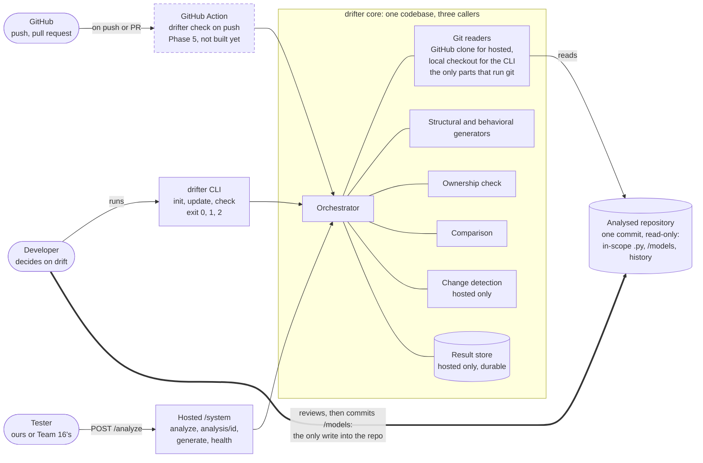

# Who talks to what

Question: who reaches the drifter core, through which entry point, and what does each one read or write?

The developer, GitHub and a tester reach one drifter core through three entry points. The analysed repository is only read; the one write into it is a person committing `/models`. The GitHub Action is Phase 5 and not built yet. Change detection and the result store run only in the hosted service.

Epic: none. This is a standing model. `docs/epics/E01-module-map/` added the module map below.

## Intended structure

The diagram above is unchanged. The module map follows it: which module may import which. The map is the target. Where today's code breaks it, `.importlinter` carries a baseline ignore line (see "Baseline" below). The map names no owners, for any file, folder or layer.

### The four layers

An import points down: a module imports from its own layer or a lower one, never from a higher one. Skipping a layer is allowed.

| Layer | Modules | What it is |
|---|---|---|
| 1. Entry points | `GitHub_Connector.api` | the hosted app: the `/system` routes, the console and the pages |
| | `drifter.cli` | the `drifter` command |
| | `Tester` (the whole package) | the tester: its routes, its HTTP client and its tests |
| 2. Services | `GitHub_Connector.analysis`, `.course`, `.fetch`, `.rules`, `.runs`, `.schemas`, `.settings` | what the hosted app adds around one check: the clone, change detection, the result store, sessions, settings |
| | `Frontend` | the pages: loading, comparing and drawing models |
| 3. Core | `drifter.check` | one check, the readers, scope, the diff and the ownership checker |
| 4. Generators | `models.common` | `parse_files`, `write_model`, the glob |
| | `models.structural_model` | the structural generator and its schema |
| | `models.behavioral_model` | the behavioral generator and its schema |
| | `models.ownership_model` | the ownership proposal, `CommitRecord` and its schema |

The GitHub Action (Phase 5, not built) calls `drifter.cli` and adds no Python package.

`Source/Frontend/ui.py` can also be started on its own for local work (`python Source/Frontend/ui.py`, `Source/Frontend/README.md`). It imports none of the five packages, so it stays under `Frontend` in the services layer and is not a fourth entry point of the map.

### The allowed calls

| Rule | In words | Contract in `.importlinter` |
|---|---|---|
| A1 | Imports point down through the four layers. | `layers` |
| A2 | The three entry points do not import each other. One exception, for as long as one container serves both: `GitHub_Connector.api` imports `Tester.api` to mount the tester's routes. | `layers` (the entry points are independent siblings), with one ignore line that stays |
| A3 | Services may import each other, except that `Frontend` imports no `GitHub_Connector` module. | `layers` and `frontend` |
| A4 | `Tester` reaches the system over HTTP only: it imports none of `GitHub_Connector`, `Frontend` and `drifter`. | `tester` |
| A5 | `Frontend` imports neither `Tester` nor `drifter.check`. The hosted app asks the core and hands `Frontend` the result. | `frontend` |
| A6 | `drifter` and `models` import none of `GitHub_Connector`, `Frontend` and `Tester`. | `core` |

`tests/` is outside the map: a test may import any module.

### Public names

What a module in another package may use. `import-linter` checks modules, not names, so this table is guidance. Each name is one that another package imported on 2026-11-21.

| Package | Public names |
|---|---|
| `models` | `common`: `parse_files`, `write_model`, `glob`, `ParseFailed`. `structural_model`: `generate_structural`. `behavioral_model`: `generate_behavioral`. `ownership_model`: `propose_ownership`, `CommitRecord`, `PathTouch`, `WINDOW`. |
| `drifter` | `check`: `answer`, `read_sources`, `local_sources`, `generate_models`, `regenerate_models`, `proposed_ownership`, `LocalReader`, `DriftError`, `MODEL_FILES`, `DEFAULT_SCOPE`, `GENERATORS`, `in_scope`, `LOG_ARGS`, `REGULAR`. `cli`: `main`. |
| `GitHub_Connector` | `api`: `app`, the object `uvicorn` serves. Nothing else: no other package imports it. |
| `Frontend` | `model_drift`: `committed`, `snapshot`, `drifted`, `SnapshotFailed`, `Verdict`. `model_loader`: `OWNERSHIP_FILE`, `SCOPE_FILE`, `models_from_dicts`. `model_viewer`: `render`. |
| `Tester` | `api`: `router`, for the one exception of A2. |

### The contracts

One file, `.importlinter`, with `root_packages` naming the five packages and five contracts. `unmatched_ignore_imports_alerting` is not set, so it keeps its default, `error`: an ignore line that matches no import fails the run.

| Contract id | Type | What it lists |
|---|---|---|
| `layers` | layers | line 1: `GitHub_Connector.api \| Tester \| drifter.cli`; line 2: the seven `GitHub_Connector` service modules and `Frontend`, joined by `:`; line 3: `drifter.check`; line 4: `models` |
| `tester` | forbidden | source `Tester`; forbidden `GitHub_Connector`, `Frontend`, `drifter` |
| `frontend` | forbidden | source `Frontend`; forbidden `GitHub_Connector`, `Tester`, `drifter.check` |
| `core` | forbidden | sources `drifter`, `models`; forbidden `GitHub_Connector`, `Frontend`, `Tester` |
| `connector` | layers, with `containers = GitHub_Connector` and `exhaustive = true` | line 1: `api`; line 2: the seven service modules, joined by `:`. No ignore line. |

In a layers line, `|` means the modules must not import each other and `:` means they may. With `exhaustive = true`, every module directly inside the container must be on one of the contract's lines, or the contract breaks.

### Baseline: the imports that break the map today

Each is one ignore line in `.importlinter`, with a comment above it that names what removes it or says why it stays.

| Import | Breaks | Ignore line in | Removed by |
|---|---|---|---|
| `GitHub_Connector.api -> Tester.api` | A2 | `layers` | Stays: the allowed exception. W3-6 removes it if the tester is split into its own service. |
| `Frontend.model_drift -> drifter.check` | A5 | `frontend` | W3-3: the page asks the core for the models at a commit. |

### Left out, on purpose

- **A new `GitHub_Connector` module has to be listed twice, and only one of the two is checked.** The `connector` contract breaks until the module is on one of its lines, so CI catches a module nobody listed. Line 2 of the `layers` contract takes no wildcard and has no such check: someone adds the module there by hand, and the two lists can disagree. The four other packages need no such contract: `layers` names `Frontend`, `Tester` and `models` whole, and `drifter` holds only `check` and `cli`, both listed.
- **Names are not checked.** A caller can import a name the Public names table does not list.
- **An import the tool cannot see is not checked:** one built from a string at run time. None exists today.

## Premises, verified

Every fact the structure rests on, checked on 2026-11-21 with `import-linter` 2.17 and `PYTHONPATH=Source`, from the repository root.

| Premise | How verified | Holds? |
|---|---|---|
| The five packages can be analysed, `Frontend` included although it has no `__init__.py`. | `lint-imports` printed `Analyzed 27 files, 47 dependencies.` | yes |
| With no ignore line, exactly two imports break the map: the two in the Baseline table. | `lint-imports` printed `Contracts: 2 kept, 2 broken.` and named `GitHub_Connector.api -> Tester.api` and `Frontend.model_drift -> drifter.check` | yes |
| With the two ignore lines the first four contracts pass. | `lint-imports` printed `Contracts: 4 kept, 0 broken.`, exit 0 | yes |
| With the `connector` contract added, and no ignore line in it, all five pass. | `lint-imports` printed `Every connector module has a layer KEPT` and `Contracts: 5 kept, 0 broken.`, exit 0 | yes |
| A new `GitHub_Connector` module that nobody listed fails the run. | On a copy of `Source/` with an added `GitHub_Connector/eighth.py`: `Every connector module has a layer BROKEN`, `Contracts: 4 kept, 1 broken.`, exit 1, and the output names `GitHub_Connector.eighth` | yes |
| A planted forbidden import fails the run. | On a copy of `Source/` with `from GitHub_Connector import settings` added to `drifter/check.py`: `Contracts: 2 kept, 2 broken.`, exit 1 | yes |
| An ignore line that matches no import fails the run, at the default setting. | With one ignore line pointed at `drifter.cli`: `No matches for ignored import Frontend.model_drift -> drifter.cli.` | yes |
| No module under `Source/` builds an import from a string. | `git grep -n -E "importlib\|__import__\|import_module" -- Source` finds only `from importlib import resources` in `Source/drifter/check.py` | yes |
| `Tester` imports no other package of the five. | `git grep -n -E "^(from\|import) (drifter\|models\|GitHub_Connector\|Frontend)" -- Source/Tester` prints nothing | yes |

## Must stay true

| ID | What must stay true | Check |
|---|---|---|
| INV-3 | Imports under `Source/` follow this map: rules A1 to A6, less the ignore lines listed in `.importlinter`. | `PYTHONPATH=Source lint-imports` ends with `Contracts: 5 kept, 0 broken.`; a step of `.github/workflows/ci.yml` |
| Every connector module has a layer | A module directly inside `GitHub_Connector` is on a line of the `connector` contract. | `PYTHONPATH=Source lint-imports --no-cache \| grep -c "Every connector module has a layer KEPT"` prints `1` |
| The baseline only shrinks | `.importlinter` holds two ignored imports, one in each of two contracts; a third needs the human's approval of the file. | `PYTHONPATH=Source lint-imports --no-cache \| grep -c "KEPT (1 ignored import)"` prints `2`, and the same run ends with `Contracts: 5 kept, 0 broken.`, so the other three contracts ignore nothing |
