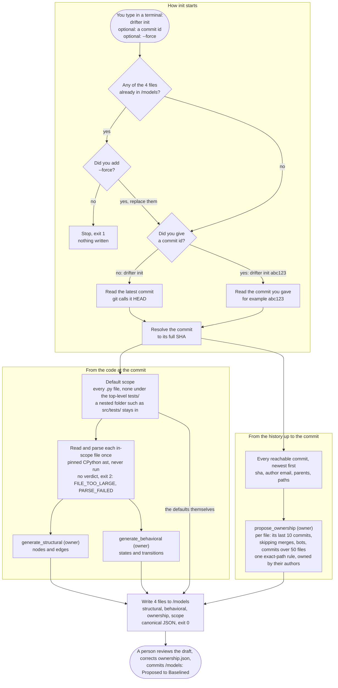

# drifter init, step by step

**`drifter` is our own terminal command, not part of bash.** `pyproject.toml` defines it (`drifter = "drifter.cli:main"`), and installing the project with `pip install .` adds it to the terminal. `init` is one of its subcommands, next to `check` and `update`.

Question: how does a repository get its first `/models`, and where can init stop?

init is the arrow **No models → Proposed** in `behavior.md`. It runs once per repository and writes a draft; it checks nothing. Structural and behavioral come from the code at the commit, ownership from the git history up to it, and scope.json gets the defaults. A person then reviews the draft and commits it as the baseline (spec §3.2, REQ-03). The hosted `POST /system/generate` runs the same `generate_models` on a fresh clone and returns the four files instead of writing them.

## How init starts

You start init by typing one command in a terminal, inside the repository:

```
drifter init
```

That is all most people need. It reads your code at the latest commit and writes four files into `/models`. Two optional extras change what it does:

| You type | What happens |
| --- | --- |
| `drifter init` | Reads the latest commit (git calls it `HEAD`). If `/models` already has any of the four files, it stops and writes nothing |
| `drifter init abc123` | Reads commit `abc123` instead of the latest one |
| `drifter init --force` | Reads the latest commit and **replaces** the files already in `/models`, a hand-corrected ownership.json included |
| `drifter init abc123 --force` | Both: reads commit `abc123` and replaces existing files |

## The steps



Every file is built in memory before any is written, so a stop leaves `/models` as it was. `--force` replaces all four files, a hand-corrected ownership.json included. To accept drift later, use `drifter update`: it rewrites only structural.json and behavioral.json, with the committed scope.
