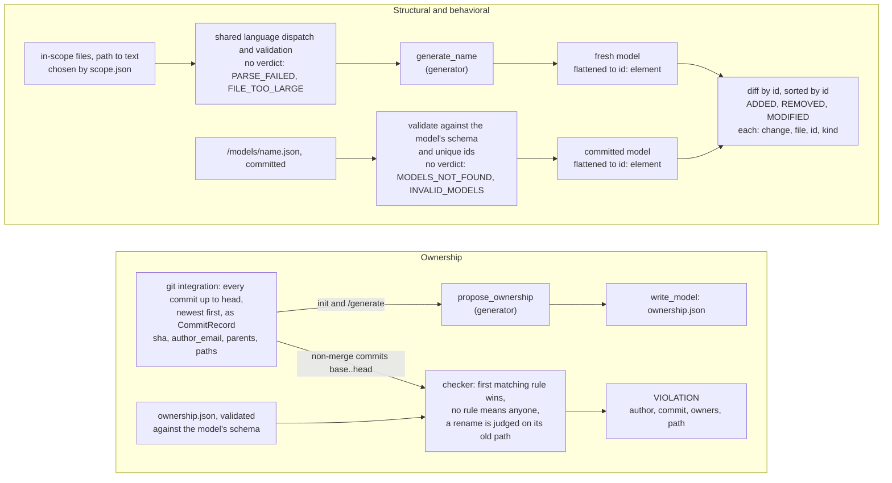

# The model seam

Question: what does each generator write, and what does the core do with it?

Each model's generator and schema decide everything inside that model: kinds, id scheme, attributes, mining rules and the rest of the schema. The core relies only on what this page says. Decided as D9 and D10 in `docs/base/phase4.md`.

## What each part writes

| Part | Writes |
| --- | --- |
| Structural | `generate_structural(files, verbosity=FULL) -> dict` and `structural.schema.json`; element lists `nodes`, `edges` |
| Behavioral | `generate_behavioral(files) -> dict` and `behavioral.schema.json`; element lists of the owner's choice |
| Structural | `generate_structural(files) -> dict` and `structural.schema.json`; element lists `nodes`, `edges` |
| Behavioral | `generate_behavioral(files) -> dict` and `behavioral.schema.json`; element lists of the generator's choice |
| Ownership | `propose_ownership(head_sha, records) -> dict` and `ownership.schema.json`; rules, never diffed |
| Core | `parse_files`, `write_model`, `CommitRecord` (defined in `ownership_model.py`), scope, the diff and the ownership checker (both in `Source/drifter/check.py`), the CLI |

## The element rule (structural and behavioral)

`common.parse_files` dispatches by source extension. Python uses `ast`; JavaScript uses `javascript_model` with pinned Tree-sitter and is lowered into the syntax subset the existing generators consume. The internal AST is never compiled or executed. JavaScript module IDs start with `./` and retain the repository path and extension, keeping them disjoint from Python's slash-free dotted IDs. Source `file` paths remain unchanged. The public generator inputs, element rule and JSON schemas stay the same.

Every top-level list in a model file holds elements. Each element has a unique `id` (unique in the whole model), a `kind` and the in-scope `file` it comes from; every other field is an attribute. Values that are not lists, such as `schema_version`, are not elements and are not diffed.

```json
{
  "schema_version": 1,
  "nodes": [
    {"id": "shop.orders:Order.cancel", "kind": "method", "file": "src/shop/orders.py", "params": ["self", "reason"]}
  ],
  "edges": []
}
```

A generator must be pure (no git, network, clock, randomness or environment), never import or run the analysed code, sort each top-level list by `id`, keep inner lists in a fixed order, leave out line numbers, times and absolute paths, and pin `schema_version` with `const` in its schema.

## Generation parameters

A generation parameter changes what a generator emits. Every one of them is declared in committed `/models`, in `scope.json`, and a check never takes it from a request or a browser: INV-1 fixes the bytes on the repository version, `/models` and the tool version, so a parameter outside those three would end determinism. The models page may preview another value, which changes nothing in the repository. Verbosity is the first, a level from 1 to 4 that says how much of the code the structural model describes, with 4 the default and the bytes the generator wrote before the parameter existed. Only structural has a ladder; behavioral keeps every element at every level while row N2 is unruled, so it is still called with the files alone.

The core applies it through `generate_one(name, files, verbosity)`, which holds the one fact of which generator takes a level, and reads it with `verbosity_of(scope)` over `parameters_of(scope)`, which answers each parameter's default for a scope that declares none or declares a value this build does not allow. Reading is total on purpose: the check validates the scope with `_scope_rule` first and never reaches a fallback, while the console's page reads a scope nothing has validated and must draw something rather than fail.

`PARAMETERS` also declares `volatility`, a check parameter and not a generation parameter: no generator sees it. `answer` reads it through `tolerance_of` and applies it after the comparison and the ownership check, and changes neither: the lists hold every difference whatever the level, and `aligned` is false only when a model carries more differences than the level tolerates (0, 3, 9 or 29 for levels 1 to 4) or the ownership list is not empty. It obeys the same three rules as a generation parameter: its default, 1, leaves every answer as it was; a value outside 1 to 4 is `INVALID_MODELS`; and the check reads it from committed `/models`. The models page's drift chip applies the same tolerance (`Frontend/model_drift.py`).

### Adding the next parameter

`PARAMETERS` in `Source/drifter/check.py` is the declaration: one row per key, its default and the values it allows. `parameters_of` reads from it and `_scope_rule` validates from it, so neither names a parameter: reading and validating, the half that would otherwise be rewritten each time, is general. Applying a parameter is not, and is not pretended to be: `generate_one` names `verbosity` and `"structural"` by hand, and the three generation sites pass the level positionally. So a second generation parameter is a row in `PARAMETERS`, a line in `generate_one`, the argument it adds to its generator, and the three call sites that pass it. Three things stay true however many there are: the default must leave the committed bytes exactly as they were, so a repository that declares nothing never moves; a value the build does not allow is `INVALID_MODELS` and never a quiet default; and the parameter is read from committed `/models` at the commit being judged, and a check never takes it from a request, a flag at check time or a browser, because INV-1 fixes the bytes on the repository version, `/models` and the tool version. A generator keeps a named argument rather than a bag of parameters: this page's first rule is that an owner decides everything inside their model, and that includes their signature. Which parameters come next is undecided. `GENERATORS` is typed `Callable[..., dict]` because its entries no longer share one signature. There are three generation sites, and all three call `generate_one`: `_regenerate` (`drifter init`, `drifter update`, `POST /system/generate`), `model_differences` (the check itself, which does not go through `_regenerate`) and `snapshot` in `Frontend/model_drift.py` (the console's models page, a duplication W3-3 removes). The level a commit is judged at is always the one its own `scope.json` declares, so the regenerated model and the committed one are never at different levels. Editing the level without regenerating shows up as differences by itself, like any other scope edit, and they are drift at volatility 1 (spec §3.2); `drifter update --verbosity` changes the level and regenerates in one step, making it the baseline. Designed in `docs/closed/E02-model-parameters/DESIGN.md`.

## One check

Steps a model's own code does are marked **(generator)**; every other step is the core's. A step that can end the check names its no-verdict code.



`propose_ownership()` returns rules sorted by path, each one exact path with its owners as sorted lowercase emails: `{"rules": [{"owners": ["a@x.com"], "pattern": "src/app.py"}], "schema_version": 1}`. The rest is the generator's own: the window of 10, the 50-file limit and the vendored folders as constants in `ownership_model.py`, a bot being an email containing `[bot]` or one of the addresses in `BOTS`, and no `email:` prefix.

## A generator is ready to plug in when

- Its own snippet goldens pass: small code, exact expected JSON.
- Output is byte-identical on Linux and Windows (REQ-07).
- The shared seam test passes (`tests/common/test_seam.py`): element rule, unique ids, sorted lists, valid against the schema, `write_model` round trip.
