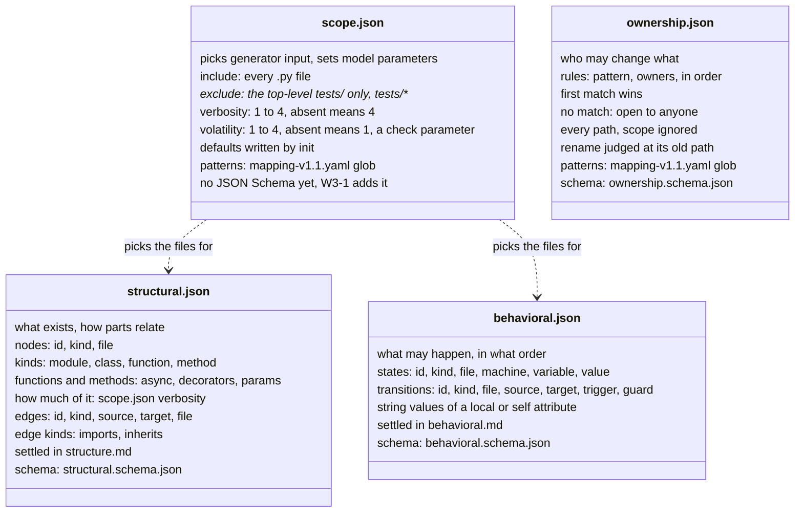

# The /models folder

Question: which four files does `/models` hold, and what does each contain?

Every model file shares one layout: a `schema_version`, sorted keys, 2-space indent, LF, one trailing newline, lists sorted by id, no line numbers (spec §3.2). Structural follows `docs/base/structure.md`. Behavioral follows `docs/base/behavioral.md`. Ownership is checked, never regenerated.

## The verbosity ladder

`scope.json`'s `verbosity` says how much of the code `structural.json` describes. Each level keeps everything the level below it keeps, so a level is a subset of the one above. An absent key means 4, which is what the generator wrote before the parameter existed, so a repository that declares none holds byte-identical models. `drifter init --verbosity` sets it before the first model is generated; afterwards `drifter update --verbosity` changes it, regenerating at the new level and making it the baseline.

The console's models page previews any level without committing one, and says which level it is drawing and which the repository commits. The console previews a volatility level the same way: it frames the page under its own two sliders, one per parameter, and asks for it with `panel=off` so that the sliders are the only control. Rendered to a file by `python -m Frontend.model_viewer`, where there is no server to ask for another level, the page names the level the folder's own `scope.json` declares.

**Change the level with `drifter update --verbosity`, which is one commit.** It writes the new level into `scope.json` and regenerates at it together, so the commit that carries both is aligned. Editing `scope.json` by hand and then running `update` without the flag does **not** work the same way: `update` reads the scope **committed at the commit**, not the working tree, so it regenerates at the old level and leaves the repository in drift. That trap is why the flag exists (verified by hand, 2026-11-22). Without the flag `update` writes the two models and leaves `scope.json` exactly as it was, as it always has.

| Level | Name | `structural.json` holds | Answers |
|---|---|---|---|
| 1 | Overview | the 6 most connected `module` nodes, and the `imports` edges between them | which parts depend on which |
| 2 | Types | up to 12 modules and 8 classes, the most connected of each, with the `imports` and `inherits` edges between kept nodes | plus: which types extend which |
| 3 | Members | up to 20 modules, 15 classes, 20 functions and 20 methods, with no `async`, `decorators` or `params` | plus: what each type and module offers |
| 4 | Full | every node and edge, with `async`, `decorators` and `params` | plus: the signature of each one |

The caps are `BUDGETS` in `Source/models/structural_model.py`. Each kind is ranked by how many edges touch a node across the whole model, most first, with the id breaking ties, so a level's nodes are a subset of the level above. A kind with fewer nodes than its cap keeps them all. The only edges are `imports` and `inherits`, so functions and methods touch none, and their cap keeps the first 20 of each by id.

Level 3 is why `structural.schema.json` holds three node variants and not two: a member named without its signature is neither a `plainNode`, whose `kind` is `class` or `module`, nor a `functionNode`, which requires all three attributes, so it is a `memberNode`. The variant is additive, so `schema_version` stays 1. Behavioral has no ladder: it emits every state and transition at every level while row N2 is unruled. Ownership has none either, being checked and never regenerated. The seam's side of this is "Generation parameters" in `model-seam.md`; the design is `docs/closed/E02-model-parameters/DESIGN.md`.

## Volatility

`scope.json`'s `volatility` is a check parameter: it changes how the check judges the differences it finds, never which differences it finds or what a generator emits. It says how many changed elements one model may carry and still count as aligned, each model counted on its own.

| Level | Name | Changed elements tolerated per model |
|---|---|---|
| 1 | Exact | 0, the default: any difference is drift |
| 2 | Light | 3 |
| 3 | Moderate | 9 |
| 4 | Loose | 29 |

Every difference is still listed at every level; only `aligned` changes. An ownership violation is never tolerated. An absent key means 1, and a value outside 1 to 4 is `INVALID_MODELS`. No command writes the key: `drifter init` leaves it out and a person edits it by hand. Above 1 the answer departs from the pod contract, which says `aligned` needs three empty lists (spec §5.1, row VOL-1). The levels are `TOLERATED` in `Source/drifter/check.py`.

## Who writes /models

| Writer | structural.json, behavioral.json | ownership.json, scope.json |
|---|---|---|
| `drifter check`, `POST /system/analyze` | regenerated in memory, never written | read only |
| `drifter init` | written from the code at the commit, with the default scope | written: ownership proposed from all history, scope as the defaults, plus `verbosity` when `--verbosity` gives a level other than 4. With any of the four files present it writes nothing and exits 1, unless `--force`; `--force` replaces all four, hand edits included |
| `drifter update` | rewritten from the code, with the committed `scope.json`, or at the level its `--verbosity` gives | `scope.json` read, and rewritten with the new level only when `--verbosity` is given; `ownership.json` untouched |
| `POST /system/generate` | returned in the response as `drifter init` would write them; nothing is written or saved | the same |
| a person | not by hand: a hand edit that does not match the code is listed on every check, and is drift at the default volatility, 1 (Exact); at a higher volatility it is drift only once the model carries more changes than that level tolerates | edited by hand |
