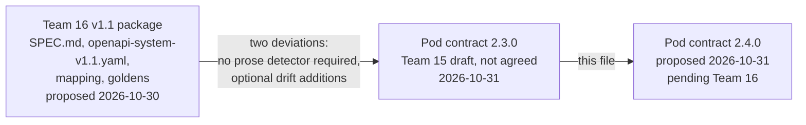
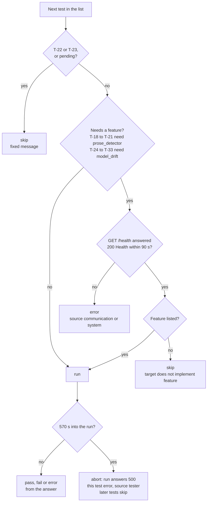
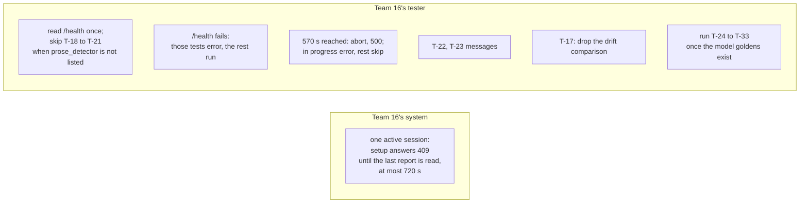

# Contract 2.3.0 to 2.4.0: what changed

Written 2026-10-31 for Teams 15 and 16. History, not instructions: the contract itself is
`docs/contract/`, and where this file and the contract disagree, the contract wins.

Contract 2.4.0 is proposed and waits for Team 16's agreement; Team 16 has agreed to no
version yet (contract section 10). This file says what changed since 2.3.0, why, what it means for each
team's system and tester, and what changed in Team 15's specification alongside it.

## The versions compared

Both contract versions build on Team 16's v1.1 package. `mapping-v1.1.yaml` and
`golden-outputs.json` are byte-identical to v1.1's in both versions. Apart from the new
optional `features` field in `Health`, the dropped 200-character `session_id` cap, the
one-session rule (a new 409 case and its 720 s) and the tester setup limit (90 s to 120 s),
no route, field, enum, error code, fixture, test id, component or other limit number
changed.

## In short

1. **Skip, never fail, a missing feature.** Each system lists what it implements in
   `GET /health` as `features`. A tester reads it once and skips the tests a system cannot
   pass by design. Team 15's system no longer fails T-18, T-19 and T-21, and no longer
   passes T-20 without testing anything.
2. **Rules for the edge cases a tester meets:** what happens when `/health` fails, and when the
   tester stops at 570 s, inside its 600 s run limit.
3. **The drift answer is fully determined:** a fixed order for ownership violations and their
   owners, and the model check runs whatever `status` is.
4. **The acceptance criteria are in the contract**, copied word for word from v1.1.
5. **Less for Team 16's tester in one place:** T-17 no longer compares `drift`.
6. **Both testers check both systems.** Team 16's tester also runs the drift tests T-24 to
   T-33, so whichever tester staff pick, each system's detector is tested.
7. **One active session per system**, as the course asks, so coverage counts only the
   session's own requests. It ends when its report is read, so back-to-back sessions do
   not wait.
8. **Coverage counts only tests the target answered**, not tests that never reached it.
9. **The drift answers publish in two groups:** T-32 as soon as the model fixture exists,
   the rest once Team 15's model formats are settled.
10. **Team 16's system needs one change:** the one-session rule. Their tester needs the
    `/health` read, the drift tests and the new rules (section "What changes for Team 16").

## 1. What changed in the contract

| # | Area | 2.3.0 | 2.4.0 | Why | Where |
| --- | --- | --- | --- | --- | --- |
| 1 | Features | none | `Health` gets an optional `features` list: `prose_detector`, `model_drift`. Absent means `["prose_detector"]` | a tester can tell what a system does by design | md §1, OpenAPI `Health` |
| 2 | T-18, T-19, T-21 on Team 15 | **fail** by design | **skip**: "target does not implement prose_detector" | a fail misreports a system the contract says is correct | md §4 |
| 2a | Who runs T-24 to T-33 | only Team 15's tester | both testers | otherwise Team 16's tester never checks Team 15's model check, and staff pairing it with Team 15's system see only the shared tests | md §1, §4 |
| 2b | T-20 on Team 15 | runs, and passes without testing anything: Team 15's `issues` is always `[]` | **skip**, like the other prose tests | a pass that tests nothing credits C4 and AC-03 for a detector the system does not have | md §4 |
| 3 | Drift tests T-24 to T-33 on Team 16 | skip when the answer has no `drift` key, or `/generate` answers 404 | skip when `/health` does not list `model_drift` | one rule for both directions; a 404 also means `REPOSITORY_NOT_FOUND` or `COMMIT_NOT_FOUND` | md §4, OpenAPI `/generate` |
| 4 | `/health` fails | no rule | only the tests that need a feature are `error`; the rest run; a pending test stays `skip` | one broken route must not hide the results of 20 unrelated tests | md §1, §4, §9 |
| 5 | Run limit | 600 s, no rule for reaching it | the tester stops: the test in progress is `error` (source `tester`), unstarted tests are `skip` | a report with every test, and no coverage credit for tests never run | md §6 |
| 6 | T-17 | identical compared fields, **and identical `drift`** | identical compared fields only, as v1.1 AC-10 | on Team 16's fixture `drift` is always `MODELS_NOT_FOUND`, so it checked nothing | md §4 |
| 7 | Ownership order | "by commit then path" | by commit SHA, then path, compared as strings; `owners` sorted as strings | T-30 compares in order; "by commit" had two readings | OpenAPI `Drift`, `OwnershipViolation` |
| 8 | `drift` when `status` is `ERROR` | undefined | the model check runs whatever `status` is | the model check does not use the change list; the CLI and the hosted service give the same `drift` | md §1, OpenAPI `AnalysisResult.drift` |
| 9 | Acceptance criteria | "AC-01 to AC-10 as in v1.1 SPEC section 10" | the ten copied word for word into §5, plus: for `model_drift`, "doc" means `/models` and a finding means a drift difference | the course asks the pod specification to list them | md §5 |
| 10 | T-22, T-23 messages | none given | "Phase 5" and "checked by inspection" | both testers' reports match | md §4 |
| 11 | `session_id` in system setup | at most 200 characters | no maximum | the cap came from Team 15's old code; v1.1 has none | OpenAPI `TestSetupRequest` |
| 12 | §1 example | `"kind": "node"` | `"kind": "method"` | the structural format (`docs/base/structure.md`) names kinds | md §1 |
| 13 | §1 and §9 wording | "Neither needs any change to Team 16's code" | names what Team 16's tester must change; §9 gains rows for `unmapped`, `features` and the AC list | say plainly what Team 16 is agreeing to | md §1, §9 |
| 14 | Sessions | concurrent sessions allowed; coverage "credited to the most recently set-up session" | one active session: system setup answers 409 for a new id until the active session's `GET /test/report` is read, or for 720 s after its setup | the course: systems "must prevent unintended interference between tests and sessions", and coverage covers "the project requests made in this session"; freeing the session on the report read lets staff run sessions back to back | md §2, §8, §9, OpenAPI `/test/setup` |
| 15 | T-33 | every `/models` file byte-equal | `structural.json`, `behavioral.json` and `scope.json` only | people correct `ownership.json` by hand after init proposes it (Team 15's spec §3.2), so it cannot be regenerated byte for byte | md §3, §4 |
| 16 | Coverage | a test covers when `pass`, `fail` or `error` | only when it got an answer from the target: `pass`, `fail`, or `error` with source `system` | the course counts coverage as "what was covered by tests"; a test that never reached the target covered nothing | md §5 |
| 17 | Publishing the drift answers | all of T-24 to T-33 at once, after the id scheme | two groups: T-32 once the model fixture exists; the rest once Team 15's model formats are settled | T-32 uses only L-pre, which has no `/models`; L0 commits all four model files, so every later case waits for all four formats | md §3, §4 |
| 18 | L7 (T-31) | a hand edit removes a call edge | a hand edit removes an `inherits` edge; T-31 still expects one structural `ADDED` | the structural model has no `calls` edges in `schema_version` 1 (Team 15's `structure.md`) | md §3 |
| 19 | Ownership emails | "Git author email", case not fixed | `author` and `owners` are lowercase emails, compared in lowercase | git may record one person as `Kaan@…` and `kaan@…`; T-30 compares strings exactly, and Team 15's ownership model already lowercases | OpenAPI `OwnershipViolation` |
| 20 | What group 2 waits for | the behavioral format and the scope and ownership rules | the behavioral format and the scope rules | `drifter init` proposes `ownership.json` with exact paths only (Team 15's spec §3.2), so the fixture needs no ownership pattern syntax | md §3 |
| 21 | §1, Team 16's tester | "three changes" | the seven changes, each with its section | the edge-case, message, coverage and run-limit rules were already in 2.4.0 but missing from §1's list | md §1 |
| 22 | Tester setup limit | 90 s, equal to system setup | 120 s; system setup stays 90 s, and the one-session window grows from 700 s to 720 s | the course: tester limits include every call to the target, so a system using its full 90 s setup put the tester over its own limit | md §2, §6, §8, §9 |
| 23 | Where the tester stops | at the 600 s run limit, answering 200 | at 570 s, abandoning the call in progress but still reading the system's `GET /test/report`, as an abort: `POST /test/run` answers 500 with source `tester`, and the stored report is read through `GET /test/report` | staff stop waiting at the registered 600 s, so a report sent at or after 600 s arrives too late, and a 90 s call started just before 600 s would end long after it; the course answers 200 only when the tester finishes, and 500 with a stored report when it aborts | md §1, §6 |
| 24 | Tester's own waits | none | 110 s for system setup (then tester setup answers 500, source `communication`); 15 s for the system's `GET /test/report` (then code coverage is `null` with a basis) | without them a hung system pushes tester setup past 120 s, or the run's report past 600 s | md §1, §6 |
| 25 | The one-session 409 | message not fixed | message "another test session is active", source `system` | the tester forwards a setup error unchanged (course spec), so this text is what a grader reads | md §2, OpenAPI `/test/setup` |
| 26 | `GET /test/report`, system and tester | no 500 listed | 500 listed, source `system` or `tester` | the course: 500 for service failures | both OpenAPI files |
| 27 | §1, §9 wording | "everywhere except two deviations" | two deviations in behavior; §9 lists every difference | §9 lists ten differences, so "except two" read as a contradiction | md §1, OpenAPI header |
| 28 | v1.1 SPEC | cited by section, not in the contract folder | copied unchanged as `spec-v1.1.md`; its `openapi-system-v1.1.yaml` means `pod-contract.openapi.yml`, and the contract wins where they differ | staff and both teams can read every rule the contract cites; the course asks for one specification the pod shares | md header, §10 |
| 29 | For graders | none | a note at the top: Team 15's `issues` is `[]` by design, so it differs from `golden-outputs.json` only in `issues` on the four cases with findings | the course has staff compare responses with the pod specification; without the note, a grader sees wrong answers | md header |

"md" is `pod-contract.md`; "OpenAPI" is `pod-contract.openapi.yml`. `pod-tester.openapi.yml`
changed its version number and its coverage descriptions (row 16).

## 2. How a tester decides each test

In 2.3.0 a tester ran every test and found out from the answer: a missing `drift` key or a
404 meant skip, and a system without a prose detector failed the prose tests. In 2.4.0 the
decision is made once, before the test's first call:

`/health` is read once per run, before T-01. A failed read costs only the 14 tests that need
a feature; T-01 to T-17 run as usual.

## 3. What each system now gets

Expected outcomes, assuming each system works as specified:

| Tests | Team 15's system, 2.3.0 | Team 15's system, 2.4.0 | Team 16's system, 2.3.0 | Team 16's system, 2.4.0 |
| --- | --- | --- | --- | --- |
| T-01 to T-17 | pass | pass | pass | pass |
| T-18, T-19, T-21 | **fail** | skip | pass | pass |
| T-20 | pass, testing nothing | skip | pass | pass |
| T-22, T-23 | skip | skip | skip | skip |
| T-24 to T-33 | skip (pending) | skip (pending) | skip (pending; then no `drift` key) | skip (pending; then no `model_drift`) |

Team 16's system gets the same outcomes; only the reason for its drift skips moved from the
answer to `/health`.

### Effect on coverage

A test counts toward coverage when it got an answer from the target: `pass`, `fail`, or
`error` with source `system` (contract §5). Skipping the four prose tests therefore lowers Team 15's coverage until the
drift tests run:

| Team 15's system | 2.3.0 | 2.4.0 |
| --- | --- | --- |
| Components, now (drift tests pending) | 6 of 7 | 5 of 7: C4 not covered |
| Components, after T-32 is published | 6 of 7 | 6 of 7: C4 through T-32 |
| Criteria, now (drift tests pending) | 8 of 10 | 5 of 10: AC-02, AC-03, AC-04 not covered |
| Criteria, after T-32 is published | 8 of 10 | 5 of 10: T-32 adds only AC-08, already covered |
| Criteria, after all model goldens | 8 of 10 | 7 of 10: AC-04 not covered |

C7, AC-05 and AC-09 are never covered (Phase 5 and inspection). The 2.3.0 numbers came from
tests of a prose detector Team 15 does not have; the course counts coverage as "what was
covered by tests", so 2.4.0's lower number is the accurate one. Team 16's coverage does not
change.

## 4. What changes for Team 16

**System: one change.** System setup answers 409 for a new session id while another session
is active: until that session's `GET /test/report` is read, or for 720 s after its setup
(contract §2). The course asks systems to prevent
interference between sessions and gives exactly this as its example; v1.1 already answers
409 for a repeated id.

Nothing else changes in the system. v1.1's `Health` schema allows extra fields, so
`features` needs no schema change, and a `Health` without `features` counts as `["prose_detector"]`, which is
what Team 16's system is. v1.1 itself records that `/health` was specified because Team 15's
tests expected one (v1.1 SPEC section 11, D11).

**Tester: new in 2.4.0**

1. Read `GET /health` once before T-01 and skip T-18 to T-21 when `prose_detector` is not
   listed, with the message "target does not implement prose_detector".
2. When `/health` gives no 200 `Health` body within 90 s: T-18 to T-21 are `error`
   (source `communication` if nothing answered, `system` otherwise); the other tests run.
3. At 570 s, inside the 600 s run limit: abandon the call in progress and send no more
   project calls, but still read the system's `GET /test/report` for code coverage;
   the test in progress is `error` with source `tester`, unstarted tests are `skip`, both
   with the message "tester run limit reached"; store the report and answer
   `POST /test/run` with 500 and source `tester`, as the course's abort.
4. T-22 and T-23 use the messages "Phase 5" and "checked by inspection".
5. Coverage counts a test only when it got an answer from the target: `pass`, `fail`, or
   `error` with source `system` (contract §5).
6. Register a tester setup limit of 120 s, up from 90 s.
7. Wait at most 110 s for system setup and 15 s for the system's `GET /test/report`
   (contract §6).

**Tester: less work.** T-17 compares only the compared fields, as v1.1 AC-10 already says.

**Tester: unchanged from 2.3.0, but now stated in §1.** Accept `drift` and `drift_error` in an
`AnalysisResult`. v1.1's OpenAPI says implementations "MUST NOT add … fields in
AnalysisResult" and sets `additionalProperties: false`, so a tester that validates answers
strictly against v1.1 fails every `/analyze` test on Team 15's system. Deviation 2 has allowed
these keys since 2.3.0.

**Tester: the drift tests, new in 2.4.0.** Run T-24 to T-33 as Team 15's tester does, once
`model-golden-outputs.json` is published: T-24 to T-32 compare `drift` (and, for T-32,
`drift_error.code`) with the expected answer, a JSON comparison like the one used for
`golden-outputs.json`; T-33 compares three file texts. Against Team 16's own system all ten
skip, because it does not list `model_drift`. Until the file is published they are pending
and skip on every system.

**Requests outside the contract**

- v1.1's OpenAPI describes `unmapped` as "Added or modified … paths", but v1.1 SPEC section
  6.1 and golden case c3 also list RENAMED, COPIED and TYPE_CHANGED paths, and v1.1 SPEC
  section 0 says the OpenAPI wins. The contract follows SPEC 6.1 (§9); Team 16's OpenAPI text
  should say the same.
- A full run makes about 45 calls, about 34 of which analyze a commit. Keeping one clone per
  repository and fetching only missing commits keeps a run well inside 600 s. Team 15 plans
  it (`docs/base/phase4.md` step A); Team 16 may want the same.

## 5. What changes for Team 15's code

Nothing in `Source/` implements 2.4.0 yet. `docs/base/phase4.md` lists the work; the parts
2.4.0 adds or changes:

| Part | Change | Phase 4 step |
| --- | --- | --- |
| System `/health` | return `"features": ["model_drift"]` | A |
| System `/test/setup` | one active session: 409 for a new id until the last session's report is read, or for 720 s after its setup | A |
| System deadline | stop a check at 80 s, so its 500 arrives before the tester's 90 s timeout; a third concurrent check waits within that deadline | A |
| System `/analyze` | run the model check whatever `status` is; sort ownership violations by SHA then path, and owners, as strings | A, C |
| System storage and fetch | keep one clone per repository; fetch only missing commits | A |
| Tester runner | read `/health` once; one table of tests with a feature column; skip, `error` on a failed `/health`, stop at 570 s | B |
| Tester T-17 | no `drift` comparison | B |
| Tester T-22, T-23 | fixed skip messages | B |

## 6. What changed in Team 15's specification and docs

| File | Change |
| --- | --- |
| `docs/base/specifications.md` §1.3, §5.1, [8], Q11 | the contract is 2.4.0, pending Team 16; no version is agreed yet |
| §4.1 | each AC-01 to AC-10 starts with the pod's check as v1.1 words it ("Pod: …"), then "This system: …"; "doc" means `/models` for this system; AC-11 notes that T-30 lists AC-02 |
| §5.1 | new: `GET /system/health` lists `["model_drift"]`, so testers skip the prose tests and run the drift tests |
| §5.2 | ownership sorted by commit SHA, then path, as strings; owners sorted; the model check also runs when `status` is `ERROR` (`CHANGE_LIMIT_EXCEEDED`) |
| header, "How to read" | revised 2026-10-31; `openspec/specs/` marked as not yet existing |
| §2.2 | 80 s per check, under the pod's 90 s per call |
| §4.1 AC-10, §5.3, §7.4 | T-33 compares `structural.json`, `behavioral.json` and `scope.json`, not `ownership.json` |
| §4.2 | five fixture rules, up from three: L4 leaves the structural model unchanged, and every commit except L6 is made by an owner; the fixture's code sits under `src/`; L7 removes an `inherits` edge, since calls are not modelled |
| §3.2, Q11; `docs/base/structure.md` | no `calls` edges in `schema_version` 1; only `src/` is dropped from module ids, and `src/__init__.py` is `src`; a root `__init__.py` is `__init__`; external base classes give no edge; source roots besides `src/` join Q11's path rules |
| §7.3 | a third concurrent check waits within its deadline; one active test session |
| §5.3 | T-18 to T-21 are skipped against this system: T-18, T-19 and T-21 no longer fail, and T-20 no longer passes without testing anything; drift repeatability is checked by Team 15's own tests, no longer by T-17 |
| `docs/base/phase4.md` | step A adds `features`, an 80 s deadline, one active session and clone caching (done when a second `/analyze` on the same repository clones nothing); step B's runner reads `/health` and skips by feature; the test map shows skip instead of fail |
| `docs/README.md` | the contract entry describes feature-based skips; diagram entries updated |
| `docs/models/` | `cross-team-test.png` and `four-field-answer.png` show the `/health` read and feature skips; `models-folder.png` uses the structural kinds of `structure.md` |

Unchanged: the requirements REQ-01 to REQ-07, the cases L-pre to L6 and what each expects,
`GLOSSARY.md` and ADR 0001.

## 7. Still open after 2.4.0

None of these blocks agreeing to 2.4.0. `docs/tickets/contract-contradictions.md` tracks
each with a fix and a check.

- **Model goldens.** `model-golden-outputs.json` and the fixture SHAs are pending (contract
  §3). T-32 can be published once the model fixture exists; the rest wait for Team 15's
  model formats. Each group bumps the version again.
- **`unmapped` wording** in Team 16's v1.1 OpenAPI.
- **Whether Team 15 builds v1.1's prose detector,** so both systems match on T-18 to T-21.
- **c5-docs-only** is the one golden case no test sends.
