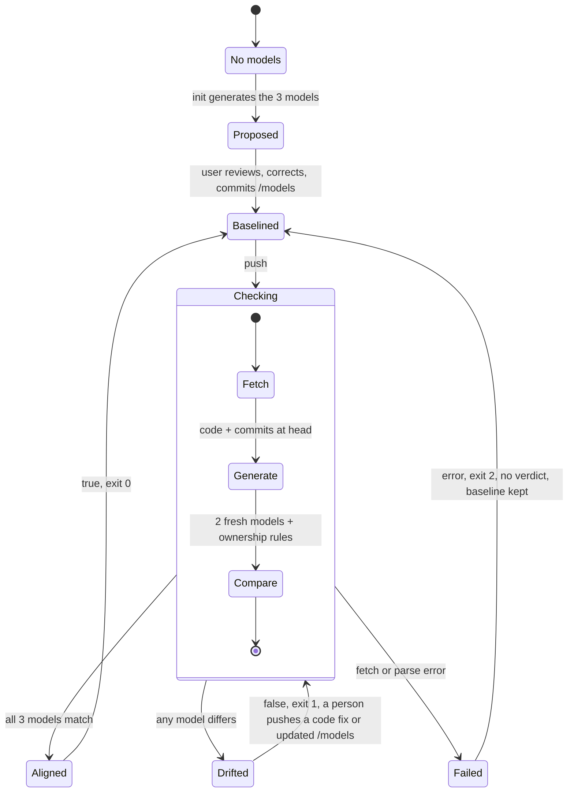

# Lifecycle of a repository under the tool

Question: what states does a repository pass through under the tool, and what moves it between them?

The tool proposes the models once, a person reviews and commits them as the baseline, and every push is then checked against them. A check ends Aligned, Drifted or Failed; only Drifted needs a person. Only structural and behavioral are regenerated; ownership is checked against its rules (spec §3.2).

