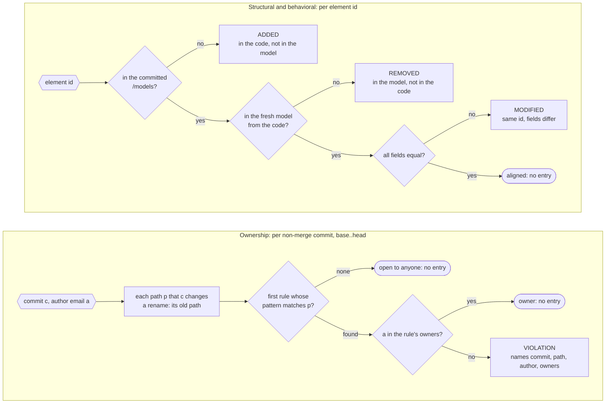

# How differences are decided

Question: when is an element ADDED, REMOVED or MODIFIED, and when is a commit an ownership VIOLATION?

Structural and behavioral are compared by set difference on element id, from the code's side. Ownership is a rule check per non-merge commit between base and head. When both sides are empty, the model is aligned and its list is `[]`.

