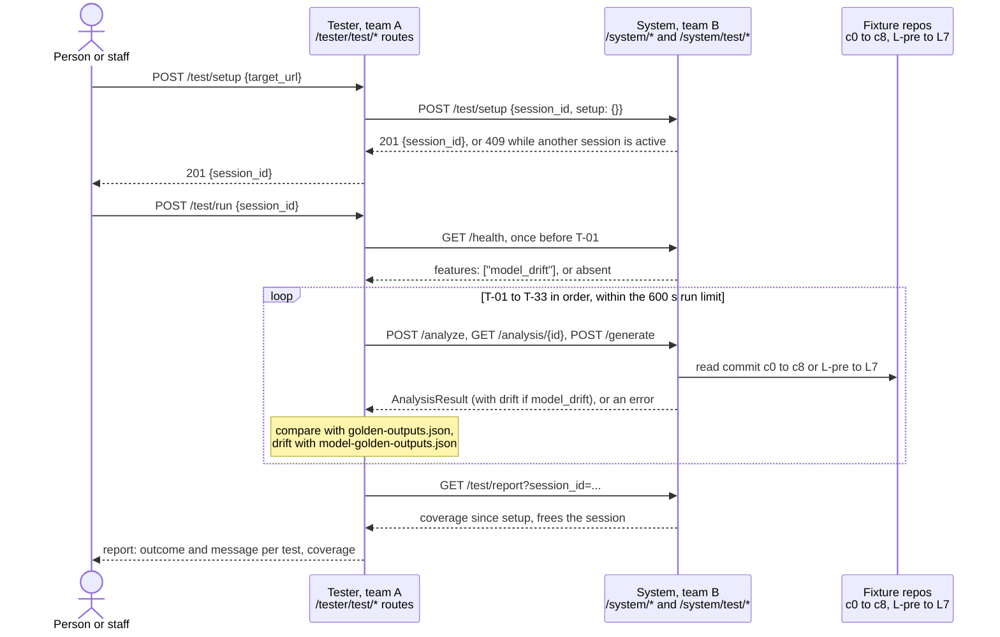

# One cross-team test session

Question: which calls make up one test session between a tester and another team's system, in what order?

As `docs/contract/pod-contract.md` defines it: one active session at a time, `/health` read once before T-01, then T-01 to T-33 in order within the 600 s run limit. Outcomes follow the contract's rules:

- A feature missing from `/health`: skip, "target does not implement <feature>". No test fails for a missing feature (contract §1).
- No 200 from `/health` within 90 s: the tests that need a feature are error.
- T-24 to T-33: skip, "expected answers not yet published", until the model fixture exists.
- At 570 s: the test in progress is error, the rest skip, "tester run limit reached"; `/test/run` then answers 500 with that message.

