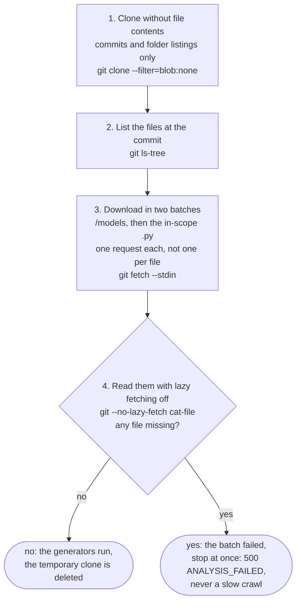

# How a check gets the repository's files

Question: how does one check get every file it needs from GitHub within the 80 s deadline?

One fresh clone per check, files downloaded in batches rather than one by one, nothing kept afterwards. Decided as D11 in `docs/base/phase4.md`, from measurements on real repositories. Today a check makes two batched downloads: `/models` first, because `scope.json` decides which code files are in scope, then the in-scope files (`docs/tickets/tracker-gaps.md` row 3). The times below were measured with one batch.

## Why: time for one check, measured

Home connection, git 2.50; to be measured again on Railway (v1.1). The limit is 80 s per check. The course fixtures have 3 files, where every option takes 1 to 3 s; real repositories decide.

| Option | pytest (274 Python files) | Django (2,939 Python files) |
| --- | --- | --- |
| **Chosen: one batch** | 9 to 13 s | 38 to 41 s |
| Full clone | 26 s | 155 s, over the limit |
| Before #18: file by file | 163 to 221 s, over the limit | over the limit: 81 files read in 90 s |

## Kept simple, and left out

Kept simple: no cache, no locks, no state shared between checks; about 10 lines in the file reader (v1.1); nothing from the repository lands on disk as files; git 2.47 from `python:3.12-slim-trixie` (v1).

Left out, flagged: a retry when the batch download is cut off; a GitHub token for higher rate limits; a clone cache per repository; spotting a file over 1 MB before downloading it.
