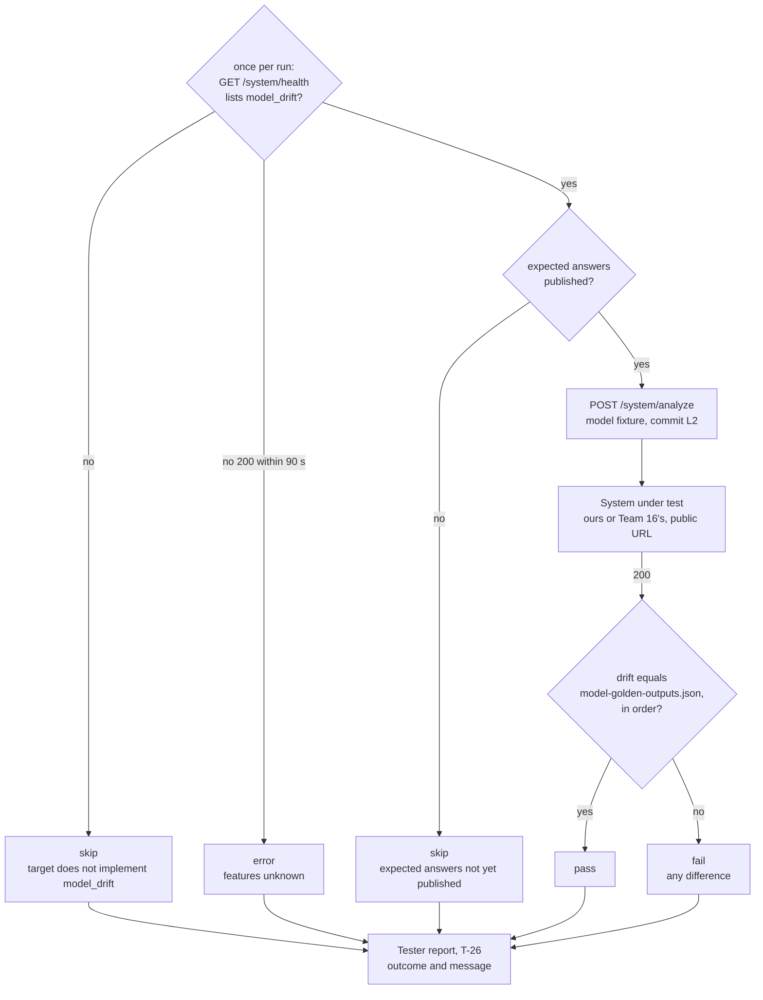

# How a tester grades a drift test (T-26)

Question: how does a tester decide whether a drift test passes, fails or is skipped?

Test T-26 sends case L2 (adds one function) to the system under test and compares the `drift` key of the answer with `docs/contract/model-golden-outputs.json`: equal, in order, passes. Each difference is `change`, `file`, `id`, `kind`, with kinds from `docs/base/structure.md`. Expected for L2:

| Field | Received and expected |
| --- | --- |
| `aligned` | `false` |
| `behavioral` | `[]` |
| `ownership` | `[]` |
| `structural` | one `ADDED` `function` |
| `drift_error` | `null` |

Other tests differ only in what is compared: the error tests T-08 to T-13 check the HTTP status and error code; T-32 (no verdict) checks `drift: null` and `drift_error.code`. T-18 to T-21 skip on a system without `prose_detector`, which is ours.

