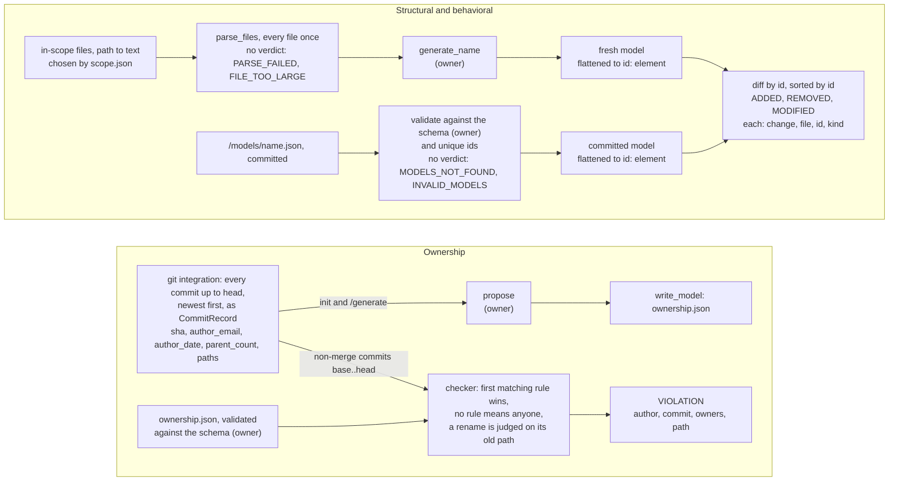

# The model seam

Question: what does each model owner write, and what does the core do with it?

Each owner decides everything inside their model: kinds, id scheme, attributes, mining rules and the rest of the schema. The core relies only on what this page says. Decided as D9 and D10 in `docs/base/phase4.md`.

## Who writes what

| Part | Owner | Writes |
| --- | --- | --- |
| Structural | Enrique | `generate_structural(files) -> dict` and `structural.schema.json`; element lists `nodes`, `edges` |
| Behavioral | Barshan | `generate_behavioral(files) -> dict` and `behavioral.schema.json`; element lists of the owner's choice |
| Ownership | Muhammad | `propose(head_sha, records) -> dict` and `ownership.schema.json`; rules, never diffed |
| Core | Kaan | `parse_files`, `write_model`, `CommitRecord`, scope, the diff, the ownership checker, the CLI |

## The element rule (structural and behavioral)

Every top-level list in a model file holds elements. Each element has a unique `id` (unique in the whole model), a `kind` and the in-scope `file` it comes from; every other field is an attribute. Values that are not lists, such as `schema_version`, are not elements and are not diffed.

```json
{
  "schema_version": 1,
  "nodes": [
    {"id": "shop.orders:Order.cancel", "kind": "method", "file": "src/shop/orders.py", "params": ["self", "reason"]}
  ],
  "edges": []
}
```

A generator must be pure (no git, network, clock, randomness or environment), never import or run the analysed code, sort each top-level list by `id`, keep inner lists in a fixed order, leave out line numbers, times and absolute paths, and pin `schema_version` with `const` in its schema.

## One check

Steps the owners write are marked **(owner)**; every other step is the core's. A step that can end the check names its no-verdict code.



`propose()` returns rules sorted by path, each one exact path with its owners as sorted lowercase emails: `{"rules": [{"owners": ["a@x.com"], "pattern": "src/app.py"}], "schema_version": 1}`. Inside it is Muhammad's: `derive()`, the window of 10, the 50-file limit and the vendored folders as a config file in the tool, a bot being an email containing `[bot]`, and no `email:` prefix.

## Done when (each owner, before plugging in at v1.2)

- Their own snippet goldens pass: small code, exact expected JSON.
- Output is byte-identical on Linux and Windows (REQ-07).
- The shared seam test passes (written by the core in v1.1): element rule, unique ids, sorted lists, valid against the schema, `write_model` round trip.
