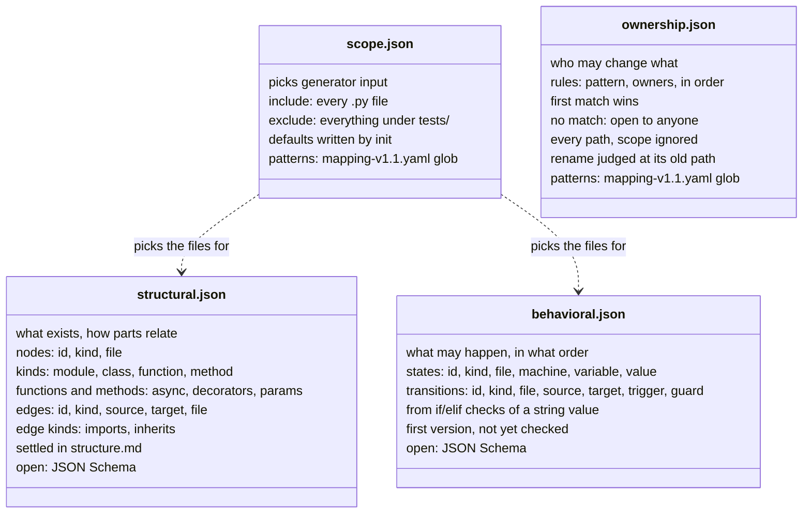

# The /models folder

Question: which four files does `/models` hold, and what does each contain?

Every model file shares one layout: a `schema_version`, sorted keys, 2-space indent, LF, one trailing newline, lists sorted by id, no line numbers (spec §3.2). Structural follows `docs/base/structure.md`. Behavioral shows what the first generator, `Source/models/behavioral_model.py`, writes; it is not yet registered for checks, so `drifter init` still writes a placeholder, and the format may change until Barshan settles it. Ownership is checked, never regenerated.

## How the first behavioral generator finds states

In each function or method defined directly in a module or class, a direct `if` or `elif` that compares a local name or `self.<attribute>` with a string, such as `if self.status == "pending":`, gives one transition when its body's first assignment to that name is another string. The compared string is the source state, the assigned one the target, and the function or method is the `trigger`.

- **Machines:** a `self` attribute belongs to its class's machine (`shop.orders:Order`); a local name belongs to its function's (`shop.orders:advance`). Module and qualified names follow `docs/base/structure.md`.
- **Ids:** `state:` or `transition:` followed by a JSON array of the parts that identify it: file, machine, variable and value for a state; file, trigger, source and target for a transition. No line numbers.
- **Left out:** `else` branches, nested conditions, compound or non-equality guards, Enum members, values that are not string literals, and functions that use `global` or `nonlocal`. A state appears only as the source or target of a transition.
