# One check, step by step

Question: what happens between a request and the four-field answer, and where can a check stop?

Two kinds of stop: an **HTTP error** answers 400, 404 or 500 and saves nothing; **no verdict** keeps HTTP 200 and status SUCCESS, with `drift: null`, a `drift_error` code and CLI exit 2. A check past its 80 s deadline answers 500 ANALYSIS_FAILED.

```mermaid
flowchart LR
    accTitle: One check, step by step
    accDescr: A request is validated, its commits resolved, the files and /models read at the commit and parsed, then the generators and the ownership check feed the comparison, which builds the four-field answer. Each step names the HTTP error or the no-verdict code it can give. The answer goes to the CLI, the hosted service, and in Phase 5 to a pull-request check.

    Req[Request<br/>repo, commit, base?<br/>CLI, Action or /system]
    Val[Validate<br/>owner/name, 7 to 40 hex<br/>HTTP error: 400 INVALID_REQUEST]
    Res[Resolve commits<br/>short SHA to full, root: base null<br/>HTTP error: 404 REPOSITORY or COMMIT_NOT_FOUND]
    Read[Read at commit<br/>scope.json, in-scope files, /models<br/>no verdict: MODELS_NOT_FOUND, INVALID_MODELS]
    Parse[Parse every file once<br/>pinned CPython ast, never run<br/>no verdict: PARSE_FAILED, FILE_TOO_LARGE]
    Gen[Structural and behavioral<br/>generators: 2 fresh models]
    Own[Ownership check<br/>commits base..head against rules]
    Cmp[Compare<br/>committed vs fresh by id<br/>plus ownership violations]
    Ans[Answer: 4 fields<br/>aligned, structural, behavioral, ownership]
    Out1[CLI: JSON and exit code<br/>0 true, 1 drift, 2 error]
    Out2[HTTP 200 AnalysisResult<br/>drift key, hosted also saves it<br/>HTTP error: 500 STORAGE_FAILED]
    Out3[PR check and artifact<br/>Phase 5, not built yet]

    Req --> Val --> Res --> Read --> Parse --> Gen --> Cmp
    Read -- commits base..head --> Own --> Cmp
    Read -- committed /models --> Cmp
    Cmp --> Ans
    Ans --> Out1 & Out2 & Out3

    style Out3 stroke-dasharray: 6 4
```

