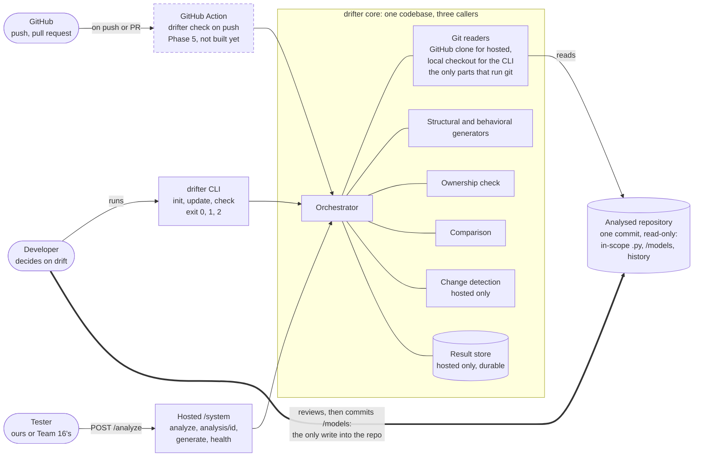

# Who talks to what

Question: who reaches the drifter core, through which entry point, and what does each one read or write?

The developer, GitHub and a tester reach one drifter core through three entry points. The analysed repository is only read; the one write into it is a person committing `/models`. The GitHub Action is Phase 5 and not built yet. Change detection and the result store run only in the hosted service.

