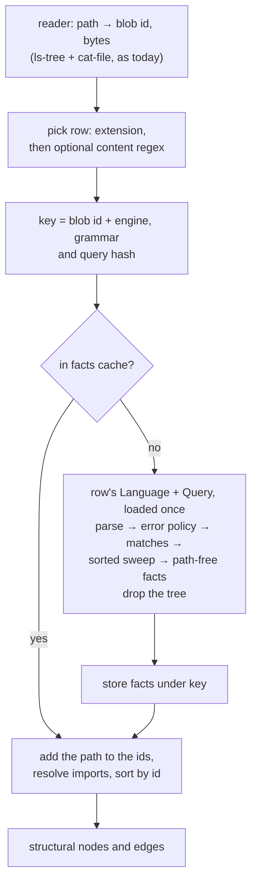

# Research: how to build the one-template engine

Question: what is the best way to build the engine of `04-one-template.md`, ranked by (1) CPU time and memory per check on large real repos, (2) scaling to many languages and large repos, and to adding a language without code, (3) ease of building and understanding, while keeping the hard rules of `docs/diagrams/model-seam.md` (pure, never run the analysed code, sorted by id, byte-identical on Linux and Windows, no line numbers)?

Measured 2026-11-02 on Windows 11 Home 10.0.26200, Intel Core Ultra 9 185H (16 cores, 22 threads), 32 GB, Python 3.13.13, `tree-sitter` 0.26.0 and the grammar wheels pinned in `04-one-template.md`. The corpus was 15 public repositories, shallow-cloned at pinned tags as data only (never built, installed or run), and read from git blobs with `ls-tree` + `cat-file --batch`, as `check.py` does. Scripts were kept in the session scratchpad (`engbench/`), not in the repo. Linux was not re-measured.

## 1. Options compared

Scores: ●●● good, ●●○ fair, ●○○ poor. Each number is either from section 2 or a cited source.

| Option | Efficient | Scalable | Easy | Verdict |
| --- | --- | --- | --- | --- |
| A. Prototype as it is: a `Query` compiled for every file, pairwise nesting, all trees kept | ●○○ Compiling per file costs 0.5 to 112 ms per file (Swift 112 ms). On webpack that is about 26 s. Pairwise nesting is 7.3x slower than a sweep. Keeping every tree reached 713 MB | ●○○ | ●●● | Fix, do not ship |
| **B. py-tree-sitter in-process, `Language` and `Query` cached per row, streaming, sorted-sweep nesting** | ●●● 4.15 M lines in 18.2 s on one core, about 228k lines/s. Peak memory 28 to 103 MB | ●●● A language stays one row and one `.scm` | ●●● One loop | **Base of the recommendation** |
| B + threads | ●○○ No gain: 2.73 s serial vs 2.75 to 2.88 s with 2 to 8 threads. The binding holds the GIL during parse and query [1] | — | ●●○ | Reject |
| B + process pool | ●●○ 4.2x with 8 workers (Java 3.08 → 0.71 s). Pool start costs 0.22 s on Windows | ●●● | ●●○ Pickling, `spawn` | Optional, only above a file-count threshold |
| **B + blob-SHA cache of per-file facts** | ●●● Two-commit drift: 64,748 → 26,936 parses (−58 %) using an in-memory cache only. With a cache kept between runs, 400 new blobs (0.6 %). A cache hit (JSON reload) costs 3 to 53 µs per file | ●●● | ●●○ The key must cover every input | **Recommended**: in-memory first, persistent later |
| C. Reuse grammars' shipped `tags.scm` with `tree-sitter-tags` | — | ●○○ No `@param`, `@import`, `@inherits` or `@async`. The crate rejects any other capture name [3]. Kotlin and Objective-C ship no `tags.scm`, and TypeScript's lacks `class_declaration` | ●●○ | Reject. Use them as a starting point only, as Aider does [4] |
| D. Rust core (PyO3/maturin + rayon) | ●●○ Parsing is already C. At most the query and post-processing share moves out: 6.3 of 18.2 s (35 %) | ●○○ Grammars compiled into the wheel, so a new language means a new build, unless grammars load dynamically | ●○○ Rust toolchain, wheels for every OS | Reject: the speed-up cap is small and processes give 4x |
| E. ast-grep-py | ●○○ 1.5 to 1.7x slower than B (Java 4.17 vs 2.71 s, Go 2.54 vs 1.51 s), before any extraction | ●○○ No Objective-C. Fixed list of 27 bundled grammars [9]. Other languages need a compiled library plus `sgconfig.yml` [11] | ●●○ Its own rule language, not `.scm` | Reject |

## 2. Benchmarks (single process, one core, one run each)

Columns are seconds unless marked. "Compile/file" is the cost the prototype pays again for every file. "Post" is the Python step from matches to nodes and edges: the sorted sweep (B) and the prototype's pairwise loop (A). B gave the same nodes as A for **all 32,393 files**.

| Repo @ tag | Lang | Files | kLOC | Load | Compile | Compile/file (ms) | Parse | Query | Post B | Post A | Peak MB, streaming | Peak MB, all trees kept |
| --- | --- | --- | --- | --- | --- | --- | --- | --- | --- | --- | --- | --- |
| nestjs/nest v12.3.2 | TS | 2176 | 216 | 0.027 | 0.007 | 6.1 | 0.56 | 0.26 | 0.06 | 0.26 | 41 | 207 |
| webpack/webpack v5.112.2 | JS | 17462 | 683 | 0.027 | 0.002 | 1.5 | 1.86 | 0.86 | 0.15 | 1.85 | 85 | 556 |
| google/guava v33.7.2 | Java | 3227 | 793 | 0.029 | 0.001 | 1.1 | 2.04 | 0.98 | 0.30 | 1.80 | 103 | 611 |
| prometheus v3.15.1 | Go | 731 | 380 | 0.027 | 0.001 | 0.6 | 1.08 | 0.47 | 0.07 | 0.61 | 62 | 350 |
| tokio-1.54.1 | Rust | 811 | 188 | 0.028 | 0.005 | 3.6 | 0.49 | 0.25 | 0.04 | 0.15 | 36 | 191 |
| redis 8.10.3 | C | 786 | 375 | 0.031 | 0.003 | 2.9 | 1.11 | 0.41 | 0.08 | 0.73 | 53 | 288 |
| fmtlib/fmt 12.2.0 | C++ | 71 | 69 | 0.028 | 0.022 | 20.5 | 0.29 | 0.09 | 0.02 | 0.59 | 44 | 75 |
| square/okhttp 5.5.1 | Kotlin | 624 | 143 | 0.024 | 0.009 | 8.1 | 0.56 | 0.17 | 0.05 | 0.19 | 41 | 143 |
| Newtonsoft.Json 13.0.4 | C# | 944 | 192 | 0.026 | 0.013 | 9.0 | 0.72 | 0.21 | 0.04 | 0.25 | 50 | 217 |
| Alamofire 5.12.2 | Swift | 101 | 44 | 0.003 | 0.116 | 111.9 | 0.18 | 0.05 | 0.01 | 0.07 | 31 | 66 |
| laravel/framework v13.39.0 | PHP | 3170 | 582 | 0.028 | 0.004 | 4.0 | 1.60 | 0.80 | 0.18 | 1.23 | 91 | 713 |
| sinatra v4.2.1 | Ruby | 147 | 24 | 0.026 | 0.020 | 20.6 | 0.08 | 0.04 | 0.01 | 0.03 | 28 | 57 |
| AFNetworking 4.0.1 | ObjC | 80 | 15 | 0.024 | 0.077 | 79.8 | 0.06 | 0.02 | 0.00 | 0.02 | 31 | 37 |
| playframework 3.0.12 | Scala | 803 | 114 | 0.030 | 0.019 | 19.1 | 0.54 | 0.17 | 0.06 | 0.24 | 40 | 154 |
| kong 3.9.4 | Lua | 1260 | 331 | 0.028 | 0.001 | 0.5 | 0.75 | 0.41 | 0.04 | 0.18 | 40 | 285 |
| **Total** | 15 | **32,393** | **4,149** | | | | **11.9** | **5.2** | **1.1** | **8.2** | | |

What the numbers say:

1. **Parsing is 65 % of the time and runs in C.** Query is 28 %, Python post-processing (B) 6 %, reading the git blobs 1.7 s in total. Throughput: about 1,780 files/s and 228k lines/s on one core. The largest repo (Guava, 793 kLOC) takes 3.3 s, far inside the 80 s deadline.
2. **Load and compile once per row.** Loading a grammar takes about 27 ms (the import) and compiling its query 1 to 116 ms. Load only the rows whose extensions occur in the repo.
3. **Do not keep trees.** Keeping every tree, as `parse_files` does for `ast` today, costs 3 to 8 times the memory (713 MB for Laravel). Turn each tree into facts and drop it.
4. **Threads do not help.** In py-tree-sitter 0.26.0, `Parser.parse` calls `ts_parser_parse*` and `QueryCursor.matches` calls `ts_query_cursor_next_match` without `Py_BEGIN_ALLOW_THREADS`. The GIL is released only around dot-graph printing. On free-threaded builds the module declares `Py_MOD_GIL_USED` [1].
5. **Processes do help.** Same facts byte for byte. Wall time with 2 / 4 / 8 / 16 workers: JS 1.70 / 1.01 / 0.73 / 0.70 s (serial 2.73). Java 1.87 / 1.02 / 0.71 / 0.63 s (serial 3.08). PHP 1.57 / 0.99 / 0.60 / 0.62 s (serial 2.57). Above 8 workers there is no gain.
6. **The blob-SHA cache is the largest lever.** Between the two tags of each repo, only **400 of 32,393** in-scope blobs were new (1.2 %). A console drift (two commits) needed 64,748 parses naively and **26,936 distinct blobs**. That is −58 % from an in-memory dict within one run, with no state kept on disk. Repeated blobs inside one commit help too: webpack 17,462 files → 13,176 blobs, Guava 3,227 → 1,924. Cached facts as JSON: 0.2 to 23 MB per repo, reloaded in 1 to 170 ms.

## 3. PARSE_FAILED on real code (`root_node.has_error`, same 15 repos)

| Lang | Failed / files | % | Outside test/fixture paths | First error, typical case |
| --- | --- | --- | --- | --- |
| Go, Rust, Ruby, Scala | 0 | 0 | 0 | — |
| PHP | 1 / 3170 | 0.03 | 0 | `Fixtures/bad-syntax-strategy.php`, deliberately invalid |
| Lua | 1 / 1260 | 0.1 | 0 | `spec/fixtures/invalid-module.lua`, deliberately invalid |
| TypeScript | 2 / 2176 | 0.1 | 0 | `@((` decorator tests in `*.spec.ts` |
| Java | 13 / 3227 | 0.4 | 13 | `@Nullable Object @Nullable ... args` (a type annotation on varargs) in Guava's main sources |
| JavaScript | 230 / 17462 | 1.3 | 0 | webpack test cases and examples, for example `import source x from "./a.wasm"` |
| Kotlin | 8 / 624 | 1.3 | 8 | `@Synchronized set(value)`, `.kts` imports |
| Swift | 5 / 101 | 5.0 | 3 | `.success(())`, `#error("…")` |
| C# | 65 / 944 | 6.9 | 65 | `#pragma warning restore` near `#endif`. A UTF-8 BOM is not the cause (checked) |
| Objective-C | 20 / 80 | 25 | 18 (9 of the 14 library files) | `NS_ASSUME_NONNULL_BEGIN`, `typedef NS_ENUM(...)` macros |
| C | 347 / 786 | 44 | 218 (`src/` 23 %, vendored `deps/` 57 %) | `#ifdef __cplusplus` around `extern "C" {`, macros like `EV_P_` |
| C++ | 37 / 71 | 52 | 18 (14 of the 15 `include/` headers) | `FMT_BEGIN_NAMESPACE`, `FMT_PRAGMA_GCC(...)` |

The rule "any error node → PARSE_FAILED for the whole check" therefore gives **no verdict on almost any real C, C++ or Objective-C repo**, and on most C#, Swift, Kotlin and Java repos. tree-sitter does not run the preprocessor, so macro-heavy code is the main cause. difftastic hit the same problem and made the tolerance a setting (`--parse-error-limit`, default 0, which falls back to a line diff). Its README advises allowing "a small number of parse errors" and names C++ preprocessing as one cause [14].

## 4. How existing multi-language tools are built

| Tool | Per-language data | Registry | Cache | Errors |
| --- | --- | --- | --- | --- |
| Aider repo map | One `*-tags.scm` per language, vendored, written in the tags vocabulary | `grep_ast.filename_to_lang` | `diskcache` keyed by file name + mtime. It compiles `Query(...)` again for every file [4] | Ignored, tags taken anyway |
| GitHub code navigation (stack graphs) | One graph DSL file per language | — | **Facts per file, keyed by git blob id**. "Most commits change a small fraction of files" [5][6][7] | — |
| tree-sitter `tags` | `queries/tags.scm` in each grammar repo, with a fixed `@definition.*` / `@reference.*` vocabulary [2] | Grammar `tree-sitter.json` | None | — |
| Helix | `runtime/queries/<lang>/*.scm` | One `languages.toml` row per language and grammar [12] | — | — |
| difftastic | Highlight query + `atom_nodes` per language | One arm in `tree_sitter_parser.rs` plus `guess_language.rs` [13] | — | Error limit, then fall back [14] |

Shared pattern: **a registry row + query files per language + one generic engine**, which is what 04 already proposes. Only GitHub caches, and it keys by blob id.

## 5. Language detection beyond the extension

GitHub Linguist resolves `.m` with rules tried in order. Objective-C comes first, through the named pattern `^\s*(@(interface|class|protocol|property|end|synchronised|selector|implementation)\b|#import\s+.+\.h[">])`. MATLAB matches later, on `^\s*%` or `function … (` lines. `.h` is tried as Objective-C, then C++ (a `cpp` pattern list: `template <`, `namespace x`, `std::`, …), then C [8]. Tested locally: the Objective-C pattern matched **49 of 49** real AFNetworking `.m` files and did not match a MATLAB sample. Simplest deterministic rule: an optional `content` regex in the language row, applied to the bytes. A `.m` file that does not match is **out of scope**, not `PARSE_FAILED`.

## 6. Recommendation

**Option B plus an in-memory blob-SHA cache of path-free facts.** It stays one Python loop over the existing py-tree-sitter wheels. A process pool and a persistent cache are later switches, not part of v1.

What it changes in `04-one-template.md`:

| 04 today | Change |
| --- | --- |
| "parse, check has_error, run query" per file | Load `Language` and `Query` **once per row, lazily**. Parse the raw **bytes** (no decode then encode), stream, never keep trees |
| Nesting "by byte range" | Say how: **one sort by (start, −end) and a stack**, O(n log n). The prototype's pairwise test is 7.3x slower and gave the same output |
| Ids built during extraction | Extract **path-free facts per blob**, then add the path. This makes the blob cache correct, and identical files share one parse |
| No caching | In-memory `dict[(blob_sha, engine_key)] → facts` per run. `engine_key` = engine version + grammar wheel version + SHA-256 of the `.scm`. A disk cache later. The generator stays pure because the cache is core-side and keyed only by content |
| `parse_files` then the generator: each file parsed twice (`check.py` `_read_files` + generator) | Parse once. The facts carry `has_error` |
| "`PARSE_FAILED` on any error node" | Measured as untenable for C, C++, Objective-C and C# (section 3). The team must choose: (a) admit a language only at 0 % non-test failures on its reference corpus, which today excludes C, C++, Objective-C, C#, Swift, Kotlin and Java, or (b) a per-row error policy that skips facts inside `ERROR` subtrees and reports the file instead of blocking the check. Both stay deterministic |
| Limit 9: drop `**/*.m` from the default scope | Row field `content = "<Linguist objectivec pattern>"`. Use the same idea for `.h` (C, C++ or Objective-C) |
| — | Process pool: a row-independent option above about 5,000 files. Threads never |

## 7. Open risks / not verified

| Item | Note |
| --- | --- |
| Linux timings and byte-identity of facts | Not re-run. The earlier research found identical output across OSes [15] |
| `post_fast` vs prototype | Same nodes on all 32,393 files. Edges were not compared separately |
| Persistent cache location | Docker or CI runs may start cold. Where to keep it (Actions cache, a volume) is not designed. Only the in-memory part was measured |
| Process pool on Linux | `fork` should start faster than the 0.22 s `spawn` measured on Windows. Not measured |
| Rust core gain | Estimated from the phase split (at most 35 % on one core), not built |
| Sourcegraph scip-syntax and syntax-highlighter | Not read. Left out of section 4 |
| Test-path classification | A regex on `test/`, `fixtures/`, `spec/` and `examples/`. Whether each failing test file is deliberately invalid was not checked, except where its name says so |
| Corpus size | One repo per language. C, C++ and Objective-C rates are likely typical of macro-heavy code, but not proven on a second repo |
| Free-threaded CPython | Not tried. The binding declares that it needs the GIL [1] |

## References

1. py-tree-sitter v0.26.0 (commit a9e753ef): `tree_sitter/binding/parser.c` lines 152–182 (parse, no GIL release) and 228–230 (release only for `print_dot_graphs`), `tree.c` 101–103, `query_cursor.c` 132–140, `module.c` 150–151 (`Py_MOD_GIL_USED`): https://github.com/tree-sitter/py-tree-sitter/tree/v0.26.0/tree_sitter/binding
2. Tree-sitter code navigation, the tags vocabulary and `queries/tags.scm`: https://tree-sitter.github.io/tree-sitter/4-code-navigation.html
3. `tree-sitter-tags` `tags.rs` (`InvalidCapture`: "Expected one of: @definition.*, @reference.*, @doc, @name, @local.*"): https://github.com/tree-sitter/tree-sitter/blob/master/crates/tags/src/tags.rs. `Tag` struct: https://docs.rs/tree-sitter-tags/latest/tree_sitter_tags/struct.Tag.html
4. Aider `repomap.py` (diskcache, key = file name + mtime, `Query` built for each file, `*-tags.scm` per language): https://github.com/Aider-AI/aider/blob/main/aider/repomap.py
5. Creager and van Antwerpen, "Stack graphs" (file-incremental, git blob identifiers): https://arxiv.org/abs/2211.01224
6. github/stack-graphs discussion #263 ("stored based on the Git blob oid", only if the result depends on content alone): https://github.com/github/stack-graphs/discussions/263
7. GitHub blog, "Introducing stack graphs": https://github.blog/open-source/introducing-stack-graphs/
8. GitHub Linguist `heuristics.yml` at 73ee9a3 (`.m` and `.h` rules, `objectivec` and `cpp` named patterns): https://github.com/github-linguist/linguist/blob/73ee9a3b277f398c37ca4ab0dea0193849de6460/lib/linguist/heuristics.yml
9. ast-grep built-in languages: https://ast-grep.github.io/reference/languages.html
10. ast-grep-py 0.51.1 on PyPI (MIT): https://pypi.org/project/ast-grep-py/
11. ast-grep custom languages (`customLanguages`, `libraryPath`) and Python API `SgRoot(src: str, language: str)`: https://ast-grep.github.io/advanced/custom-language.html and https://ast-grep.github.io/guide/api-usage/py-api.html
12. Helix, adding languages (`languages.toml`, `runtime/queries/<lang>/`): https://docs.helix-editor.com/guides/adding_languages.html
13. difftastic, adding a parser: https://difftastic.wilfred.me.uk/adding_a_parser.html
14. difftastic parse errors: README "What about parse errors?" https://github.com/Wilfred/difftastic and `src/options.rs` (`DEFAULT_PARSE_ERROR_LIMIT = 0`): https://github.com/Wilfred/difftastic/blob/master/src/options.rs
15. `docs/proposals/language-engine/research-multi-language.md`, section 2 (determinism across OSes)
