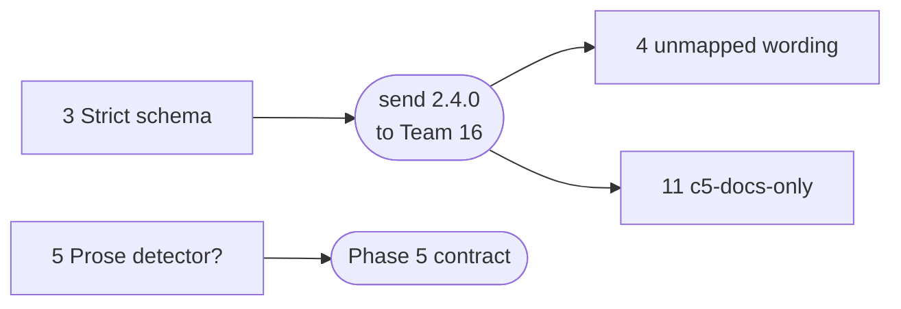

# Tickets: contradictions in the contract, spec and docs

Written 2026-10-31. Each ticket is one place where two sources disagree: our contract, our
spec, our diagrams, the course PDF (`docs/base/student-facing-spec.docx.pdf`) or Team 16's
v1.1 package. Which source wins is in `docs/README.md`; the course PDF wins over all.

Each ticket gives the contradiction, the fix (recommended first), a check that says when it
is done, and who owns it. Close a ticket by doing its check, then move it to the closed
table with where it was resolved. Numbers stay fixed.

Closed on 2026-10-31, in contract 2.4.0 and the spec:

| # | Ticket | Resolution |
| --- | --- | --- |
| 1 | Coverage mixes concurrent sessions | one active session: contract §2, §8, §9 |
| 2 | Which draft is 2.4.0 | Team 16 never received a 2.4.0, so it keeps its number |
| 6 | T-33 vs a hand-corrected `ownership.json` | T-33 compares three files: contract §3, §4 |
| 7 | Fixture commits by non-owners | fixture rule: spec §4.2 |
| 8 | L4 may change structural too | fixture rule: spec §4.2 |
| 9 | System deadline equals tester timeout | 80 s per check: spec §2.2, `phase4.md` v1 |
| 10 | A third concurrent check | waits within its deadline: spec §7.3 |
| 12 | Diagrams out of date | five diagrams redrawn to the spec and contract 2.4.0: `docs/models/`, `docs/README.md` |
| 13 | Outdated text in the spec and plan | spec header and "How to read"; `phase4.md` Q8 and status |

## Open

| # | Ticket | Sources in conflict | When | Owner |
| --- | --- | --- | --- | --- |
| 3 | Extra keys vs Team 16's strict schema | v1.1 OpenAPI vs contract deviation 2 | before sending 2.4.0 | ask Team 16 |
| 4 | Team 16's `unmapped` wording | v1.1 OpenAPI vs v1.1 SPEC and goldens | with 2.4.0 | Team 16 |
| 5 | Our system's behavior differs from Team 16's | course PDF vs contract deviation 1 | Phase 5 decision | Team 15 |
| 11 | `c5-docs-only` is never tested | contract AC-01 vs §4 test list | low | Team 15, ask Team 16 |

## Before sending 2.4.0

### 3. Extra keys vs Team 16's strict schema

**Contradiction.**

- v1.1 OpenAPI: implementations "MUST NOT add, rename or omit fields in AnalysisResult", and
  `AnalysisResult` has `additionalProperties: false`.
- Contract deviation 2: Team 15 adds `drift` and `drift_error`.

Team 16 has not agreed to deviation 2 yet; 2.4.0 proposes it. A tester that validates answers strictly against
v1.1 still fails every `/analyze` test on our system.

**Fix.** Ask Team 16 whether their tester validates against their v1.1 schema or against
`pod-contract.openapi.yml`. If against v1.1, they switch to ours.

**Done when.** Team 16 confirms in writing that their tester accepts `drift` and
`drift_error`.

### 4. Team 16's `unmapped` wording

**Contradiction.**

- v1.1 OpenAPI: `unmapped` holds "Added or modified IMPLEMENTATION paths".
- v1.1 SPEC §6.1 and golden case c3: ADDED, MODIFIED, RENAMED, COPIED and TYPE_CHANGED.
- v1.1 SPEC §0: "If this file and the OpenAPI file ever disagree, the OpenAPI file wins". By
  their own rule, their goldens would be wrong.

Our contract follows SPEC §6.1 and records it in §9.

**Fix.** Ask Team 16 to change their OpenAPI description to match SPEC §6.1.

**Done when.** Team 16's OpenAPI lists all five change types for `unmapped`.

## Phase 5 decision

### 5. Our system's behavior differs from Team 16's

**Contradiction.**

- Course PDF: "Within a pod, project paths, methods, inputs, responses, and behavior must
  match the shared specification."
- Course PDF: staff may "call the project endpoints defined by the pod, and compare their
  responses with the pod specification."
- Contract deviation 1: our `issues` is always `[]`, so on c1, c2, c8 and c0-to-c3 our answer
  differs from `golden-outputs.json`. A grader who skips §1's features rule sees wrong
  answers.

The contract permits this, but it stretches "behavior must match", and it is why T-18 to
T-21 skip on our system.

**Fix options.**

1. **Implement v1.1's prose detector** (SPEC §6: deterministic, fully specified, with
   goldens). Deviation 1 disappears; T-01 to T-21 must give the same answers on both
   systems. Cost: a feature our product does not need, and spec §2.2's "prose documentation
   is not analysed" changes.
2. **Keep deviation 1** and make the features rule hard to miss: one line in §8's access
   note telling staff that `issues` is `[]` by design on a system without
   `prose_detector`.

**Done when.** Team 15 has decided. Option 1: our system passes T-18 to T-21, and §1, §9 and
the spec drop deviation 1. Option 2: §8's access note says it.

## Low priority

### 11. `c5-docs-only` is never tested

**Contradiction.**

- Contract §5, AC-01: "`changes` and `skipped` equal golden | all cases".
- Contract §4: no test sends `c5-docs-only`; the other nine cases are used.

AC-01 is v1.1 text copied word for word, so it cannot be reworded.

**Fix.** Ask Team 16 whether their tester sends c5.

- **If yes:** add T-34 (c5-docs-only, C1 C2 C3 C5, AC-01) so both lists match.
- **If no:** leave it. Spec §7.4's test of all 10 cases still covers our system.

**Done when.** Both testers' lists agree on c5.

## Not tickets: proposals for Phase 5

These improve cross-testing but do not resolve a contradiction:

- **A shared test list.** A machine-readable test list in `docs/contract/` that both testers
  load, the way both systems load `mapping-v1.1.yaml`.
- **A 2×2 agreement check.** Before each phase demo, run both testers against both systems;
  per test, both testers must give the same outcome on the same system.
- **T-22 and T-23 for Phase 5.** Specify review decisions so T-22 can run.
